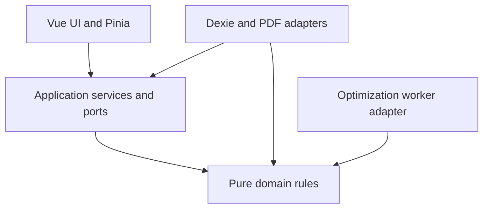

# OptiCutList developer documentation

**From project requirements to a validated cutting plan.**

OptiCutList is an open-source, browser-based workspace for planning rectangular panel cuts. It connects materials, finished parts, physically owned stock, optimization and printable fabrication documents. Business data stays in the browser's IndexedDB by default; optional self-hosting uses one shared SQLite database while optimization stays in the browser.

This Wiki is the implementation guide for contributors: find the owning module, understand its invariants, and follow a change safely from UI to persistence.

## Start here

| Your goal | Start with | Then explore |
| --- | --- | --- |
| Run the project locally | [Getting started](getting-started.md#environment) | [Repository map](getting-started.md#repository-map) |
| Understand the system | [Architecture](architecture.md) | [Domain & business rules](domain-model.md) |
| Find a feature's implementation | [Application & UI](features.md) | [End-to-end workflow traces](workflows.md) |
| Make a safe first change | [Contribution workflow](getting-started.md#contribution-workflow) | [Testing](testing.md) · [Maintenance recipes](maintenance.md) |

### Your first contribution

1. **Run it.** Use the [local setup instructions](getting-started.md#environment); create a disposable project and explore Materials → Parts → Optimization → Cutting Plans → Stock.
2. **Trace it.** Choose a screen in the [feature map](features.md) and follow its [workflow trace](workflows.md) into the application service.
3. **Understand the boundary.** Read the relevant [domain invariant](domain-model.md#invariant-enforcement-and-failure-consequences) and [test suite](testing.md#test-boundaries).
4. **Change and verify.** Follow a [maintenance recipe](maintenance.md), add focused coverage, and run the [required checks](testing.md).

## Explore the documentation

| Area | Guides & references |
| --- | --- |
| **Architecture & domain** | [System architecture](architecture.md) · [Entities, ownership & invariants](domain-model.md) |
| **Data & persistence** | [Persistence overview](persistence-and-json.md) · [IndexedDB tables & transactions](storage.md) · [Self-hosted deployment & API](storage.md#self-hosted-storage) · [Docker & Portainer](storage.md#standalone-docker-deployment) |
| **Optimization & inventory** | [Optimization engine](optimization.md) · [Physical stock & offcuts](stock-management.md) |
| **Application & documents** | [Screens & interactions](features.md) · [Workflow traces](workflows.md) · [Cutting plans & PDF](pdf-generation.md) |
| **Import & compatibility** | [JSON contracts](json-formats.md) · [Parts import](parts-json.md) · [Stock exchange](stock-json-format.md) |
| **Development** | [Getting started](getting-started.md) · [Testing](testing.md) · [Safe contributions](maintenance.md) · [CI & releases](ci-cd.md) · [Wiki publishing](wiki-publishing.md) |

## Architecture at a glance

Vue features call injected application services. Pure domain code owns geometry and cutting rules; infrastructure implements persistence and document adapters. The optimizer runs in a Web Worker, while accepted-result persistence coordinates inventory changes.

This diagram shows dependency direction, not execution order. For composition and runtime flows, see [architecture](architecture.md#layers-and-dependency-direction). IndexedDB is persistent truth; selection, hover, zoom and undo history are [transient state](architecture.md#data-flow-and-state-lifetime).

> **Two distinctions to learn early:** Catalog references are not owned inventory. A collision-free layout is not necessarily an executable guillotine cutting plan. Read [stock ownership](stock-management.md#owned-stock-versus-references) and [independent validation](optimization.md#geometry-and-independent-validation) before changing either boundary.

## Where do I find…?

| I need to… | Go directly to… |
| --- | --- |
| Locate a component, route or shared control | [Feature map](features.md) · [Routing](architecture.md#routing) · [Shared UI](architecture.md#shared-ui-and-assets) |
| Add a field without breaking existing projects | [Domain-field recipe](maintenance.md#introduce-a-domain-field) · [JSON compatibility](json-formats.md#compatibility-matrix-implemented-behavior) |
| Understand a table, index or migration | [Table catalog](storage.md#complete-table-catalog) · [Upgrade path](storage.md#implemented-upgrade-path-and-future-migrations) |
| Diagnose why a panel was chosen | [Stock preference & ranking](optimization.md#multi-panel-schedules-and-stock-preference) · [Search limitations](optimization.md#search-limitations-and-termination) |
| Investigate stock availability or a reconciliation conflict | [Contextual availability](stock-management.md#availability-is-contextual) · [Atomic reconciliation](storage.md#stock-reconciliation-transaction-trace) |
| Change PDF layout, preview, print or download | [PDF renderer map](pdf-generation.md#renderer-module-reference) · [Output lifecycle](pdf-generation.md#output-sequence-and-cleanup-ownership) |
| Debug an import or preserve a legacy file | [JSON compatibility matrix](json-formats.md#compatibility-matrix-implemented-behavior) · [Transfer workflows](workflows.md#file-transfers-and-settings) |
| Choose the right regression test | [Test boundaries](testing.md#test-boundaries) · [Invariant assertions](testing.md#assertion-patterns-that-catch-business-regressions) |

## Contribute with confidence

Read [AGENTS.md](../AGENTS.md) and [ARCHITECTURE.md](../ARCHITECTURE.md) before editing; they remain authoritative. Keep technical claims grounded in source, preserve identities and inventory history, and follow the [safe contribution guide](maintenance.md). Documentation changes follow the same review discipline as code.

These pages live in `docs/` and are [published automatically](wiki-publishing.md) to the Wiki. Edit the repository source, not generated Wiki pages. Stable page paths keep links working across both views.

## About this reference

The technical reference was audited on 17 October 2026 across the major source layers, configuration and representative regression suites. Detailed guides retain source links, compatibility guidance, limitations and explicitly labeled proposals. See the [discrepancy register](architecture.md#guidance-and-implementation-discrepancies) when historical guidance differs from code.

Source inspection does not establish real-printer fidelity, browser-native PDF behavior, production repository settings, device storage quotas or visual/accessibility behavior in real browsers. These remain manual verification areas. Update the relevant guide when changing a contract, ownership rule, database version, worker protocol or PDF pipeline.
