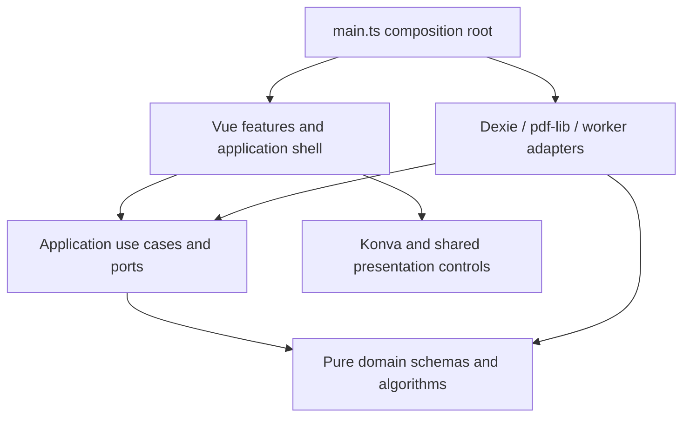
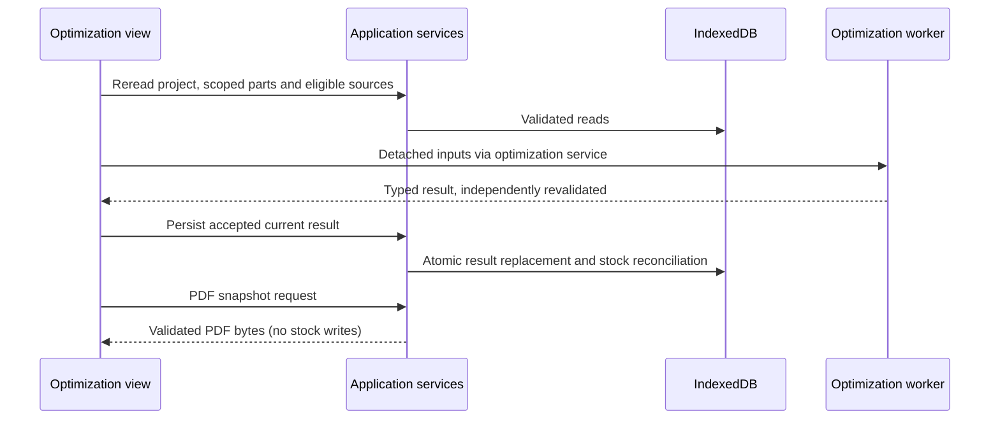

# Implementation architecture

The authoritative decisions remain in [ARCHITECTURE.md](../ARCHITECTURE.md) and [AGENTS.md](../AGENTS.md). This guide maps those decisions to current code.

## Layers and dependency direction

- **Domain:** [models](../src/domain/model/), [geometry](../src/domain/geometry/), [cutting-tree](../src/domain/cutting-tree/) and [optimizer](../src/domain/optimizer/). Pure TypeScript; Zod is its only third-party runtime dependency. Schema types are inferred, not maintained as parallel entity interfaces.
- **Application:** [repository ports](../src/application/persistence/repositories.ts), guarded entity services, transfers, result persistence, inventory reconciliation, worker service and PDF orchestration. These modules coordinate identities and transactions; they do not render Vue or create Dexie databases.
- **Infrastructure:** [local-database.ts](../src/infrastructure/persistence/local-database.ts), [project-json.ts](../src/infrastructure/projects/project-json.ts) and [PDF renderers](../src/infrastructure/pdf/). These implement ports using concrete browser/storage/document libraries.
- **Features:** Vue components and typed injection helpers under [features](../src/features/). Konva and PDF.js belong to presentation, not to domain algorithms. A file named `project-service.ts` in a feature is an injection adapter; the application file with the same name owns business coordination.
- **Workers:** [handle-optimization-request.ts](../src/workers/optimization/handle-optimization-request.ts) validates messages and delegates to domain code. It has no inventory side effects.

[main.ts](../src/main.ts) creates persistence once, wraps it with guarded catalog/project/stock services, supplies typed injection keys, creates router/Pinia and lazily imports the PDF renderer. Database closing is registered on app unmount. Tests can provide isolated factories instead of inheriting singletons.

## Data flow and state lifetime

| State | Lifetime and owner |
| --- | --- |
| Projects, Parts, catalog, StockItems, plans, receipts, ledgers | IndexedDB through repository ports |
| Project material/product/stock choices, cutting/PDF settings | Fields on persisted CuttingProject |
| Offcut Keep decisions and active source consumption | Persisted ProjectStock ledger |
| Manual ordering | Separate `stockOrders` / `catalogOrders` stores |
| Reconstructed geometry, availability, utilization, PDF DTOs | Derived from validated records |
| Undo/redo, selection, hover, zoom, collapses, drafts | Transient feature/workspace state |
| Toasts | Pinia instance, not persisted |
| Theme preference | LocalStorage; resolved theme on document root |
| Last intentional Projects destination and per-project tab | Injected reactive session state |

[cutting-workspace-state.ts](../src/features/projects/cutting-workspace-state.ts) shares transient document-readiness/invalidation flags, not the cutting result itself. The shell's [App.vue](../src/app/App.vue) uses KeepAlive for selected views, preserving their component-owned workspace state across supported navigation. Caching must not cause a stale worker response or queued write to enter another project. Views use revisions/cancellation signals and dispose observers, worker services, PDF previews and canvas stages.

## Routing

[createAppRouter](../src/app/router/index.ts) accepts an injected history for tests; production defaults to hash history.

| Route | Current role |
| --- | --- |
| `/` | Home |
| `/projects` | Overview |
| `/import` | Project import |
| `/catalog` (`/suppliers` alias) | Global Catalog, route name `suppliers` |
| `/stock` | Global physical inventory |
| `/projects/:projectId` | Workspace, defaults to Materials |
| `materials`, `parts`, `optimization`, `cutting-plans`, `stock` children | Project workflow in that order |
| `export` child alias | Cutting Plans compatibility link |
| `/parts`, `/materials` | Redirect to Projects |

Settings is a shell modal, **not a Settings route**. Project IDs are schema-validated and loaded through [ProjectWorkspace.vue](../src/features/projects/ProjectWorkspace.vue). Its compact context/navigation header derives active state from RouterLink; it is neither a completion wizard nor global breadcrumbs. All tabs are directly navigable; the document view itself requires a valid current result.

## Shared UI and assets

Use [AppButton](../src/shared/ui/AppButton.vue) for ordinary actions: primary, secondary, ghost or destructive; default/small sizes; labeled icon-only and guarded loading states. [AppDialog](../src/shared/ui/AppDialog.vue) uses native modal dialog behavior, a shared close control, accessible heading, busy dismissal guard and focus restoration. [AppSplitButton](../src/shared/ui/AppSplitButton.vue) centralizes independent action/menu targets and keyboard dismissal/navigation.

[FormField](../src/shared/ui/FormField.vue) associates labels, hints and errors. Inputs/selects/textareas use semantic classes in [styles.css](../src/app/styles.css); there is no dedicated shared textarea component. [AppCheckbox](../src/shared/ui/AppCheckbox.vue) exposes native indeterminate state and `aria-checked="mixed"`. [toast-store.ts](../src/shared/ui/toast-store.ts) deduplicates active messages; one shell host renders them. Success timers default to four seconds; persistent errors require dismissal. Toast progress pauses on hover/focus and respects reduced motion.

Material thumbnails come from preset identity and the validated [materials.json](../public/materials/materials.json) manifest, using `BASE_URL` through [material-library.ts](../src/features/materials/material-library.ts). The current manifest is version 2 with preview paths, not per-item textures. [PanelDimensionPreview.vue](../src/shared/ui/PanelDimensionPreview.vue) uses uniform solid fill and deterministic SVG grain. Supplier logos use only a validated origin's direct favicon via [supplier-favicon.ts](../src/features/suppliers/supplier-favicon.ts).

## Guidance and implementation discrepancies

These are observations, not permission to weaken authoritative rules:

| Existing statement | Current implementation and evidence |
| --- | --- |
| Root README says only shell/tooling exists | Feature directories implement project workflow, inventory, optimizer, transfers and PDF. README status is stale. |
| README/architecture describe active Pages deployment | CI deploy job is commented out; validation and artifact upload remain active. See [ci.yml](../.github/workflows/ci.yml). |
| Guidance describes user-configured project panel quantities/default one | [CuttingProject](../src/domain/model/cutting-project.ts) retains `panelQuantities` for compatibility; new runs use demand-bounded catalog supply and actual stock counts. No current manual quantity controls. |
| AGENTS describes Parts exchange downloads | Standalone export is removed. [parts-transfer-service.ts](../src/application/projects/parts-transfer-service.ts) supports import; [parts-json.md](parts-json.md) already records this. |
| Older catalog guidance says no inventory writes belong in Catalog | Explicit Add to stock now invokes guarded `StockRepository.addFromProduct`; catalog records remain unchanged. See [stock-repository.ts](../src/application/inventory/stock-repository.ts). |
| Older entity summary mentions availability metadata as ordinary product UI | `availability` remains required in SupplierProduct for legacy validation/eligibility, but forms hide it and new records use `unknown`. Price is optional. |
| Guidance names Playwright | No Playwright dependency, configuration or browser test command is currently provided. Vitest/jsdom tests do not establish real-browser layout behavior. |
| Earlier project-tab guidance gates Cutting Plans navigation | Current header allows all five links; document generation is gated inside the view. |

## Limitations and maintenance risks

The project optimizer is a bounded heuristic, not an exhaustive solver. Built-in PDF fonts cannot encode arbitrary Unicode. Browser-local data and partial transfers are not a full inventory-audit backup. Large workspace components coordinate substantial async state. [CuttingFinalization.vue](../src/features/optimization/CuttingFinalization.vue), [PdfExportControls.vue](../src/features/optimization/PdfExportControls.vue) and explicit confirmation UI/services remain in source/tests; the current routed document flow uses CuttingPlansWorkspace instead. Do not mistake these older components for the active export interface or delete historical services/receipts on appearance alone.

**Recommendations:** reconcile the stale guidance in a separately authorized documentation pass; keep new business decisions in application/domain services, and cover revisions/cancellation when touching large components. An automated architectural import-boundary checker is not configured by the current ESLint rules; dependency discipline relies on review and tests.
