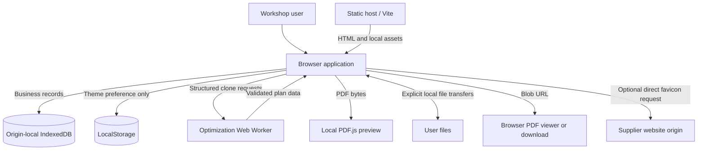
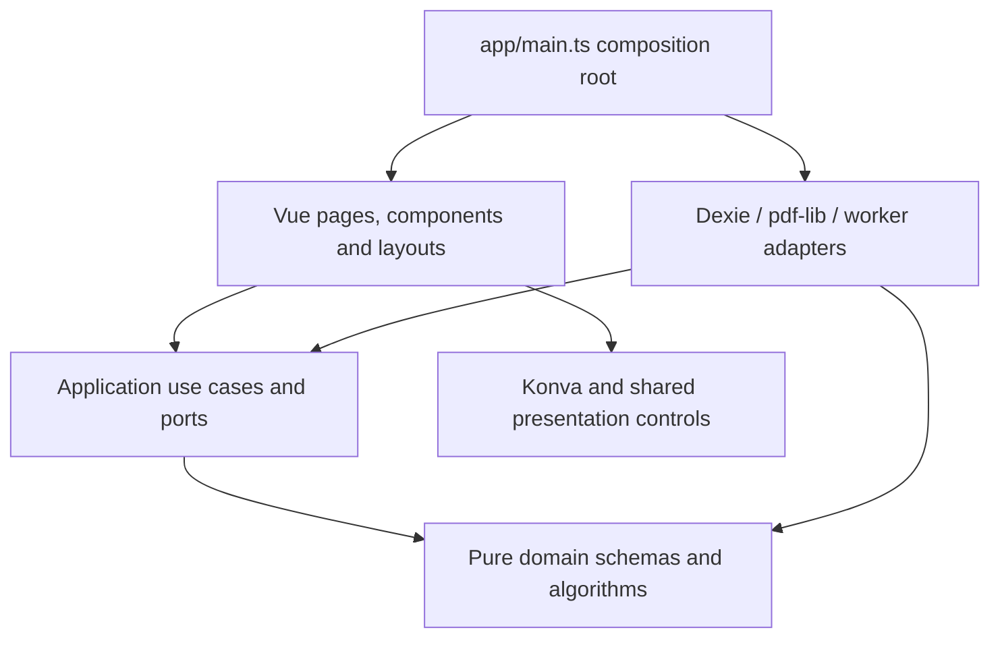
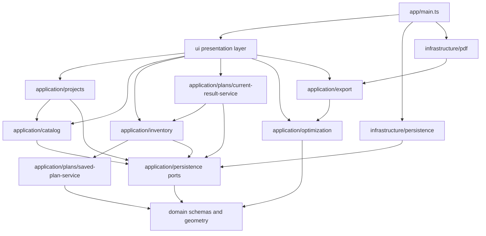
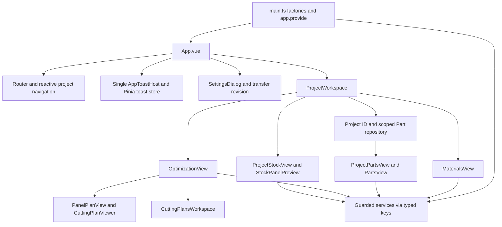
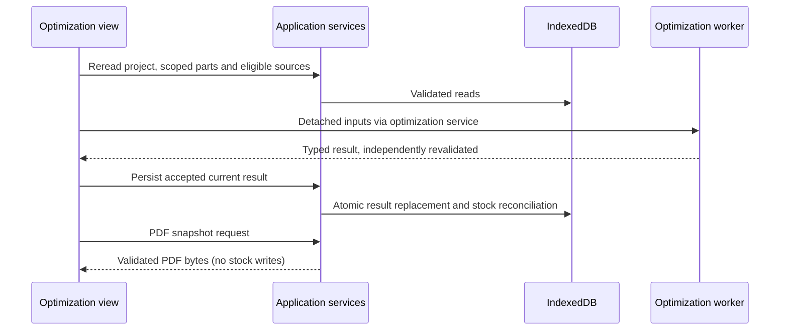
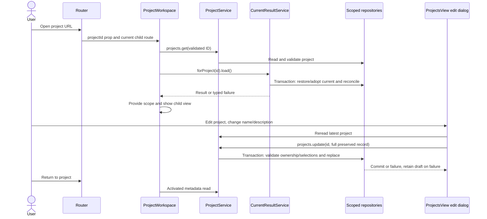
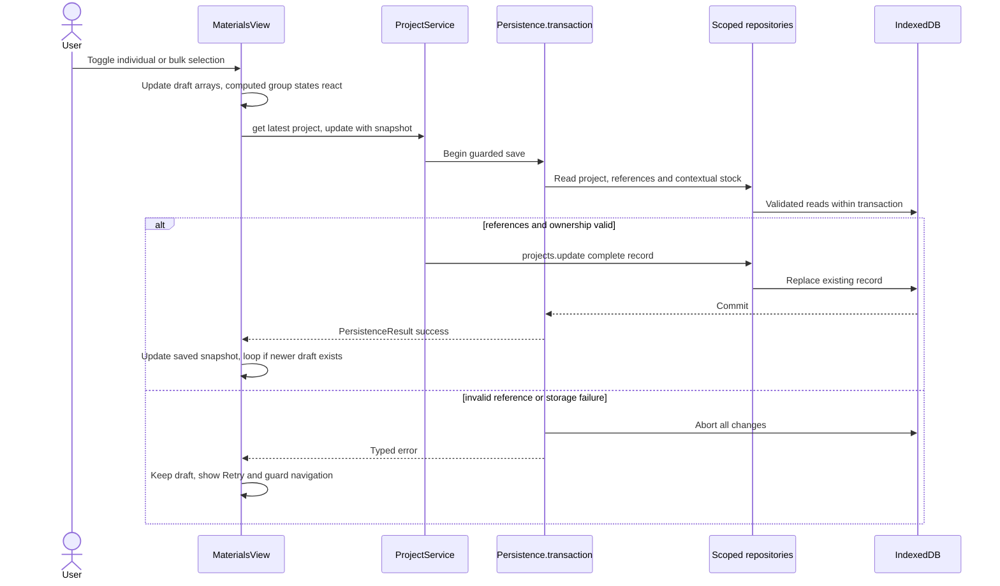

# Architecture

[Documentation home](README.md) / Architecture & domain

The authoritative decisions remain in [ARCHITECTURE.md](../ARCHITECTURE.md) and [AGENTS.md](../AGENTS.md). This guide maps those decisions to current code.

**On this page:** [Runtime system context](#runtime-system-context) · [Layers and dependency direction](#layers-and-dependency-direction) · [Module dependency map and public interfaces](#module-dependency-map-and-public-interfaces) · [Data flow and state lifetime](#data-flow-and-state-lifetime) · [Routing](#routing) · [Guidance and implementation discrepancies](#guidance-and-implementation-discrepancies)

## Runtime system context

The production artifact is static HTML/CSS/ES modules. Vite's build bundles worker entry points and local PDF.js assets; a static host serves files, not application APIs. Browser origin/profile owns the database. Reload reconstructs state from IndexedDB; no server can recover an evicted origin's records.

“No backend” does not mean no network requests: static assets and optional supplier favicons are network resources. Material previews and PDF.js workers are bundled/local paths; no scraping, logo aggregator or remote optimizer participates. Browser-native print/save decisions are outside the application transaction model.

### Execution domains and copy boundaries

| Domain | Work | Boundary/cleanup |
| --- | --- | --- |
| Main browser thread | Vue, guarded application services, Dexie calls, pdf-lib generation, Konva presentation | Components invalidate obsolete async reads; PDF rendering is not the optimization worker's job |
| Optimization worker | Protocol guard and domain `optimizePanel` / `optimizeProject` | Structured-clone input; terminate to cancel; no Dexie or stock mutation |
| PDF.js worker | Interpret already generated PDF bytes | Local Vite worker URL; loading/render destruction owned by preview adapter |
| Native PDF viewer tab | Browser PDF display/printing | Synchronously opened user gesture; viewer owns Blob URL lifecycle |

`structuredClone` snapshots in optimization, editing and export isolate caller mutations. They do not create a lock on current database entities: save/import/reconciliation still need transaction-time rechecks.

## Layers and dependency direction

- **Domain:** [models](../src/domain/model/), [geometry](../src/domain/geometry/), [cutting-tree](../src/domain/cutting-tree/) and [optimizer](../src/domain/optimizer/). Pure TypeScript; Zod is its only third-party runtime dependency. Schema types are inferred, not maintained as parallel entity interfaces.
- **Application:** [repository ports](../src/application/persistence/repositories.ts), guarded entity services, transfers, result persistence, inventory reconciliation, worker service and PDF orchestration. These modules coordinate identities and transactions; they do not render Vue or create Dexie databases.
- **Infrastructure:** [local-database.ts](../src/infrastructure/persistence/local-database.ts), [project-json.ts](../src/infrastructure/projects/project-json.ts) and [PDF renderers](../src/infrastructure/pdf/). These implement ports using concrete browser/storage/document libraries.
- **UI:** Vue components and typed injection helpers under [UI](../src/ui/). Konva and PDF.js belong to presentation, not to domain algorithms. The UI `use-project-service.ts` is a Vue injection helper; `application/projects/project-service.ts` owns business coordination.
- **Workers:** [handle-optimization-request.ts](../src/infrastructure/optimization/handle-optimization-request.ts) validates messages and delegates to domain code. It has no inventory side effects.

[main.ts](../src/app/main.ts) selects persistence once through [createConfiguredPersistence](../src/app/persistence.ts), wraps it with guarded catalog/project/stock services, supplies typed injection keys, creates router/Pinia and lazily imports the PDF renderer. Database closing is registered on app unmount. Tests can provide isolated factories instead of inheriting singletons. The existing [Persistence contract](../src/application/persistence/repositories.ts) is backend-neutral; `LocalPersistence` remains a compatibility alias. Unset or `browser` build-time `VITE_STORAGE_MODE` selects Dexie; `server` and unsupported values fail without fallback. Only browser storage is implemented. See [deployment modes and future server requirements](storage.md#storage-deployment-modes); selecting a mode never migrates or synchronizes data.

## UI organization and migration

Production presentation code lives entirely in `src/ui/`: `pages`, `layouts`, `components`, `composables`, `state`, `stores`, `canvas`, `pdf` and `utils`, plus `styles.css`. Component subfolders describe their screen context, but there are no feature packages owning business logic. `src/app` contains bootstrap, routing and configuration only. The optimization worker entry/factory/message adapter lives in `src/infrastructure/optimization`; all placement logic still lives in Domain.

Typed Vue injection helpers belong to UI and are wired by bootstrap; application services do not import them. Pinia notifications and navigation/editor state remain transient. Cross-layer UI imports use the existing `@/` alias, without barrel modules. Existing tests remain at their historical locations; only paths to moved modules/assets change, not assertions or fixtures. Old feature/shared/worker directories therefore contain tests only, not a parallel production organization.

## Module dependency map and public interfaces

Arrows below mean an import/call dependency, not an inventory write. The dependency between plans and inventory is intentionally directional: current-result orchestration invokes reconciliation, while inventory reads historical plans through the lower-level saved-plan service.

This graph abstracts individual imports; e.g. project transfers also use saved-plan reconstruction and catalog remapping. It is not an exhaustive package graph or a suggestion to add barrel modules.

| Module | Public contracts / entry symbols | Important responsibility |
| --- | --- | --- |
| [application/projects/project-service.ts](../src/application/projects/project-service.ts) | `ProjectService`, `ProjectPartsRepository`, `createProjectService` | Project CRUD/selection validation, scoped Part ownership, adoption, deletion orchestration |
| [application/catalog/catalog-repositories.ts](../src/application/catalog/catalog-repositories.ts) | `CatalogProductRepository`, `createCatalogRepositories` | Supplier/material/product reference guards and product ordering |
| [application/inventory/stock-repository.ts](../src/application/inventory/stock-repository.ts) | `StockRepository`, `createStockRepository` | Manual inventory, exact product additions, contextual availability, ordering, receipt history |
| [application/inventory/project-stock-service.ts](../src/application/inventory/project-stock-service.ts) | `createProjectStockService`, `reconcileProjectStock`, `ProjectStockPreview` | Derived offcut rows, Keep decisions and physical source reconciliation |
| [application/plans/current-result-service.ts](../src/application/plans/current-result-service.ts) | `createCurrentResultService`, `CurrentResultState` | Current pointer, safe replacement and legacy adoption |
| [application/plans/saved-plan-service.ts](../src/application/plans/saved-plan-service.ts) | `SavePlanInput`, `OpenedSavedPlan`, `prepareSavedPlan`, `readSavedPlan` | Validated snapshot preparation/reconstruction, retained legacy API |
| [application/optimization/optimization-service.ts](../src/application/optimization/optimization-service.ts) | `OptimizationService`, `OptimizationWorkerPort` | Typed worker lifecycle and main-thread revalidation |
| [application/export/cutting-plan-pdf-service.ts](../src/application/export/cutting-plan-pdf-service.ts) | `CuttingPlanPdfPort`, `prepareProjectPdfDocument`, `createCuttingPlanPdfService` | Detached validated documents and renderer boundary |
| Transfer modules | `createProjectTransferService`, `createPartsTransferService`, `createCatalogTransferService`, `createStockTransferService` | Preview, confirmation, revalidation and atomic transfer-specific policy |

### Dependency injection wiring

The composition root supplies **guarded** catalog materials/suppliers/products and StockRepository, not the generic database CRUD ports directly to writable screens. `catalogStockRepositoryKey` is the notable raw read snapshot used by Catalog to describe real stock; explicit purchase creation goes through StockRepository.

UI composables export a typed `InjectionKey` plus `use...` helper. Required project/Part services throw on missing setup where their helper requires it; optional services expose unavailable states in the consuming UI. Do not replace a missing injected service with a database singleton.

[ProjectWorkspace.vue](../src/ui/layouts/ProjectWorkspace.vue) validates route identity, then supplies `projectIdKey`, project-scoped `partRepositoryKey` and `cuttingWorkspaceStateKey` to children. These scopes prevent a global Part page from accidentally editing another project's entities.

## Data flow and state lifetime

| State | Lifetime and owner |
| --- | --- |
| Projects, Parts, catalog, StockItems, plans, receipts, ledgers | IndexedDB through repository ports |
| Project material/product/stock choices, cutting/PDF settings | Fields on persisted CuttingProject |
| Offcut Keep decisions and active source consumption | Persisted ProjectStock ledger |
| Manual ordering | Separate `stockOrders` / `catalogOrders` stores |
| Reconstructed geometry, availability, utilization, PDF DTOs | Derived from validated records |
| Undo/redo, selection, hover, zoom, collapses, drafts | Transient feature/workspace state |
| Toasts | Pinia instance, not persisted |
| Theme preference | LocalStorage; resolved theme on document root |
| Last intentional Projects destination and per-project tab | Injected reactive session state |

[cutting-workspace-state.ts](../src/ui/state/cutting-workspace-state.ts) shares transient document-readiness/invalidation flags, not the cutting result itself. The shell's [App.vue](../src/ui/layouts/App.vue) uses KeepAlive for selected views, preserving their component-owned workspace state across supported navigation. Caching must not cause a stale worker response or queued write to enter another project. Views use revisions/cancellation signals and dispose observers, worker services, PDF previews and canvas stages.

## Loading and editing a project: actual sequence

Workspace `load()` validates identity and reads the project; it also calls `currentResults.forProject(id).load()`. That second operation may adopt one legacy plan or reconcile physical stock. Therefore “open project” is not universally a read-only database operation. On later workspace activation, the header rereads project metadata so renames are reflected.

## Persistent changes and reactive drafts

Pinia is available but the only current `defineStore` is [useToastStore](../src/ui/stores/toast-store.ts). Most UI state is component-owned `ref`, `shallowRef`, `computed` or injected `reactive` state. There is no global entity cache or automatic Dexie liveQuery subscription.

Materials autosave illustrates the distinction: selected ID arrays are drafts; saved arrays are the last confirmed snapshot; `dirty` is derived. `save()` serializes through one `pendingSave` Promise, while `persistSelections()` loops until the newest draft is stored. It rereads the project before each full-record update to preserve new Part ownership. A later draft is not overwritten by an earlier completion. Lifecycle/window-focus and Settings import revisions trigger explicit refreshes, not polling.

Read and update in the View above are separate calls; the service repeats authoritative checks in its own transaction. This is not optimistic version-locking for arbitrary whole-project concurrent edits. Some forms have dedicated snapshot comparison (notably stock when the caller supplies the prior record), but not every entity implements a revision number. Multiple browser tabs can therefore require careful stale-draft handling even though each transaction is atomic.

## Routing

[createAppRouter](../src/app/router/index.ts) accepts an injected history for tests; production defaults to hash history.

| Route | Current role |
| --- | --- |
| `/` | Home |
| `/projects` | Overview |
| `/import` | Project import |
| `/catalog` (`/suppliers` alias) | Global Catalog, route name `suppliers` |
| `/stock` | Global physical inventory |
| `/projects/:projectId` | Workspace, defaults to Materials |
| `materials`, `parts`, `optimization`, `cutting-plans`, `stock` children | Project workflow in that order |
| `export` child alias | Cutting Plans compatibility link |
| `/parts`, `/materials` | Redirect to Projects |

Settings is a shell modal, **not a Settings route**. Project IDs are schema-validated and loaded through [ProjectWorkspace.vue](../src/ui/layouts/ProjectWorkspace.vue). Its compact context/navigation header derives active state from RouterLink; it is neither a completion wizard nor global breadcrumbs. All tabs are directly navigable; the document view itself requires a valid current result.

## Shared UI and assets

Use [AppButton](../src/ui/components/common/AppButton.vue) for ordinary actions: primary, secondary, ghost or destructive; default/small sizes; labeled icon-only and guarded loading states. [AppDialog](../src/ui/components/common/AppDialog.vue) uses native modal dialog behavior, a shared close control, accessible heading, busy dismissal guard and focus restoration. [AppSplitButton](../src/ui/components/common/AppSplitButton.vue) centralizes independent action/menu targets and keyboard dismissal/navigation.

[FormField](../src/ui/components/common/FormField.vue) associates labels, hints and errors. Atelier Light/Dark palette roles live in [styles.css](../src/ui/styles.css): canvas/sidebar/card surfaces, neutral hover, green selection, accessible control borders and state colors. Root-only `cutting-*` inks keep material drawings stable across themes. Inputs/selects/textareas use semantic classes in [styles.css](../src/ui/styles.css); there is no dedicated shared textarea component. [AppCheckbox](../src/ui/components/common/AppCheckbox.vue) exposes native indeterminate state and `aria-checked="mixed"`. [toast-store.ts](../src/ui/stores/toast-store.ts) deduplicates active messages; one shell host renders them. Success timers default to four seconds; persistent errors require dismissal. Toast progress pauses on hover/focus and respects reduced motion.

Material thumbnails come from preset identity and the validated [materials.json](../public/materials/materials.json) manifest, using `BASE_URL` through [material-library.ts](../src/ui/utils/material-library.ts). The current manifest is version 2 with preview paths, not per-item textures. [PanelDimensionPreview.vue](../src/ui/components/common/PanelDimensionPreview.vue) uses uniform solid fill and deterministic SVG grain. Supplier logos use only a validated origin's direct favicon via [supplier-favicon.ts](../src/ui/utils/supplier-favicon.ts).

## Error channels and design trade-offs

| Channel | Implemented behavior | Caller obligation |
| --- | --- | --- |
| Persistence | Discriminated `PersistenceResult`; adapter exceptions become `storageFailure` | Narrow `ok` before using value; never suppress corrupt records |
| Domain fit/search | Expected infeasibility is typed; some low-level invalid contexts throw | Validate external input and preserve diagnostic distinctions |
| Worker | `completed`, `cancelled`, `failed`; domain selection can itself be failure | Check outer outcome and inner `selection.ok`; disposed service use throws synchronously |
| Inventory reconciliation | Unsafe business reversals can commit ledger `conflict` while preserving inventory | Read conflict separately from storage success |
| PDF | `invalidPlan` / `generationFailure`; native-output errors handled by UI | Retain retry path; no success claim about disk save or printing |
| UI | Form errors linked to controls, operation errors inline or persistent error toast | Success only after underlying write succeeds |

Broad transactions simplify consistent cross-record checks but serialize more work than table-minimal transactions would. Strict reads protect against silent corruption but one bad record can block a list or transfer. Historical snapshots allow document reconstruction independent of live catalog edits but intentionally omit prices and external inventory ownership. Explicit defaults preserve legacy files without write-on-open migrations, at the cost of requiring normalized comparisons at use sites.

See [storage reference](storage.md) for physical tables/transactions, [workflow reference](workflows.md) for per-feature write sets, and [maintenance](maintenance.md) for safe extension recipes.

### Concrete adapter exceptions and review scope

UI presentation adapters intentionally depend on PDF.js (`ui/pdf/pdf-preview.ts`) and Konva (`ui/canvas/plan-canvas.ts`). They render documents and scenes; neither accesses persistence. Cover-image decoding now goes through the existing PDF application service's optional `readCoverImage` port. [Bootstrap](../src/app/main.ts) supplies the lazy [infrastructure decoder](../src/infrastructure/pdf/cover-image.ts); UI has no direct infrastructure import. Application inputs use a structural file contract, not a Vue/DOM dependency. No decoder behavior or PDF output changes.

Authoritative guidance and code should be read together. In particular, project-aware planning availability does not imply every legacy consumer uses the same query; the [stock call-path note](stock-management.md#call-path-difference-worth-reviewing) records one area for targeted regression review. Likewise transaction atomicity does not imply all live entity updates use optimistic concurrency or all history displays query every ledger type.
## Guidance and implementation discrepancies

These are observations, not permission to weaken authoritative rules:

| Existing statement | Current implementation and evidence |
| --- | --- |
| Root README says only shell/tooling exists | Feature directories implement project workflow, inventory, optimizer, transfers and PDF. README status is stale. |
| Earlier developer guides said Pages deployment was commented out | The current [ci.yml](../.github/workflows/ci.yml) is validation-only; [cd.yml](../.github/workflows/cd.yml) independently owns tag-only Pages deployment and master Wiki publication. Live repository settings remain unverified. |
| Historical root architecture passages describe manual project panel quantities/default one | [CuttingProject](../src/domain/model/cutting-project.ts) retains `panelQuantities` for compatibility; new runs use demand-bounded catalog supply and actual stock counts. No current manual quantity controls. |
| Earlier documentation describes Parts exchange downloads | Current AGENTS and [parts-json.md](parts-json.md) correctly say import-only; no exporter remains in [parts-transfer-service.ts](../src/application/projects/parts-transfer-service.ts). |
| Older broad catalog descriptions exclude inventory creation | Current AGENTS explicitly permits confirmed Add to stock through guarded `StockRepository.addFromProduct`; catalog records remain unchanged. See [stock-repository.ts](../src/application/inventory/stock-repository.ts). |
| Older entity summary mentions availability metadata as ordinary product UI | `availability` remains required in SupplierProduct for legacy validation/eligibility, but forms hide it and new records use `unknown`. Price is optional. |
| Guidance names Playwright | No Playwright dependency, configuration or browser test command is currently provided. Vitest/jsdom tests do not establish real-browser layout behavior. |
| Older root architecture passages gate Cutting Plans navigation | Current AGENTS and header permit all five links; document generation is gated inside the view. |

## Limitations and maintenance risks

The project optimizer is a bounded heuristic, not an exhaustive solver. Built-in PDF fonts cannot encode arbitrary Unicode. Browser-local data and partial transfers are not a full inventory-audit backup. Large workspace components coordinate substantial async state. [CuttingFinalization.vue](../src/ui/components/optimization/CuttingFinalization.vue), [PdfExportControls.vue](../src/ui/components/optimization/PdfExportControls.vue) and explicit confirmation UI/services remain in source/tests; the current routed document flow uses CuttingPlansWorkspace instead. Do not mistake these older components for the active export interface or delete historical services/receipts on appearance alone.

**Recommendations:** reconcile the remaining stale root summaries with the already updated AGENTS rules; keep new business decisions in application/domain services, and cover revisions/cancellation when touching large components. An automated architectural import-boundary checker is not configured by the current ESLint rules; dependency discipline relies on review and tests.

---

**Continue exploring:** [Domain & business rules](domain-model.md) · [Trace a workflow](workflows.md) · [Documentation home](README.md)
