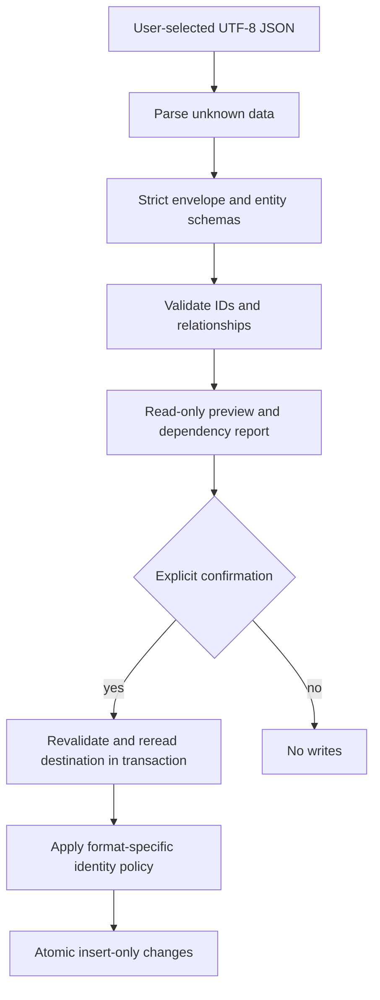

# JSON formats & compatibility

[Documentation home](../README.md) / [Developer Guide](README.md) / Import & compatibility

This document specifies implemented exchange boundaries and a separately labeled future compatibility proposal. [Storage](storage.md) describes IndexedDB versions; portable file versions are independent. Existing complete row examples remain in [Parts JSON](parts-json.md) and [Stock JSON](stock-json-format.md).

**On this page:** [Envelope fields](#envelope-fields) · [Project format: ownership plus dependencies](#project-format-ownership-plus-dependencies) · [Catalog format: remapped insert-only references](#catalog-format-remapped-insert-only-references) · [Stock format: exact identities and dependency preservation](#stock-format-exact-identities-and-dependency-preservation) · [Compatibility matrix: implemented behavior](#compatibility-matrix-implemented-behavior) · [Proposed compatibility architecture — not implemented](#proposed-compatibility-architecture--not-implemented)

## Shared processing contract

[projectJson](../../src/infrastructure/projects/project-json.ts) is the small `ProjectJsonPort` adapter: strip one leading BOM, `JSON.parse` to unknown, serialize with two-space indentation and a final newline. There is no general migration dispatcher behind this adapter. Each transfer service validates its own strict envelope and relationships.

A selected filename extension never proves the payload valid. Catalog UI additionally requires a `.cocl` suffix; Stock UI requires `.json`, while Project/Parts file pickers advertise their accepted extensions and pass contents to their validators. Accepting `.pocl` or `.json` means accepting an older filename convention, not arbitrary old shapes or automatic model conversion. Unknown object properties are rejected by strict schemas, even when a new application UI field seems harmless.



Preview results are data to review, not a durable reservation. Import rechecks persisted records, so conflicts appearing after preview still block or remap according to the format policy.

## Envelope fields

| Format | Required top-level fields | Optional fields | Main validator |
| --- | --- | --- | --- |
| Project | `format: "opticutlist-project"`, `schemaVersion: 1`, `project`, `parts`, `catalog`, `savedPlans` | `currentResultId` | [validateProjectTransfer](../../src/application/projects/project-transfer-format.ts) |
| Catalog | `format: "opticutlist-catalog"`, `schemaVersion: 1`, `catalog` | `catalogOrders` | [validateCatalogTransfer](../../src/application/catalog/catalog-transfer-format.ts) |
| Stock | `format: "opticutlist-stock"`, `schemaVersion: 1`, `materials`, `stockItems` | `stockOrders` | [validateStockTransfer](../../src/application/inventory/stock-transfer-format.ts) |
| Parts | `format: "opticutlist-parts"`, `version: 1`, `parts` | None | [validatePartsTransfer](../../src/application/projects/parts-transfer-format.ts) |

Array fields can be empty where their schemas permit; every referenced dependency must still satisfy the format's relationship checks. Duplicate entity IDs within a collection are rejected. Stable-ID reuse is not equivalent to matching names.

### Shared entity payloads

These are complete entity fields, not arbitrary patches. See [domain schema reference](domain-model.md#schema-field-reference) for lengths and enums.

| Entity payload | Required | Optional |
| --- | --- | --- |
| Material | `id`, `name`, `category` | `libraryPresetId` |
| Supplier | `id`, `name` | `websiteUrl` (absolute http(s)) |
| SupplierProduct | `id`, `supplierId`, `materialId`, `name`, all three `*Mm` dimensions, `grainDirection`, `currency`, `availability` | `price`, `productUrl` |
| Part | `id`, `name`, `materialId`, all dimensions, `quantity`, `grainDirection`, `rotation` | None |
| StockItem | `id`, `kind`, `materialId`, all dimensions, `quantity`, `grainDirection`, strict `provenance` | Only branch-specific provenance fields |

An absent price is unknown; explicit zero is known. `availability` remains required in product files despite no longer appearing in forms. Optional description/settings fields have missing-value behavior; that does not make required physical thickness optional.

## Project format: ownership plus dependencies

[projectTransferSchema](../../src/application/projects/project-transfer-format.ts) nests `cuttingProjectSchema` and `catalogRecordsSchema`. `catalog` contains arrays `materials`, `suppliers`, `products`. `savedPlans` contains pairs `{ summary, contents }`; contents use their own `formatVersion: 1` compact encoding.

Project fields:

| Required | Optional / constraints |
| --- | --- |
| `id`, `name`, `partIds`, `materialIds`, `supplierProductIds` | `description`, `stockItemIds`, `cuttingSettings`, `pdfSettings`, retained `panelQuantities` |
| Distinct IDs in each selection/ownership array | Stock IDs stay physical references, not transferred inventory |
| Exact Part membership in exported `parts` | Legacy quantities must refer to distinct selected products if present |

Historical contents include `id`, `projectId`, `formatVersion`, `settings`, snapshot `parts`, `sources`, allocated `panels`, global `unplaced` and `metrics`. Source entries hold `{ product: PanelSnapshot, quantity, materialName, supplierName }`. Panel entries hold source ID, panelCopyIndex, strategy, edited flag, compact tree and optional diagnostic reasons. The [codec](../../src/application/plans/saved-plan-codec.ts) derives regions and validates actual copy accounting; structurally valid JSON is not enough.

`validateProjectTransfer` enforces:

- `parts` exactly equals project-owned Part IDs.
- Exported products exactly equal selected product IDs.
- Included materials equal the union of selected material IDs, current Parts' materials and selected products' materials.
- Included suppliers equal those required by selected products.
- Current result references an included saved summary.
- Every summary/contents pair agrees on ID and project owner; every saved tree reconstructs/validates.

Historical plan snapshots can refer to historical material/product identities beyond the live catalog subset. The remapper accounts for those historical identities separately rather than rewriting history to whichever current record happens to share a name.

[createProjectTransferService](../../src/application/projects/project-transfer-service.ts) exports a transaction-consistent project snapshot and imports after explicit consent. [remapProjectTransfer](../../src/application/projects/remap-project-transfer.ts) maps project/Part/plan conflicts and catalog references through consistent ID maps, including Part IDs in tree leaves and diagnostics. Identical catalog records may be reused; incoming owned entities do not overwrite existing ones. Destination reference reservations come specifically from [read-transfer-records.ts](../../src/application/catalog/read-transfer-records.ts): live Parts/Stock/project material references, product supplier references, selected/purchase-linked product IDs and owned Part IDs. Project remapping additionally includes destination saved-plan/receipt IDs and incoming historical snapshot references. This is not a scan of every destination ledger or every historical payload.

Stock allocation keys and project stockItemIds are not converted into newly owned panels. Physical StockItems, movements, Keep decisions and receipts are excluded. Import may retain unavailable stock references that need review, and later reconciliation can report missing inventory dependencies. Export is a project transfer, not a promise to restore inventory audit state on another machine.

Minimal complete example:

```json
{
  "format": "opticutlist-project",
  "schemaVersion": 1,
  "project": {
    "id": "workbench", "name": "Workbench",
    "partIds": [], "materialIds": [], "supplierProductIds": [],
    "cuttingSettings": { "kerfMm": 3, "edgeMarginMm": 0, "preferStockPanels": false },
    "pdfSettings": { "orientation": "landscape", "description": "Workshop copy" }
  },
  "parts": [],
  "catalog": { "materials": [], "suppliers": [], "products": [] },
  "savedPlans": []
}
```

## Catalog format: remapped insert-only references

The same `catalog` grouping exports complete records. Optional order rows are `{ id: supplierId, productIds: [...] }`, with unique supplier orders and products belonging to that supplier and included in the file.

[remapCatalog](../../src/application/catalog/remap-catalog.ts) starts with collision-safe maps. It restores a stable ID only if the existing same-ID record has identical fields; product comparison happens after its material/supplier references are mapped. Distinct IDs with equal names are not merged. Occupied IDs receive fresh parsed UUIDs; the allocation helper has a bounded retry failure instead of overwriting if it cannot allocate a unique identity.

[Catalog import](../../src/application/catalog/catalog-transfer-service.ts) inserts materials, suppliers and products in one transaction. Existing local order stays first; newly imported order IDs append after remapping. No inventory or project records are transferred. Preview exposes remapped conflicts/reuse counts; a “conflict” here is not necessarily rejection, unlike physical Stock conflicts.

Complete small example:

```json
{
  "format": "opticutlist-catalog",
  "schemaVersion": 1,
  "catalog": {
    "materials": [{ "id": "mdf", "name": "MDF", "category": "Engineered wood panels" }],
    "suppliers": [{ "id": "supplier", "name": "Workshop supplier" }],
    "products": [{
      "id": "sheet", "supplierId": "supplier", "materialId": "mdf", "name": "MDF sheet",
      "lengthMm": 800, "widthMm": 600, "thicknessMm": 15,
      "grainDirection": "none", "currency": "EUR", "availability": "unknown"
    }]
  },
  "catalogOrders": [{ "id": "supplier", "productIds": ["sheet"] }]
}
```

This product deliberately has no price. An importer must preserve unknown, not insert zero.

## Stock format: exact identities and dependency preservation

[stock-transfer-format.ts](../../src/application/inventory/stock-transfer-format.ts) validates stock, exact referenced Material snapshots and optional material order rows. No unrelated materials may be included. Stock-order IDs must point to included same-material stock.

The transaction-time `inspect` in [stock-transfer-service.ts](../../src/application/inventory/stock-transfer-service.ts) checks:

1. Every incoming Material already exists and is structurally identical.
2. Existing Stock IDs are identical or the whole file fails; absent IDs must not be reserved by selections, historical plan sources, receipts, active consumption or ledger events.
3. Purchase provenance resolves an exact product with matching Material and existing supplier.
4. Cutting provenance is an identical **existing** StockItem with a live project or deleted-project audit, plan origin and matching immutable creation snapshot.
5. Incoming ordering does not overwrite a different live local order.

Only new independent manual/purchased records are inserted. Identical records are no-ops, not quantity increments. Absent generated offcuts cannot be recreated from this file, even if a convincing-looking project ID is supplied. See the [full example](stock-json-format.md).

## Parts format: material mapping and new owned records

Parts rows contain `name`, `material`, `length`, `width`, `thickness`, `quantity`, `grainDirection`, `rotation`, all required. No database IDs, preset IDs or catalog objects belong in the file. `material` is a label, not an identity.

[Parts preview](../../src/application/projects/parts-transfer-service.ts) computes eligible project materials and proposes mappings only for exactly one matching label. Import requires one non-null material ID per row, new Part IDs and explicit confirmation, then calls scoped `createMany`. Membership is checked again inside the write transaction. A repeated import intentionally adds another batch. There is no supported standalone export.

## Compatibility matrix: implemented behavior

| Change / input | Current outcome |
| --- | --- |
| Version 1 omits optional project description/settings | Valid, resolved defaults at use time |
| `preferStockPanels` absent versus false | Enabled versus explicitly disabled; false preserved |
| PDF orientation absent versus Landscape | Portrait fallback versus explicit Landscape |
| Product price absent versus zero | Unknown/N/A versus valid zero |
| Product availability omitted | Invalid required field, even though UI hides it |
| Project legacy `panelQuantities` included | Valid if references pass; retained but ignored by new supply preparation |
| JSON unknown keys or unsupported version | Rejected, not stripped or guessed |
| `.pocl` or `.json` filename with current project shape | Accepted through same validator |
| Matching names/dimensions with different identities | Not sufficient for reuse or ownership |
| Missing historical inventory in project/Stock transfer | No invented replacement; reconciliation/dependency limitations remain |

There is no implemented file-to-file migration chain, generic recovery converter or complete application backup format. The only current transformations are strict parsing, supported optional defaults, ID remapping and compact-tree reconstruction.

## Source-level compatibility risks to verify

Import services deliberately write transaction-scoped raw repositories after validating/remapping the batch, rather than calling nested guarded CRUD transactions. Consequently, their checks must be audited separately from ordinary creation/update checks. `readTransferRecords` does not include archived `projectStock.deletedProject` IDs in its destination project-ID set, whereas guarded `ProjectService.saveProject` explicitly rejects archived IDs. A project import colliding with such an archive therefore needs targeted regression review; the ordinary creation guard alone does not prove that import path is protected. This is a source-level risk, not a behavior change or a reproduced failure in this documentation task.

Similarly, destination historical material/product reservations are limited to the sets actually collected above. Do not claim full-audit restoration or blanket historical collision coverage from insert-only semantics alone. Future compatibility work should test these boundaries explicitly before extending the file contracts.

## Proposed compatibility architecture — not implemented

The following is a maintenance proposal, not an existing module or new supported format:


A future dispatcher should retain a validator per supported historical version and apply explicit pure transformations before ID remapping. Each step needs golden historical fixtures, unsupported-version tests, loss detection and exact dependency validation. DB upgrades must remain a separate mechanism: a JSON migration must never open/change IndexedDB while merely previewing a file.

Only introduce version 2 when semantics genuinely require it; accepting arbitrary extra keys or silently filling mandatory dimensions is not backward compatibility. Keep format-specific identity policies separate: project/catalog conflict remapping cannot safely be reused for physical inventory. A future full backup would need receipts, ledgers, reserved IDs and a coherent restoration policy, not merely concatenate the existing exchanges.

---

**Continue exploring:** [Parts import example](parts-json.md) · [Stock exchange example](stock-json-format.md) · [Documentation home](../README.md)
