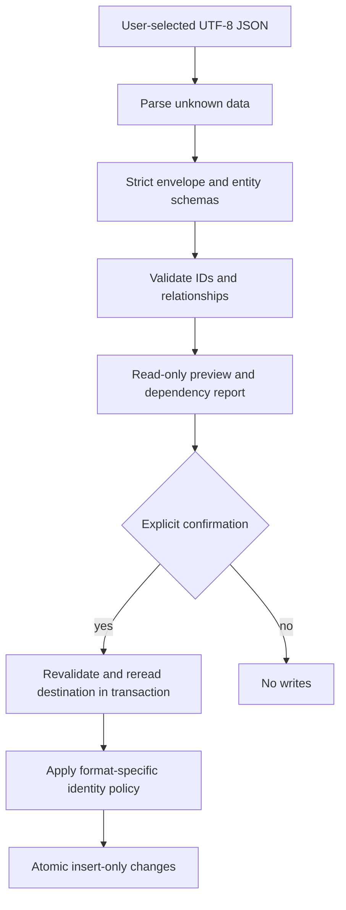

# JSON formats & compatibility

[Documentation home](../README.md) / [Developer Guide](README.md) / Import & compatibility

This document specifies implemented exchange boundaries and a separately labeled future compatibility proposal. [Storage](storage.md) describes IndexedDB versions; portable file versions are independent. The version-1 baseline below shows a complete JSON document for each supported exchange format, including Parts import. Required fields, material mapping, provenance, ordering and import safety rules are consolidated on this page.

**On this page:** [Version 1 baseline](#version-1-baseline) · [Envelope fields](#envelope-fields) · [Project format: ownership plus dependencies](#project-format-ownership-plus-dependencies) · [Catalog format: remapped insert-only references](#catalog-format-remapped-insert-only-references) · [Stock format: exact identities and dependency preservation](#stock-format-exact-identities-and-dependency-preservation) · [Parts format: required fields](#parts-format-material-mapping-and-new-owned-records) · [Compatibility matrix: implemented behavior](#compatibility-matrix-implemented-behavior) · [Documenting future versions](#documenting-future-versions) · [Proposed compatibility architecture — not implemented](#proposed-compatibility-architecture--not-implemented)

## Version 1 baseline

**All four exchange formats currently support only version 1.** There is no version 2 importer or exporter. Application release versions, IndexedDB versions, SQLite migrations and JSON exchange versions are independent.

| Exchange | File extension | Version field | Direction | Version 1 definition |
| --- | --- | --- | --- | --- |
| Project | `.oclproject.json` (also accepts legacy `.pocl` / `.json` names) | `schemaVersion: 1` | Import and export | [Project document](#project-format-ownership-plus-dependencies) |
| Catalog | `.cocl` | `schemaVersion: 1` | Import and export | [Catalog document](#catalog-format-remapped-insert-only-references) |
| Stock | `.oclstock.json` (also accepts `.json`) | `schemaVersion: 1` | Import and export | [Stock document](#stock-format-exact-identities-and-dependency-preservation) |
| Parts | `.oclparts.json` (also accepts `.json`) | **`version: 1`**, not `schemaVersion` | **Import only** | [Parts document and required fields](#parts-format-material-mapping-and-new-owned-records) |

The examples are complete JSON files, not fragments or patches. They demonstrate required fields and selected optional fields. Other optional values and saved-plan payloads follow the field contracts below and their linked schemas; empty `savedPlans` means there are no saved plans in that example. A valid file still needs destination-specific dependency checks and explicit import confirmation.

Treat these definitions as the current **version-1 reference**. Add only the differences for a future format version, following [Documenting future versions](#documenting-future-versions); do not duplicate unchanged format definitions.

## Shared processing contract

[projectJson](../../src/infrastructure/projects/project-json.ts) is the small `ProjectJsonPort` adapter: strip one leading BOM, `JSON.parse` to unknown, serialize with two-space indentation and a final newline. There is no general migration dispatcher behind this adapter. Each transfer service validates its own strict envelope and relationships.

A selected filename extension never proves the payload valid. Catalog UI additionally requires a `.cocl` suffix; Stock UI requires `.json`, while Project/Parts file pickers advertise their accepted extensions and pass contents to their validators. Accepting `.pocl` or `.json` means accepting an older filename convention, not arbitrary old shapes or automatic model conversion. Unknown object properties are rejected by strict schemas, even when a new application UI field seems harmless.



Preview results are data to review, not a durable reservation. Import rechecks persisted records, so conflicts appearing after preview still block or remap according to the format policy.

## Envelope fields

| Format | Required top-level fields | Optional fields | Main validator |
| --- | --- | --- | --- |
| Project | `format: "opticutlist-project"`, `schemaVersion: 1`, `project`, `parts`, `catalog`, `savedPlans` | `currentResultId` | [validateProjectTransfer](../../src/application/projects/project-transfer-format.ts) |
| Catalog | `format: "opticutlist-catalog"`, `schemaVersion: 1`, `catalog` | `catalogOrders` | [validateCatalogTransfer](../../src/application/catalog/catalog-transfer-format.ts) |
| Stock | `format: "opticutlist-stock"`, `schemaVersion: 1`, `materials`, `stockItems` | `stockOrders` | [validateStockTransfer](../../src/application/inventory/stock-transfer-format.ts) |
| Parts | `format: "opticutlist-parts"`, `version: 1`, `parts` | None | [validatePartsTransfer](../../src/application/projects/parts-transfer-format.ts) |

Parts has no optional top-level fields; its optional row fields are described in [Parts optional fields](#parts-optional-fields).

Array fields can be empty where their schemas permit; every referenced dependency must still satisfy the format's relationship checks. Duplicate entity IDs within a collection are rejected. Stable-ID reuse is not equivalent to matching names.

### Shared entity payloads

These are complete entity fields, not arbitrary patches. See [domain schema reference](domain-model.md#schema-field-reference) for lengths and enums.

| Entity payload | Required | Optional |
| --- | --- | --- |
| Material | `id`, `name`, `category` | `libraryPresetId` |
| Supplier | `id`, `name` | `websiteUrl` (absolute http(s)) |
| SupplierProduct | `id`, `supplierId`, `materialId`, `name`, all three `*Mm` dimensions, `grainDirection`, `currency`, `availability` | `price`, `productUrl` |
| Part | `id`, `name`, `materialId`, all dimensions, `quantity`, `grainDirection`, `rotation` | None |
| StockItem | `id`, `kind`, `materialId`, all dimensions, `quantity`, `grainDirection`, strict `provenance` | Only branch-specific provenance fields |

An absent price is unknown; explicit zero is known. `availability` remains required in product files despite no longer appearing in forms. Optional description/settings fields have missing-value behavior; that does not make required physical thickness optional.

## Project format: ownership plus dependencies

[projectTransferSchema](../../src/application/projects/project-transfer-format.ts) nests `cuttingProjectSchema` and `catalogRecordsSchema`. `catalog` contains arrays `materials`, `suppliers`, `products`. `savedPlans` contains pairs `{ summary, contents }`; contents use their own `formatVersion: 1` compact encoding.

Project fields:

| Required | Optional / constraints |
| --- | --- |
| `id`, `name`, `partIds`, `materialIds`, `supplierProductIds` | `description`, `stockItemIds`, `cuttingSettings`, `pdfSettings`, retained `panelQuantities` |
| Distinct IDs in each selection/ownership array | Stock IDs stay physical references, not transferred inventory |
| Exact Part membership in exported `parts` | Legacy quantities must refer to distinct selected products if present |

Historical contents include `id`, `projectId`, `formatVersion`, `settings`, snapshot `parts`, `sources`, allocated `panels`, global `unplaced` and `metrics`. Source entries hold `{ product: PanelSnapshot, quantity, materialName, supplierName }`. Panel entries hold source ID, panelCopyIndex, strategy, edited flag, compact tree and optional diagnostic reasons. The [codec](../../src/application/plans/saved-plan-codec.ts) derives regions and validates actual copy accounting; structurally valid JSON is not enough.

`validateProjectTransfer` enforces:

- `parts` exactly equals project-owned Part IDs.
- Exported products exactly equal selected product IDs.
- Included materials equal the union of selected material IDs, current Parts' materials and selected products' materials.
- Included suppliers equal those required by selected products.
- Current result references an included saved summary.
- Every summary/contents pair agrees on ID and project owner; every saved tree reconstructs/validates.

Historical plan snapshots can refer to historical material/product identities beyond the live catalog subset. The remapper accounts for those historical identities separately rather than rewriting history to whichever current record happens to share a name.

[createProjectTransferService](../../src/application/projects/project-transfer-service.ts) exports a transaction-consistent project snapshot and imports after explicit consent. [remapProjectTransfer](../../src/application/projects/remap-project-transfer.ts) maps project/Part/plan conflicts and catalog references through consistent ID maps, including Part IDs in tree leaves and diagnostics. Identical catalog records may be reused; incoming owned entities do not overwrite existing ones. Destination reference reservations come specifically from [read-transfer-records.ts](../../src/application/catalog/read-transfer-records.ts): live Parts/Stock/project material references, product supplier references, selected/purchase-linked product IDs and owned Part IDs. Project remapping additionally includes destination saved-plan/receipt IDs and incoming historical snapshot references. This is not a scan of every destination ledger or every historical payload.

Stock allocation keys and project stockItemIds are not converted into newly owned panels. Physical StockItems, movements, Keep decisions and receipts are excluded. Import may retain unavailable stock references that need review, and later reconciliation can report missing inventory dependencies. Export is a project transfer, not a promise to restore inventory audit state on another machine.

### Project JSON — version 1

```json
{
  "format": "opticutlist-project",
  "schemaVersion": 1,
  "project": {
    "id": "workbench",
    "name": "Workbench",
    "partIds": [
      "shelf"
    ],
    "materialIds": [
      "mdf"
    ],
    "supplierProductIds": [
      "sheet"
    ],
    "cuttingSettings": {
      "kerfMm": 3,
      "edgeMarginMm": 0,
      "preferStockPanels": false
    },
    "pdfSettings": {
      "orientation": "landscape",
      "description": "Workshop copy"
    }
  },
  "parts": [
    {
      "id": "shelf",
      "name": "Shelf",
      "materialId": "mdf",
      "lengthMm": 400,
      "widthMm": 200,
      "thicknessMm": 15,
      "quantity": 2,
      "grainDirection": "none",
      "rotation": "allowed"
    }
  ],
  "catalog": {
    "materials": [
      {
        "id": "mdf",
        "name": "MDF",
        "category": "Engineered wood panels"
      }
    ],
    "suppliers": [
      {
        "id": "supplier",
        "name": "Workshop supplier"
      }
    ],
    "products": [
      {
        "id": "sheet",
        "supplierId": "supplier",
        "materialId": "mdf",
        "name": "MDF sheet",
        "lengthMm": 800,
        "widthMm": 600,
        "thicknessMm": 15,
        "grainDirection": "none",
        "currency": "EUR",
        "availability": "unknown"
      }
    ]
  },
  "savedPlans": []
}
```

## Catalog format: remapped insert-only references

The same `catalog` grouping exports complete records. Optional order rows are `{ id: supplierId, productIds: [...] }`, with unique supplier orders and products belonging to that supplier and included in the file.

[remapCatalog](../../src/application/catalog/remap-catalog.ts) starts with collision-safe maps. It restores a stable ID only if the existing same-ID record has identical fields; product comparison happens after its material/supplier references are mapped. Distinct IDs with equal names are not merged. Occupied IDs receive fresh parsed UUIDs; the allocation helper has a bounded retry failure instead of overwriting if it cannot allocate a unique identity.

[Catalog import](../../src/application/catalog/catalog-transfer-service.ts) inserts materials, suppliers and products in one transaction. Existing local order stays first; newly imported order IDs append after remapping. No inventory or project records are transferred. Preview exposes remapped conflicts/reuse counts; a “conflict” here is not necessarily rejection, unlike physical Stock conflicts.

### Catalog JSON — version 1

```json
{
  "format": "opticutlist-catalog",
  "schemaVersion": 1,
  "catalog": {
    "materials": [{ "id": "mdf", "name": "MDF", "category": "Engineered wood panels" }],
    "suppliers": [{ "id": "supplier", "name": "Workshop supplier" }],
    "products": [{
      "id": "sheet", "supplierId": "supplier", "materialId": "mdf", "name": "MDF sheet",
      "lengthMm": 800, "widthMm": 600, "thicknessMm": 15,
      "grainDirection": "none", "currency": "EUR", "availability": "unknown"
    }]
  },
  "catalogOrders": [{ "id": "supplier", "productIds": ["sheet"] }]
}
```

This product deliberately has no price. An importer must preserve unknown, not insert zero.

## Stock format: exact identities and dependency preservation

Settings → Stock exports `stock.oclstock.json` as readable UTF-8 JSON. Import accepts that extension or general `.json` filenames; contents determine compatibility.

[stock-transfer-format.ts](../../src/application/inventory/stock-transfer-format.ts) validates stock, exact referenced Material snapshots and optional material order rows. No unrelated materials may be included. Stock-order IDs must point to included same-material stock.

All StockItem fields in the example below are required. Material `libraryPresetId` and the top-level `stockOrders` array are optional. IDs are stable domain identities: do not replace them with names or regenerate them when replaying a file. Material snapshots contain only identities used by included stock, for verification; **import never creates or updates materials**. A compatible catalog must already exist (use Catalog import separately). Preset identity is optional and does not determine compatibility.

Stock fields reuse the existing strict StockItem schema. Length, width and thickness are finite positive millimeters; quantity is a positive safe integer. `kind` is `fullPanel` or `offcut`; grain is `none`, `length` or `width`. Unknown properties, duplicate IDs, missing references and unsupported versions are rejected. Empty inventory uses empty `materials` and `stockItems` arrays.

Provenance is preserved verbatim:

- Manual: `{ "source": "manual" }`.
- Purchase: `{ "source": "purchase", "supplierProductId": "product-id" }`. The catalog product must already exist with the same material ID.
- Cutting: `{ "source": "cutting", "projectId": "project-id", "savedPlanId": "plan-id", "sourceStockItemId": "source-stock-id", "panelIndex": 0, "wasteIndex": 1 }`. A catalog-origin offcut uses `supplierProductId` instead of `sourceStockItemId`; at least one exact source identity is required. Indices are zero-based non-negative integers.

The transaction-time `inspect` in [stock-transfer-service.ts](../../src/application/inventory/stock-transfer-service.ts) checks:

1. Every incoming Material already exists and is structurally identical.
2. Existing Stock IDs are identical or the whole file fails; absent IDs must not be reserved by selections, historical plan sources, receipts, active consumption or ledger events.
3. Purchase provenance resolves an exact product with matching Material and existing supplier.
4. Cutting provenance is an identical **existing** StockItem with a live project or deleted-project audit, plan origin and matching immutable creation snapshot.
5. Incoming ordering does not overwrite a different live local order.

Only new independent manual/purchased records are inserted. Identical records are no-ops, not quantity increments. Absent generated offcuts cannot be recreated from this file, even if a convincing-looking project ID is supplied. The complete version-1 example follows below.

### Stock import outcomes

New manual/purchased records may be added with unchanged IDs and quantities. Conflicting IDs or material snapshots block the entire file; there is no name/dimension matching, ID remapping, quantity merging or deletion. Cutting-generated offcuts require matching original history, including a retained deleted-project audit when its plan payload has been removed. Missing or modified offcuts are never recreated.

Failures leave existing data unchanged. Identical records can be replayed without stock movements. Imports do not reset movement history, project selections, cutting results or reconciliation state.

### Stock backup limitations

This is **not a complete application backup**. Files exclude catalog products/suppliers, projects, cutting trees, movement receipts, project stock ledgers, PDFs and images. Material snapshots are dependency checks, not catalog imports. The file cannot restore project-generated stock/history to an empty installation or undo consumption in another project. These scenarios are rejected rather than guessing or resetting provenance. Transfer matching catalog dependencies separately before importing independent manual/purchased stock.

### Stock display ordering

The optional `stockOrders` array is shown in the complete example below. Each entry uses a material ID as `id` and lists its `stockItemIds` in display order.

These are presentation preferences, separate from StockItems and movement history. Every listed ID must appear in `stockItems` with that material; duplicates and cross-material references are rejected. Exports omit stale IDs. Without metadata, rows use deterministic ID order; importing an older file preserves any local order. Import inserts new order records atomically with stock and rejects conflicting existing orders without overwriting them. Replaying identical data/order is safe. This optional addition does not change stock quantities or backup limitations.

### Stock JSON — version 1

```json
{
  "format": "opticutlist-stock",
  "schemaVersion": 1,
  "materials": [
    {
      "id": "mdf",
      "name": "MDF",
      "category": "Engineered wood panels"
    }
  ],
  "stockItems": [
    {
      "id": "owned-sheet",
      "kind": "fullPanel",
      "materialId": "mdf",
      "lengthMm": 800,
      "widthMm": 600,
      "thicknessMm": 15,
      "quantity": 2,
      "grainDirection": "none",
      "provenance": {
        "source": "manual"
      }
    }
  ],
  "stockOrders": [
    {
      "id": "mdf",
      "stockItemIds": [
        "owned-sheet"
      ]
    }
  ]
}
```

The referenced MDF material must already exist and match in the destination. Manual provenance makes this a transfer of independent owned stock; it does not create supplier products or recover cutting history. The optional `stockOrders` entry controls display order only.

## Parts format: material mapping and new owned records

Parts rows require `name`, `length`, `width`, `thickness` and `quantity`. `material`, `grainDirection` and `rotation` are optional for CAD software that cannot supply them. No database IDs, preset IDs or catalog objects belong in the file. When supplied, `material` is a label, not an identity.

[Parts preview](../../src/application/projects/parts-transfer-service.ts) computes eligible project materials and proposes mappings only for exactly one matching label. Import requires one non-null material ID per row, new Part IDs and explicit confirmation, then calls scoped `createMany`. Membership is checked again inside the write transaction. A repeated import intentionally adds another batch. There is no supported standalone export.

### Parts JSON — version 1

The first row supplies all fields; the second shows the minimum CAD payload. Choose its material explicitly in the import preview.

```json
{
  "format": "opticutlist-parts",
  "version": 1,
  "parts": [
    {
      "name": "Cabinet side",
      "material": "Birch plywood",
      "length": 720,
      "width": 560,
      "thickness": 18,
      "quantity": 2,
      "grainDirection": "length",
      "rotation": "forbidden"
    },
    {
      "name": "Shelf",
      "length": 524,
      "width": 500,
      "thickness": 18,
      "quantity": 3
    }
  ]
}
```

### Parts required fields

The top-level `format`, `version` and `parts` properties are required. Each row must include the five fields listed below; physical dimensions and quantity have no implicit defaults.

| Location / field | Required value or type |
| --- | --- |
| `format` | Exactly `"opticutlist-parts"` |
| `version` | Number `1`; `schemaVersion` is not accepted |
| `parts` | Array of part rows; an empty array is valid and duplicate names are allowed |
| `parts[].name` | Nonempty trimmed string, at most 200 characters |
| `parts[].length` | Finite positive number, millimeters |
| `parts[].width` | Finite positive number, millimeters |
| `parts[].thickness` | Finite positive number, millimeters |
| `parts[].quantity` | Positive safe integer, at most 9007199254740991 |

### Parts optional fields

| Field | Accepted value when supplied | Behavior when omitted |
| --- | --- | --- |
| `parts[].material` | Nonempty trimmed material label, at most 200 characters | No material is guessed, even if only one is eligible; choose it in preview |
| `parts[].grainDirection` | `"none"`, `"length"` or `"width"` | `"none"` (no grain constraint) |
| `parts[].rotation` | `"allowed"` or `"forbidden"` | `"allowed"` (90° rotation permitted when grain does not determine orientation) |

Only omitted fields receive these behaviors. Explicit values remain unchanged; null, blank strings, wrong types and invalid enum values are rejected. These defaults match the new-Part form. Review the preview and edit imported Parts if the real material needs a grain or rotation constraint; missing CAD information cannot establish one.

Validation normalizes grain and rotation before preview or import. Every stored Part still has an explicit material ID, grain direction and rotation policy; project JSON and the domain Part schema remain unchanged.

Use JSON numbers, not numeric strings. Unknown properties are rejected. Parts import uses `length`, `width`, `thickness` and an optional **material label**; a Part embedded in a project file instead uses `lengthMm`, `widthMm`, `thicknessMm`, `id` and `materialId`. These are two different payloads, not interchangeable spellings.

### Parts import and material mapping

Parts → **New part ▾ → Import parts** accepts UTF-8 `.oclparts.json` and legacy `.json` filenames, previews the rows and requires confirmation. It appends new Parts without overwriting existing ones or creating materials. Use project export to save a project's parts; standalone Parts export is not supported.

The file contains no project/database IDs, catalogue entities, stock, plans or UI
state. CAD exporters should convert their units to millimeters and export original
part dimensions rather than rotated cutting placements. Numbers must be numbers,
not strings. Do not append undocumented metadata to version 1.

Before importing, choose project materials or eligible catalogue/stock panels in
Materials. Import proposes a material only when its exact label matches exactly
one eligible project Material. Missing or ambiguous labels require an explicit
per-row material choice in the preview. No material is inferred from dimensions,
stock provenance or preset texture. Own-project offcuts never qualify. Identical
material names cannot convey database identity: review these mappings explicitly.

Every imported Part gets a new internal ID. Importing a file twice intentionally
adds two batches; it is not a synchronization/update format. Validation and all
Part/ownership writes run through the existing project rules in one atomic
transaction. A failure leaves the complete batch unapplied. Existing direct
material choices remain valid, and exact thickness matching during optimization
is unchanged.

## Compatibility matrix: implemented behavior

| Change / input | Current outcome |
| --- | --- |
| Version 1 omits optional project description/settings | Valid, resolved defaults at use time |
| Parts v1 omits material / grain / rotation | Explicit preview material choice / `none` / `allowed` |
| Parts v1 supplies invalid optional values | Rejected; optional does not mean accepting null or blank values |
| `preferStockPanels` absent versus false | Enabled versus explicitly disabled; false preserved |
| PDF orientation absent versus Landscape | Portrait fallback versus explicit Landscape |
| Product price absent versus zero | Unknown/N/A versus valid zero |
| Product availability omitted | Invalid required field, even though UI hides it |
| Project legacy `panelQuantities` included | Valid if references pass; retained but ignored by new supply preparation |
| JSON unknown keys or unsupported version | Rejected, not stripped or guessed |
| `.pocl` or `.json` filename with current project shape | Accepted through same validator |
| Matching names/dimensions with different identities | Not sufficient for reuse or ownership |
| Missing historical inventory in project/Stock transfer | No invented replacement; reconciliation/dependency limitations remain |

There is no implemented file-to-file migration chain, generic recovery converter or complete application backup format. The only current transformations are strict parsing, supported optional defaults, ID remapping and compact-tree reconstruction.

## Source-level compatibility risks to verify

Import services deliberately write transaction-scoped raw repositories after validating/remapping the batch, rather than calling nested guarded CRUD transactions. Consequently, their checks must be audited separately from ordinary creation/update checks. `readTransferRecords` does not include archived `projectStock.deletedProject` IDs in its destination project-ID set, whereas guarded `ProjectService.saveProject` explicitly rejects archived IDs. A project import colliding with such an archive therefore needs targeted regression review; the ordinary creation guard alone does not prove that import path is protected. This is a source-level risk, not a behavior change or a reproduced failure in this documentation task.

Similarly, destination historical material/product reservations are limited to the sets actually collected above. Do not claim full-audit restoration or blanket historical collision coverage from insert-only semantics alone. Future compatibility work should test these boundaries explicitly before extending the file contracts.

## Documenting future versions

This is a documentation convention; it does not implement migration or make a new version acceptable to today's importers.

1. Keep the version-1 definitions above as the baseline. Preserve their examples and field requirements.
2. When a new exchange version is actually implemented, add a dated change entry for **that format and version**. List only added, removed or changed fields, defaults and meaning, with the exact previous behavior.
3. State which older versions the new importer accepts, whether a migration runs, what the exporter writes and what older application versions reject. Link the implementing schemas and compatibility tests.
4. Include a focused JSON example of changed content only, clearly labeled as a fragment when it is not a complete importable file. Refer to the baseline for unchanged fields.
5. Review each format separately. A Project format change does not automatically change Catalog, Stock or Parts versions. Distinguish an exchange-version increment from a compatible optional addition within version 1.

**Version history today:** version 1 is the only implemented baseline for Project, Catalog, Stock and Parts. There are no later-version changes to list yet. Do not add a speculative version-2 format or claim that changing the version number alone migrates a file.

### Version 1 compatible addition — CAD Parts imports

Parts import accepts omitted `material`, `grainDirection` and `rotation` with the behaviors above. Existing complete version-1 files retain their values. This broadens the reader without a version bump or persisted-record migration. **Older application builds that required all three fields may reject the reduced CAD payload**; include all fields when targeting those readers. No other exchange format changed.

## Proposed compatibility architecture — not implemented

The following is a maintenance proposal, not an existing module or new supported format:


A future dispatcher should retain a validator per supported historical version and apply explicit pure transformations before ID remapping. Each step needs golden historical fixtures, unsupported-version tests, loss detection and exact dependency validation. DB upgrades must remain a separate mechanism: a JSON migration must never open/change IndexedDB while merely previewing a file.

Only introduce version 2 when semantics genuinely require it; accepting arbitrary extra keys or silently filling mandatory dimensions is not backward compatibility. Keep format-specific identity policies separate: project/catalog conflict remapping cannot safely be reused for physical inventory. A future full backup would need receipts, ledgers, reserved IDs and a coherent restoration policy, not merely concatenate the existing exchanges.

---

**Continue exploring:** [Parts UI](features.md#project-parts) · [Stock lifecycle](stock-management.md) · [Documentation home](../README.md)
