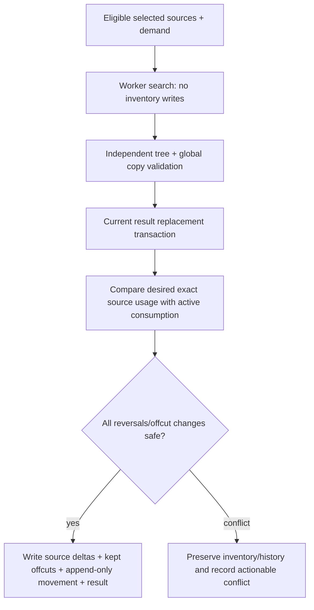
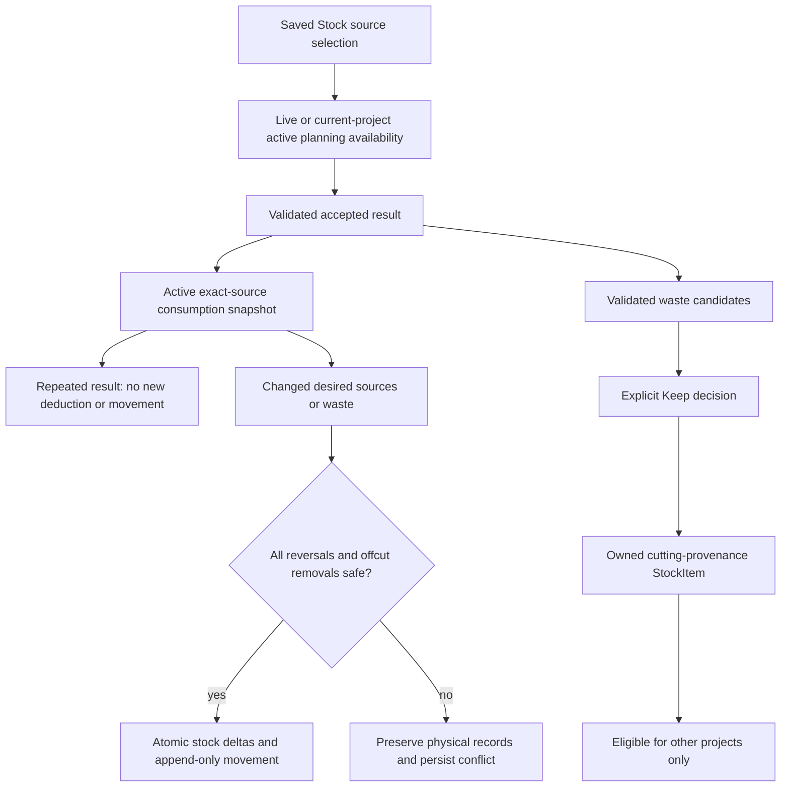

# Stock lifecycle & reconciliation

[Documentation home](../README.md) / [Developer Guide](README.md) / Optimization & inventory

Physical stock is an identity-based inventory system, not a collection of catalog availability estimates. Start with [StockItem](../../src/domain/model/stock-item.ts), [ProjectStock](../../src/domain/model/project-stock.ts), the [guarded stock repository](../../src/application/inventory/stock-repository.ts) and [project-stock-service.ts](../../src/application/inventory/project-stock-service.ts).

**On this page:** [Owned stock versus references](#owned-stock-versus-references) · [Availability is contextual](#availability-is-contextual) · [Result persistence and automatic reconciliation](#result-persistence-and-automatic-reconciliation) · [Offcut candidates and Keep decisions](#offcut-candidates-and-keep-decisions) · [Transactions, idempotency and rollback](#transactions-idempotency-and-rollback) · [Project deletion](#project-deletion)

## Owned stock versus references

A SupplierProduct describes a purchasable panel. Selecting or optimizing it does not buy, reserve or consume physical stock. A StockItem represents owned full panels/offcuts with a positive quantity and exact provenance. Identical dimensions do not merge identities.

Manual inventory CRUD uses `createStockRepository`; it validates complete records, material/product relationships and identity reservations from plans/history. Updates/deletions compare draft snapshots inside the transaction so a stale form cannot overwrite intervening inventory changes. Catalog `addFromProduct` creates individually identified quantity-one purchase panels atomically, rereading product/material/supplier first. It follows manual-addition inventory conventions rather than fabricating cutting receipts.

## Availability is contextual

[readProjectStockAvailability](../../src/application/inventory/project-stock-availability.ts) returns live stock plus **only that project's active `ProjectStock.consumed` quantities**, coalesced by exact Stock ID. This is a read-only planning view and uses the caller's transaction snapshot.

For example, Project A consumes the sole panel S. S disappears from live Stock but remains in A's active consumption ledger. Returning to A's Materials or rerunning optimization can still use S as A's already allocated source. Project B's planning read cannot recover A's allocation. A saved Materials ID or an old historical movement alone does not grant access.

[isStockEligibleForProject](../../src/application/inventory/stock-eligibility.ts) excludes cutting-provenance offcuts whose originating projectId equals the current project. This prevents a project recursively depending on its own output. The offcut can remain globally visible and usable by other projects. Legacy invalid selections remain visible for explicit removal; they must not silently become eligible.

Selection is not reservation. Authoritative consumption occurs when an accepted result is persisted/restored. Services recheck inventory so stale project choices cannot bypass current limits.

## Result persistence and automatic reconciliation

[createCurrentResultService](../../src/application/plans/current-result-service.ts) calls `reconcileProjectStock` in its persistence transaction. Loading a current result can also reconcile it; it is not necessarily a side-effect-free read.

Reconciliation derives desired Stock usage from each allocated panel's exact source `stockItemId`. Catalog panels do not enter source consumption. Existing active consumption is compared with desired counts: unchanged allocation creates no duplicate deduction or movement. Depleted live records are deleted, while original snapshots remain in the ledger/receipts. Safe quantity changes use recorded originals rather than guessing from geometry.

Preflight checks precede stock writes. If source stock has been changed elsewhere, immutable receipts prohibit reversal, or retained/consumed offcuts make restoration unsafe, inventory/history are preserved and `ProjectStock.conflict` is persisted. This business conflict can be a successful persistence result containing conflict state; callers must inspect it rather than treating every `ok: true` as reconciled inventory. Repository failures instead abort the encompassing transaction.

## Offcut candidates and Keep decisions

[cuttingOffcutCandidates](../../src/application/inventory/cutting-confirmation-service.ts) derives candidates from independently validated waste leaves. It excludes margin strips and kerf regions, which are not reusable waste rectangles.

A persisted offcut decision stores source panel snapshot, panel/copy/waste indices, exact region, Keep/removed flags and optional original physical Stock snapshot. Stable matching across new results uses source identity, panel copy and integer-micrometre region fingerprint, not plan labels or dimension-only matching.

Checking Keep creates one physical `offcut`, quantity one, with copied material/thickness/grain and cutting provenance. A catalog-origin offcut retains exact supplierProductId; a stock-origin offcut retains sourceStockItemId. Unchecking or replacing geometry removes previously generated inventory **only if it is unchanged and unused**. Consumed offcuts are not recreated simply because a Keep decision remains checked.

[ProjectStockView.vue](../../src/ui/pages/ProjectStockView.vue) separates inspection from inventory: row/canvas hover and selection do not invoke `setKeep`; only checkbox change does. Temporary `Offcut N` labels are per-panel UI references and are never stored or used for matching.

## Transactions, idempotency and rollback

Multi-record operations use [LocalPersistence.transaction](../../src/application/persistence/repositories.ts) and only its scoped repositories. Any failed scoped operation aborts all changes, even if its result is accidentally ignored. No timers/network requests belong inside the transaction.

Project-stock movements append exact `added`, `removed`, `consumed` and `restored` snapshots with plan identity and timestamp. Repeat synchronization with no physical changes adds no movement. Legacy [CuttingConfirmation](../../src/domain/model/cutting-confirmation.ts) receipts remain immutable and can seed existing source consumption without a duplicate deduction. Manual CRUD is not presented as a complete append-only purchase ledger; cutting audit records are the history model implemented here.

Recommended failure regression: force the final ledger write to fail after source changes, then assert that source inventory, offcuts and current result all remain unchanged. Existing tests cover this in [project-stock-service.spec.ts](../../src/application/inventory/__tests__/project-stock-service.spec.ts).

## Project deletion

[project-deletion.ts](../../src/application/projects/project-deletion.ts) inspects original consumption/restoration and offcut snapshots, current inventory, other-project selections/consumption and receipts.

- **Keep current stock** retains current physical inventory and historical events.
- **Restore initial stock** is all-or-nothing. Modified/consumed/externally referenced offcuts, disagreeing source history or unsafe source restoration block deletion in that mode.

Successful deletion removes owned Parts, plan payloads/summaries and the current result reference. It retains immutable receipts and a named `deletedProject` audit in ProjectStock, clearing active offcut entries. Guarded project creation reserves the archived identity, and deleted projects must not be reconciled again. The separate import-path reservation gap is recorded in the [JSON audit risks](json-formats.md#source-level-compatibility-risks-to-verify). Other projects and shared catalog records are not cascaded.

A deletion preview is not authorization to skip transaction-time checks: inventory can change after preview.

## Exchanges, ordering and edge cases

[Stock exchange](stock-json-format.md) exports identity/provenance and matching Material snapshots, not movement history. Import accepts new independent manual/purchase stock and exact existing records; conflicts/history-reserved missing IDs block the whole file. It cannot recreate consumed sources or absent generated offcuts and is not an inventory audit backup.

[stock-order.ts](../../src/application/inventory/stock-order.ts) stores material-keyed display order separately. Reordering cannot change quantity, source, eligibility or reconciliation. Identical-dimension StockItems remain distinct throughout ordering, project selection, optimizer allocation and transfer.

When investigating a bug, inspect live StockItem, current result source snapshot, ProjectStock active consumption, offcut decisions and immutable receipts together. Missing live inventory may mean legitimate current-project allocation; conversely, a selected ID may be genuinely stale. Never fix either situation by globally restoring inventory or suppressing warnings.

## Service API and preview interpretation

`createProjectStockService(persistence).forProject(projectId)` exposes:

| Method | Effect |
| --- | --- |
| `preview()` | Transactional derived read of current plan, candidate rows, persisted decisions, conflict and movements; does not itself apply physical deltas |
| `sync()` | Read, reconcile current accepted result and persist updated state atomically |
| `setKeep(key, keep)` | Resolve a current candidate key, update/create its decision, reconcile and persist in one transaction |

The preview row type includes `candidate`, optional `entry`, `keep`, `status` and `modified`. Status is one of Not added / Available / Consumed / Outdated, derived from recorded decisions, live physical stock and receipts. It is not a second persisted availability enum. Current UI hides Outdated rows from active drawing inspection while the service retains historical information needed for safety.

A candidate key includes current plan ID/panelIndex/wasteIndex. Cross-result matching uses the stronger source/copy/material/thickness/grain/panel-and-region fingerprint. Ambiguous multiple historical matches are not guessed; exact plan/index matches take priority only when unique. Decision IDs and generated physical Stock IDs may differ: code uses `entry.stock.id` when referring to actual inventory.

### Guard coverage is deliberately not uniform

`StockRepository.update` validates material, immutable provenance and an optional supplied previous snapshot. Manual delete rereads the record and checks the supplied snapshot if present, then deletes the live record. It does **not** run the project-deletion restoration preflight or automatically remove all saved project selections. Such selections can become explicitly unavailable, and later reconciliation can detect unsafe changes. Do not describe generic Stock CRUD as a universal reservation/reference lock.

`StockRepository.history(id)` reads matching immutable CuttingConfirmation receipts, not the newer embedded ProjectStock movement list. Automatic reconciliation events remain persisted in ProjectStock even though project Stock no longer displays movement history. This is a current presentation/query limitation, not missing inventory accounting records.

### Call-path difference worth reviewing

Project-aware planning/Materials availability uses `readProjectStockAvailability`. In contrast, `ProjectService.parts(...).saveInProject` and Parts-import material derivation inspect live Stock records when an eligible material is inferred solely through selected Stock rather than a direct material choice. After that source is fully consumed, those paths may not recover the same material through active consumption. This is a source-level edge-case risk identified by the audit, not a newly implemented rule or a reproduced regression claim. A future fix needs an application-level regression and must not make consumed inventory globally available.

### Ledger lifecycle diagram

---

**Continue exploring:** [Transaction trace](storage.md#stock-reconciliation-transaction-trace) · [Stock exchange contract](stock-json-format.md) · [Documentation home](../README.md)
