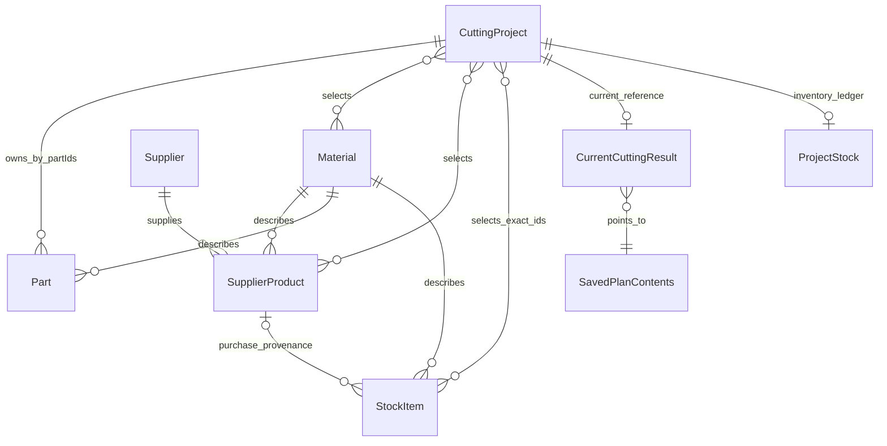
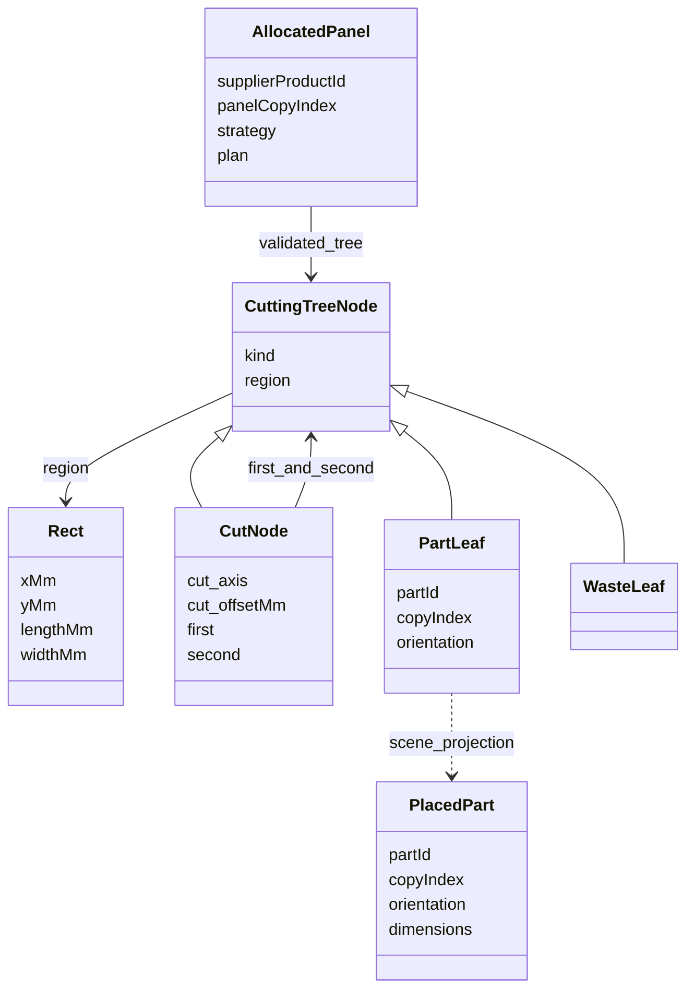

# Domain model & business rules

[Documentation home](README.md) / [Developer Guide](developer-guide.md) / Architecture & domain

The runtime contracts are the strict Zod schemas in [src/domain/model](../src/domain/model/). This guide describes relationships; source schemas remain the exact field-level reference. See [persistence and JSON](persistence-and-json.md) for how records cross storage boundaries.

**On this page:** [Entity relationships](#entity-relationships) · [Grain and orientation](#grain-and-orientation) · [Provenance](#provenance) · [Schema field reference](#schema-field-reference) · [Invariant enforcement and failure consequences](#invariant-enforcement-and-failure-consequences)

## Identity and physical dimensions

[ids.ts](../src/domain/model/ids.ts) defines branded, non-whitespace opaque IDs. They need not be UUIDs; application-created records generally use `crypto.randomUUID()` parsed through the corresponding ID schema. Never use display labels, material names or dimensions as identity.

[dimensions.ts](../src/domain/model/dimensions.ts) requires finite, strictly positive `lengthMm`, `widthMm`, `thicknessMm` on Part, SupplierProduct and StockItem. Width is not necessarily the shorter side. Thickness belongs to a physical item, not Material. [common.ts](../src/domain/model/common.ts) defines trimmed nonempty names up to 200 characters and positive integer quantities. Geometry has additional representable-range checks; a schema-valid tiny positive number can still fail conversion to a supported micrometre extent.

[compatibility.ts](../src/domain/compatibility.ts) requires identical Material IDs and **exact numeric thickness equality**. Two materials named MDF are not automatically interchangeable. Nominal 18 and 18.000001 mm are different thicknesses, even though placement geometry uses micrometre arithmetic. Grain/orientation and fit are separate checks.

## Entity relationships

The diagram expresses application relationships, not database foreign-key enforcement. Guarded services enforce references inside transactions.

| Entity | Important fields and lifecycle |
| --- | --- |
| [Material](../src/domain/model/material.ts) | `id`, `name`, `category`, optional `libraryPresetId`. A compatibility identity; preset is only local presentation identity. |
| [Supplier](../src/domain/model/supplier.ts) | Identity/name and optional absolute http(s) website. UI normalization accepts a domain before persistence. |
| [SupplierProduct](../src/domain/model/supplier-product.ts) | Supplier/material IDs, name, dimensions, grain, optional nonnegative unit `price`, required currency, optional product URL and retained availability enum. A reusable catalog reference, not owned inventory. |
| [Part](../src/domain/model/part.ts) | Name, material, dimensions, production quantity, grain and `rotation`. Ownership comes from a project's `partIds`, not a projectId on Part. |
| [StockItem](../src/domain/model/stock-item.ts) | `fullPanel` or `offcut`, material, dimensions, positive quantity, grain and explicit provenance. No general name field. |
| [CuttingProject](../src/domain/model/cutting-project.ts) | Name, optional trimmed description up to 2,000 characters, owned Part IDs, selected material/product IDs, optional distinct Stock IDs, cutting/PDF settings and legacy panel quantities. |

Empty descriptions and missing optional fields are valid. Missing price means unknown; explicit zero is a known zero price. Currency is a three-uppercase-letter code, not a full currency registry lookup.

## Project and Part ownership

[createProjectService](../src/application/projects/project-service.ts) exposes `parts(projectId)` for scoped Part operations. Creation/import/adoption update Part records and project `partIds` atomically. Updating project metadata cannot independently reassign Part ownership. Reads/writes reject cross-project ownership inconsistencies.

Part creation/editing requires membership in the project's selected materials, including materials of eligible selected source references. [part-materials.ts](../src/application/projects/part-materials.ts) centralizes this derivation. Removing a material choice does not silently delete existing Parts; the UI surfaces compatibility issues. Legacy Parts without a project owner remain unassigned until explicit adoption; simply opening a project must not claim them.

Project selection IDs express **intent**, not physical consumption or reservation. A stale selected Stock ID cannot establish ownership. The authoritative active allocation is `ProjectStock.consumed`; see [stock management](stock-management.md).

## Grain and orientation

[orientation.ts](../src/domain/model/orientation.ts) defines grain `none`, `length`, `width` and rotation `allowed` / `forbidden`. [getAllowedOrientations](../src/domain/geometry/part-orientation.ts) follows final grain alignment when both source and Part specify grain; that alignment takes precedence over legacy rotation preferences. A 90-degree turn swaps dimensions and the grain axis. If either grain is unspecified, the existing rotation preference governs.

Example: a length-grain Part on a width-grain source may require rotation, even if an old record stores rotation forbidden. A width-grain Part on a length-grain source cannot use a normal placement merely because its dimensions fit. Do not implement a separate UI-only interpretation of these constraints.

## Plans, placements and cuts

[panel-source.ts](../src/domain/optimizer/panel-source.ts) adapts StockItems into geometry-only sources with allocation key `stock:<stockItemId>` and a separate exact `stockItemId`. This is not a SupplierProduct insert. Catalog sources keep their product identity.

[PanelCuttingPlan](../src/domain/optimizer/plan-with-strategy.ts) contains a validated tree, placements, unplaced-copy ranges and area metrics. [ProjectCuttingPlan](../src/domain/optimizer/project-plan.ts) allocates panel copies and accounts for all demand globally. A placed copy is identified by Part ID and copyIndex; repeated names are harmless.

[cutting-tree.ts](../src/domain/cutting-tree/cutting-tree.ts) models full-region guillotine cuts with two child regions, Part leaves and waste leaves. Cut offsets and physical kerf derive child geometry. Collision-free rectangles alone do not prove an executable guillotine plan. [validateCuttingTree](../src/domain/cutting-tree/validate-cutting-tree.ts) independently verifies the tree; [validateProjectPlan](../src/domain/optimizer/validate-project-plan.ts) adds global copy/source-limit checks.

A waste leaf is not an automatically owned offcut. Eligible waste becomes an offcut candidate; only a persisted Keep decision causes physical creation. Edge trims and kerf are not reusable waste leaves.

## Persisted historical snapshots

[saved-cutting-plan.ts](../src/domain/model/saved-cutting-plan.ts) defines summary and compact contents. A `PanelSnapshot` stores historical identity, material, dimensions and grain, optionally exact Stock ID, but excludes current catalog price/URL/availability. Compact trees store cuts and leaf identities, not canvas coordinates; reconstruction recomputes and validates full regions.

[CurrentCuttingResult](../src/domain/model/current-cutting-result.ts) is one project-keyed reference to a saved plan, with a preserve-legacy flag. It does not contain rendered output or undo history. Historical Parts/source names and settings keep restored drawings meaningful after live catalog changes.

[ProjectStock](../src/domain/model/project-stock.ts) stores exact offcut entries, Keep/removed flags, original Stock snapshots, current consumption, append-only change records and a possible conflict. [CuttingConfirmation](../src/domain/model/cutting-confirmation.ts) retains immutable legacy physical-cutting receipts. These records remain meaningful after project deletion through a named audit entry.

## Provenance

Stock provenance is a strict discriminated union:

- `manual`: independently entered owned stock.
- `purchase`: exact `supplierProductId`.
- `cutting`: originating project/plan, panel and waste indices, and at least one exact source Stock ID or catalog product ID.

Dimensions cannot recreate that chain. Provenance exists to prevent duplicate consumption, unsafe reversals and circular reuse, not merely to display a source label.

## Persisted versus derived versus transient

Persisted: entity records, project settings/selections, compact plans, audit records, ordering metadata and Keep decisions. Derived: eligible sources, reconstructed regions, offcut candidates, utilization, material groups and purchasing rows. Transient: form drafts, active row, hover, panel collapses, temporary `Offcut N` labels and editor undo/redo.

Do not persist a derived label or preview as an inventory identity. Adding a field requires reviewing schemas, guarded repositories, snapshots, transfers and tests together; additive optional fields do not automatically require a Dexie store version.

## Schema field reference

Fields below are verified against the linked domain modules. Optional means absent is accepted, not that null is accepted. `z.strictObject` rejects unknown keys; optional fields generally accept `undefined` in TypeScript, while portable JSON represents absence by omitting the property.

| Schema/value | Fields or constraints | Consequence for callers |
| --- | --- | --- |
| `stableIdSchema` in [ids.ts](../src/domain/model/ids.ts) | Nonempty, at most 128 characters, no whitespace, per-entity brands | Parse IDs at boundaries; a database UUID is not required, but an arbitrary label is not a substitute |
| `nameSchema` in [common.ts](../src/domain/model/common.ts) | Trimmed, 1–200 characters | Empty/whitespace labels fail; stored names can differ from raw typed whitespace |
| `quantitySchema` | Positive safe integer through Zod integer validation | Zero cannot represent a live exhausted StockItem; depletion removes the live record |
| `panelQuantitySchema` in [cutting-project.ts](../src/domain/model/cutting-project.ts) | Nonnegative safe integer | Internal capacity may be zero; this does not reintroduce user planning controls |
| `Dimensions3D` | Strict finite positive length/width/thickness in mm | Omitted thickness or negative/NaN values fail before persistence |
| `CuttingSettings` | Nonnegative finite `kerfMm`, `edgeMarginMm`; optional boolean `preferStockPanels` | Defaults applied by workflow, not by these required numeric fields |
| `PdfSettings` | Optional A4/A3, portrait/landscape, trimmed title up to 300 and description up to 2,000 characters, bounded cover payload | No orientation field means workflow fallback, not forced persisted Portrait |
| `StockProvenance` | Strict manual / purchase / cutting union | Branch metadata cannot be casually dropped during edits or transfers |
| `PanelSnapshot` | Historical ID/name/material/dimensions/grain, optional exact stockItemId | Excludes current price/currency/URL/availability; stock key must equal `stock:<id>` |
| `CompactTree` | Recursive cut/part/waste union; positive offsets, nonnegative copy indices | Structural acceptance is followed by geometry reconstruction and validation |

The geometry extent helpers require at least one micrometre after rounding and safe integer conversion. Entity schema validity and executable-geometry validity are distinct stages. Thickness compatibility is deliberately exact numeric equality, not a rounded geometry tolerance.

### Historical records and embedded value types

| Type | Required content and consistency |
| --- | --- |
| `SavedPlanSummary` | Plan ID, projectId, trimmed name, ISO createdAt |
| `SavedPlanContents` | Same identity/owner, formatVersion 1, settings, snapshot Parts, sources, allocated compact panels, global unplaced ranges and metrics |
| `CurrentCuttingResult` | Project-keyed id, planId, preserveLegacy flag |
| `ProjectOffcut` | Stable decision ID, planId, panel/copy/waste indices, panel snapshot, materialName, positive bounded region, Keep flag, removed default false, nullable original Stock snapshot |
| `ProjectStock` | Project ID, entries, movements; defaults for conflict null and consumed empty; optional deletedProject metadata |
| Ledger movement | ID, planId, ISO createdAt, added/removed Stock snapshots, consumed/restored quantity-and-snapshot arrays |
| `CuttingConfirmation` | Plan-keyed receipt, projectId, confirmedAt, consumed source snapshots with panelIndices and created offcut snapshots |
| `StockOrder` / `CatalogOrder` | Material/supplier-keyed rank arrays with distinct IDs; application-layer presentation contracts |

`ProjectOffcut` validates that its region is within its panel and any stored original Stock snapshot matches offcut kind, quantity one, geometry/material/thickness/grain and cutting provenance. `ProjectStock` rejects duplicate entry/physical/movement identities and cross-project generated snapshots. These checks preserve the meaning of audit data even when current live Stock is absent.

### Derived structures are not extra tables

The inheritance notation illustrates discriminated-union variants, not runtime JavaScript classes. `Rect`, `PlacedPart`, `PanelCuttingPlan`, `ProjectCuttingPlan`, scenes and editing sessions are computed TypeScript structures. Only the explicit compact payload and snapshots persist. Konva shapes, SVG paths and PDF annotations do not become physical entities.

## Invariant enforcement and failure consequences

| Rule | Primary enforcement | Why it exists / what would fail without it |
| --- | --- | --- |
| Same material identity and exact thickness | `getCompatibilityIssues`, fit and tree validation | A geometric fit cannot authorize cutting from a different specification or thickness |
| Positive finite physical dimensions | Entity schemas plus supported-range geometry helpers | Invalid sizes can produce zero regions, impossible drawings or nondeterministic arithmetic |
| Complete copy accounting | `validateProjectPlan` plus scoped ownership | Missing or repeated copies would silently underproduce/overproduce demand |
| Exact panel-copy capacity | Source quantity and distinct allocation key checks | Reusing a Stock panel/copy would invent inventory |
| Grain after rotation | `getAllowedOrientations`, tree validator/editor | A dimensionally fitting placement can produce the wrong finished grain |
| Physical kerf and positive remainder | `splitRect`, strategy fit and tree validator | Decorative adjacency is not an executable saw cut; kerf cannot be ignored |
| Root equals usable panel region | Tree expectation checks | Margin strips would be treated as usable finished material |
| Project owns each Part once | Scoped `withProject`, ownership update/adoption | Another project's changes/deletion could corrupt shared demand |
| Selection does not grant stock ownership | Active ledger availability, not saved selected IDs | Stale or imported selections could take another project's consumed panel |
| Own-generated offcut ineligible | `isStockEligibleForProject` and planning validation | Circular source/output dependence breaks repeat reconciliation |
| Safe reversal only from unchanged snapshots | Reconciliation and deletion preflight | Restoring a used panel while a descendant offcut survives duplicates material |
| Strict transfer relationships | Format validators and post-remap reconstruction | ID collision or missing dependency could bind a plan to unrelated data |
| No hidden corrupt-row filtering | Repository read validation | UI counts/exports would appear valid while silently losing business records |

A schema alone cannot enforce every relationship: a valid SupplierProduct shape does not prove the supplier exists. Likewise a valid Stock provenance shape does not prove inventory history backs it. Guarded services and transaction-time checks are part of the invariant, not optional frontend validation.

## Ownership lifecycle examples

**Purchased panel:** catalog product reference → explicit Add to stock confirmation → distinct owned fullPanel IDs → project selection → validated allocation → active ledger consumption → optional retained cutting offcuts. The Catalog product remains a reusable reference throughout.

**Generated offcut:** validated waste candidate → persisted Keep decision → quantity-one StockItem with exact origin → possibly consumed by another project → original ledger/receipt retained. A missing live offcut is not automatically an unchecked decision or permission to recreate it.

**Deleted project:** explicit deletion choice → transaction-time safety review → remove owned demand/layout records → preserve receipts and named ledger audit. Keep and Restore have different physical results but both preserve provenance/history required by remaining inventory.

The [storage ER diagram](storage.md#physical-relationship-diagram) shows all tables and keys; [workflow traces](workflows.md) show how these lifecycles execute.

---

**Continue exploring:** [Stock ownership](stock-management.md) · [Persistent records](storage.md) · [Documentation home](README.md)
