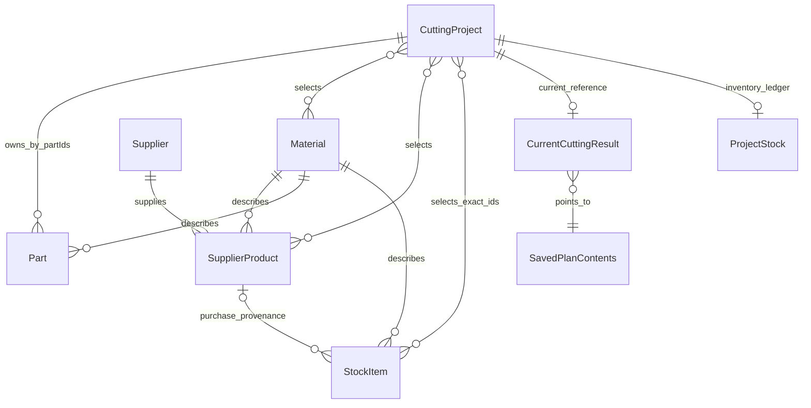

# Domain model and ownership

The runtime contracts are the strict Zod schemas in [src/domain/model](../src/domain/model/). This guide describes relationships; source schemas remain the exact field-level reference. See [persistence and JSON](persistence-and-json.md) for how records cross storage boundaries.

## Identity and physical dimensions

[ids.ts](../src/domain/model/ids.ts) defines branded, non-whitespace opaque IDs. They need not be UUIDs; application-created records generally use `crypto.randomUUID()` parsed through the corresponding ID schema. Never use display labels, material names or dimensions as identity.

[dimensions.ts](../src/domain/model/dimensions.ts) requires finite, strictly positive `lengthMm`, `widthMm`, `thicknessMm` on Part, SupplierProduct and StockItem. Width is not necessarily the shorter side. Thickness belongs to a physical item, not Material. [common.ts](../src/domain/model/common.ts) defines trimmed nonempty names up to 200 characters and positive integer quantities. Geometry has additional representable-range checks; a schema-valid tiny positive number can still fail conversion to a supported micrometre extent.

[compatibility.ts](../src/domain/compatibility.ts) requires identical Material IDs and **exact numeric thickness equality**. Two materials named MDF are not automatically interchangeable. Nominal 18 and 18.000001 mm are different thicknesses, even though placement geometry uses micrometre arithmetic. Grain/orientation and fit are separate checks.

## Entity relationships

The diagram expresses application relationships, not database foreign-key enforcement. Guarded services enforce references inside transactions.

| Entity | Important fields and lifecycle |
| --- | --- |
| [Material](../src/domain/model/material.ts) | `id`, `name`, `category`, optional `libraryPresetId`. A compatibility identity; preset is only local presentation identity. |
| [Supplier](../src/domain/model/supplier.ts) | Identity/name and optional absolute http(s) website. UI normalization accepts a domain before persistence. |
| [SupplierProduct](../src/domain/model/supplier-product.ts) | Supplier/material IDs, name, dimensions, grain, optional nonnegative unit `price`, required currency, optional product URL and retained availability enum. A reusable catalog reference, not owned inventory. |
| [Part](../src/domain/model/part.ts) | Name, material, dimensions, production quantity, grain and `rotation`. Ownership comes from a project's `partIds`, not a projectId on Part. |
| [StockItem](../src/domain/model/stock-item.ts) | `fullPanel` or `offcut`, material, dimensions, positive quantity, grain and explicit provenance. No general name field. |
| [CuttingProject](../src/domain/model/cutting-project.ts) | Name, optional trimmed description up to 2,000 characters, owned Part IDs, selected material/product IDs, optional distinct Stock IDs, cutting/PDF settings and legacy panel quantities. |

Empty descriptions and missing optional fields are valid. Missing price means unknown; explicit zero is a known zero price. Currency is a three-uppercase-letter code, not a full currency registry lookup.

## Project and Part ownership

[createProjectService](../src/application/projects/project-service.ts) exposes `parts(projectId)` for scoped Part operations. Creation/import/adoption update Part records and project `partIds` atomically. Updating project metadata cannot independently reassign Part ownership. Reads/writes reject cross-project ownership inconsistencies.

Part creation/editing requires membership in the project's selected materials, including materials of eligible selected source references. [part-materials.ts](../src/application/projects/part-materials.ts) centralizes this derivation. Removing a material choice does not silently delete existing Parts; the UI surfaces compatibility issues. Legacy Parts without a project owner remain unassigned until explicit adoption; simply opening a project must not claim them.

Project selection IDs express **intent**, not physical consumption or reservation. A stale selected Stock ID cannot establish ownership. The authoritative active allocation is `ProjectStock.consumed`; see [stock management](stock-management.md).

## Grain and orientation

[orientation.ts](../src/domain/model/orientation.ts) defines grain `none`, `length`, `width` and rotation `allowed` / `forbidden`. [getAllowedOrientations](../src/domain/geometry/part-orientation.ts) follows final grain alignment when both source and Part specify grain; that alignment takes precedence over legacy rotation preferences. A 90-degree turn swaps dimensions and the grain axis. If either grain is unspecified, the existing rotation preference governs.

Example: a length-grain Part on a width-grain source may require rotation, even if an old record stores rotation forbidden. A width-grain Part on a length-grain source cannot use a normal placement merely because its dimensions fit. Do not implement a separate UI-only interpretation of these constraints.

## Plans, placements and cuts

[panel-source.ts](../src/domain/optimizer/panel-source.ts) adapts StockItems into geometry-only sources with allocation key `stock:<stockItemId>` and a separate exact `stockItemId`. This is not a SupplierProduct insert. Catalog sources keep their product identity.

[PanelCuttingPlan](../src/domain/optimizer/plan-with-strategy.ts) contains a validated tree, placements, unplaced-copy ranges and area metrics. [ProjectCuttingPlan](../src/domain/optimizer/project-plan.ts) allocates panel copies and accounts for all demand globally. A placed copy is identified by Part ID and copyIndex; repeated names are harmless.

[cutting-tree.ts](../src/domain/cutting-tree/cutting-tree.ts) models full-region guillotine cuts with two child regions, Part leaves and waste leaves. Cut offsets and physical kerf derive child geometry. Collision-free rectangles alone do not prove an executable guillotine plan. [validateCuttingTree](../src/domain/cutting-tree/validate-cutting-tree.ts) independently verifies the tree; [validateProjectPlan](../src/domain/optimizer/validate-project-plan.ts) adds global copy/source-limit checks.

A waste leaf is not an automatically owned offcut. Eligible waste becomes an offcut candidate; only a persisted Keep decision causes physical creation. Edge trims and kerf are not reusable waste leaves.

## Persisted historical snapshots

[saved-cutting-plan.ts](../src/domain/model/saved-cutting-plan.ts) defines summary and compact contents. A `PanelSnapshot` stores historical identity, material, dimensions and grain, optionally exact Stock ID, but excludes current catalog price/URL/availability. Compact trees store cuts and leaf identities, not canvas coordinates; reconstruction recomputes and validates full regions.

[CurrentCuttingResult](../src/domain/model/current-cutting-result.ts) is one project-keyed reference to a saved plan, with a preserve-legacy flag. It does not contain rendered output or undo history. Historical Parts/source names and settings keep restored drawings meaningful after live catalog changes.

[ProjectStock](../src/domain/model/project-stock.ts) stores exact offcut entries, Keep/removed flags, original Stock snapshots, current consumption, append-only change records and a possible conflict. [CuttingConfirmation](../src/domain/model/cutting-confirmation.ts) retains immutable legacy physical-cutting receipts. These records remain meaningful after project deletion through a named audit entry.

## Provenance

Stock provenance is a strict discriminated union:

- `manual`: independently entered owned stock.
- `purchase`: exact `supplierProductId`.
- `cutting`: originating project/plan, panel and waste indices, and at least one exact source Stock ID or catalog product ID.

Dimensions cannot recreate that chain. Provenance exists to prevent duplicate consumption, unsafe reversals and circular reuse, not merely to display a source label.

## Persisted versus derived versus transient

Persisted: entity records, project settings/selections, compact plans, audit records, ordering metadata and Keep decisions. Derived: eligible sources, reconstructed regions, offcut candidates, utilization, material groups and purchasing rows. Transient: form drafts, active row, hover, panel collapses, temporary `Offcut N` labels and editor undo/redo.

Do not persist a derived label or preview as an inventory identity. Adding a field requires reviewing schemas, guarded repositories, snapshots, transfers and tests together; additive optional fields do not automatically require a Dexie store version.
