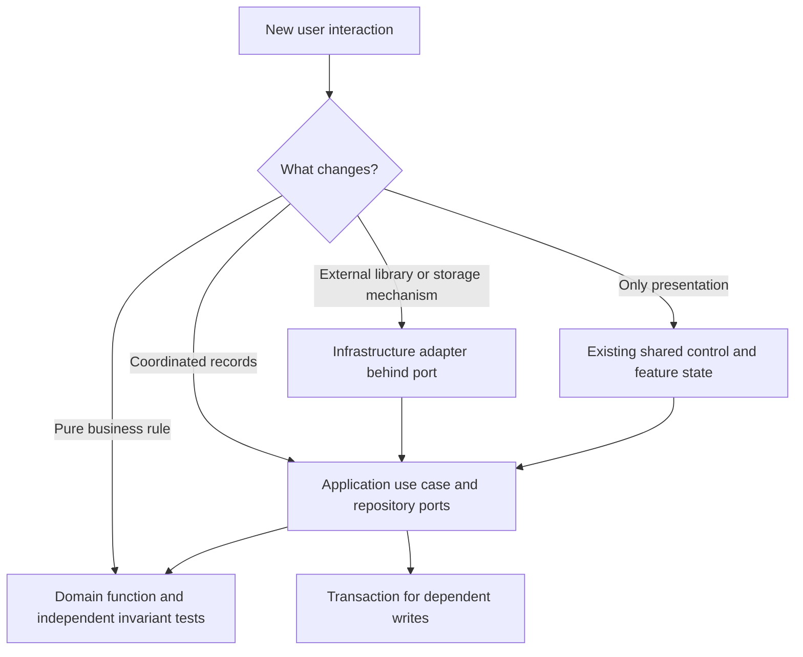

# Safe contribution guide

[Documentation home](README.md) / [Developer Guide](developer-guide.md) / Development & reference

These are developer procedures, not implemented new features. They apply the current [AGENTS.md](../AGENTS.md) constraints to the audited code. Start with [architecture](architecture.md), then identify the owning service and test boundary before editing. Obtain approval before changing fundamental architecture or domain invariants.

**On this page:** [Introduce a domain field](#introduce-a-domain-field) · [Add a Dexie table or migration](#add-a-dexie-table-or-migration) · [Modify an optimization rule](#modify-an-optimization-rule) · [Change stock reconciliation](#change-stock-reconciliation) · [Evolve a JSON exchange schema](#evolve-a-json-exchange-schema) · [Review and completion checklist](#review-and-completion-checklist)

## Introduce a domain field

1. Locate the owning Zod schema in [domain/model](../src/domain/model/). Add the field there and infer the type; do not create a second hand-maintained entity interface.
2. Decide absent/empty/null/zero/false behavior explicitly. Existing optional price distinguishes omitted from zero; Stock preference distinguishes omitted from false. Do not use a truthiness fallback when false or zero is meaningful.
3. Audit every complete-record constructor: form submission, fixture, adapter import, inline preset save, copy/remapping and snapshot creation. Generic update is full replacement, so omitted fields can be lost if callers reconstruct records carelessly.
4. Decide whether the field belongs in historical snapshots as well as the live entity. Current prices do not belong in PanelSnapshot; historical geometry/settings do. Avoid putting UI-only offcut labels or transient editor state into schemas.
5. Inspect strict stored reads. If existing records cannot satisfy the new schema, design an approved migration or backward-compatible optional read contract before shipping.
6. Review project/catalog/Stock/Parts exchange schemas independently. Many embed domain schemas, so a supposedly local field can change several portable boundaries. Parts rows are a separate shape and should not gain unrelated fields automatically.
7. Test old records with field absent, present valid values, invalid values, complete edit replacement, reopen and portable round-trip. Add a store version only if table/index or actual data migration requires it.

Relevant examples: optional project `description`, `cuttingSettings`, `pdfSettings`, SupplierProduct `price`, and optional `preferStockPanels`. Their absent-value rules differ; do not copy one blindly.

## Add a Dexie table or migration

Source: [local-database.ts](../src/infrastructure/persistence/local-database.ts), [repository ports](../src/application/persistence/repositories.ts), [storage reference](storage.md).

1. Define whether the new data is an entity, an embedded value, presentation metadata or derived state. Avoid a table for something already safely computed.
2. Add a typed repository to application ports and a strict runtime schema. Select primary key/indexes from actual query requirements; most current guards scan arrays/lists.
3. Append the next Dexie version declaration. Never edit shipped store declarations or remove/recreate a database. If data transformation is necessary, await it inside Dexie's upgrade transaction and preserve invalid/ambiguous data rather than silently discarding it.
4. Wire the repository in the adapter's scoped factory as well as the normal factory. A repository omitted from transaction scope cannot safely participate in multi-record writes.
5. Keep multi-record work inside `LocalPersistence.transaction`, using only supplied repositories. No outside persistence instance, network request or timer may escape into the callback.
6. Test from each affected old version with isolated `IDBFactory`: unchanged records, intended transformation, indexes, repeated reopen and forced migration failure preserving old version/data.
7. Document IndexedDB version separately from JSON format and package version. An additive table does not mean every exchange envelope becomes version 2.

**Recommendation:** narrow transaction scope only through an explicitly designed port change and regression coverage; current all-store transactions intentionally trade concurrency for simple consistent cross-record checks.

## Modify an optimization rule

1. Identify the rule's level. Compatibility/orientation belongs in shared domain helpers; single-panel strategy choice belongs in strategy code; whole-result Stock priority belongs in project candidate generation and comparison.
2. Read [plan-with-strategy.ts](../src/domain/optimizer/plan-with-strategy.ts), [optimize-panel.ts](../src/domain/optimizer/optimize-panel.ts), [optimize-project.ts](../src/domain/optimizer/optimize-project.ts) and both validators before changing a score.
3. Keep `largestAreaFirst` unchanged as required. New strategies join `PLACEMENT_STRATEGIES` and reuse splitting/validation. A ranking change requires updating root architecture decisions.
4. Use micrometre helpers. Never “fix” a fit by changing physical kerf, thickness or Part dimensions. Check grain in final panel axes, not only the stored rotation flag.
5. Preserve explicit demand, source provenance, finite physical limits, empty-panel rejection and global copy indices. No inventory read/write belongs inside placement search.
6. If changing final objectives, ensure candidate generation can actually propose relevant solutions. Document heuristic limits rather than claiming global optimality.
7. Test deterministic ties, exact-tree baseline, constrained rotations, insufficient supply, mixed sources, disabled preference, numeric boundaries and bounded termination. Inject a fake worker for application tests and verify main-thread revalidation.
8. Check saved-plan strategy enum/codec, worker guards, manual editor and PDF validation if output shape changes. Do not use UI-only scoring that cannot round-trip through these boundaries.

## Change stock reconciliation

Read [project-stock-service.ts](../src/application/inventory/project-stock-service.ts), [project-stock-availability.ts](../src/application/inventory/project-stock-availability.ts), [current-result-service.ts](../src/application/plans/current-result-service.ts), legacy [confirmation service](../src/application/inventory/cutting-confirmation-service.ts) and [project-deletion.ts](../src/application/projects/project-deletion.ts) together.

1. Define exact source/decision/physical IDs involved. Do not match by name, dimensions alone or temporary `Offcut N` labels.
2. Preserve live availability versus current-project active consumption. A selected ID/historical event does not prove current allocation, and own-project generated offcuts stay ineligible.
3. Compute desired state and validate every reversal/removal before physical writes. Preserve consumed/externally modified offcuts and surface conflicts instead of recreating inventory.
4. Apply result, source deltas, offcut changes and append-only movement records in one transaction. Repeated identical synchronization must add neither quantities nor movements.
5. Distinguish business conflict state from storage failure. Do not clear `conflict` simply because a repository call returned `ok: true`.
6. Preserve immutable receipts, audited plan origins and archived project identities. Review Keep versus Restore deletion and Stock exchange reserved-ID checks.
7. Add failure injection after earlier writes and verify complete rollback. Cover another project's selection/consumption, partial quantities, changed geometry, legacy receipts, repeated load/reoptimization and reload.

Never restore global stock merely to make a project selection warning disappear. Never infer that an offcut absent from the live table should be created again.

## Evolve a JSON exchange schema

1. Identify the exact format/envelope and its version field; Parts uses `version`, other transfers use `schemaVersion`, saved contents use `formatVersion`.
2. Review strict schema consumers, preview and transaction-time revalidation. A field optional in a form may still be required in the legacy portable contract (`availability`).
3. For additive optional fields, prove absent behavior and old file import. For incompatible semantics, design a versioned reader explicitly; current code has no migration registry.
4. Use the [proposed compatibility architecture](json-formats.md#proposed-compatibility-architecture--not-implemented) only as a proposal. Do not document or silently implement a converter that does not exist.
5. Preserve all identity relationships before/after remapping, including compact-tree Part references, historical source IDs and currentResultId. Physical Stock import intentionally refuses the project/catalog remapping policy.
6. Preview without writes, require explicit consent, then reread/revalidate/insert atomically. Export must not mutate business entities.
7. Maintain old-file fixtures and invalid cases. Test unknown fields, unsupported versions, duplicate IDs, reserved historical identities, matching versus conflicting snapshots and rollback.
8. State backup limitations. A new export field cannot repair missing inventory ledgers or turn a project transfer into a full application backup.

## Add a feature without breaking boundaries

Reuse typed injection keys/factories from main.ts rather than constructing services/DB in components. Scope project-sensitive services in ProjectWorkspace. Keep workers thin, heavy pure search in the domain, and Konva/PDF.js in presentation adapters. Follow shared AppButton/AppDialog/FormField/AppCheckbox semantics; preserve event isolation, visible focus and busy guards.

Choose state lifetime deliberately: ephemeral drafts in refs, reusable notifications in the existing Pinia store, business data in IndexedDB. A second global store for derived selection/group states invites drift. Subscribe to existing revision/lifecycle refresh mechanisms rather than adding polling.

For async features, identify cancellation ownership before coding: request IDs, revision counters, AbortSignals, pending transactions, component deactivation and resource cleanup do not all mean the same thing. Reject obsolete responses and invalidate queued writes as well as worker work. Keep output consumers from seeing an older “successful” plan after a failed replacement.

## Review and completion checklist

| Review question | Evidence to collect |
| --- | --- |
| Did identities/ownership stay correct? | Schema and guarded service tests, not just rendered labels |
| Are physical counts unchanged unless intended? | Stock table and ledger/receipt assertions across repeated operations |
| Is async failure recoverable? | Retained draft, Retry/discard behavior, stale response tests |
| Is the portable contract still readable? | Historical fixtures and post-remap validation |
| Is rendering still physically faithful? | Literal geometry expectations, uniform transforms, no visual widening of kerf |
| Did the change cross layers? | Imports, composition wiring and dependency graph review |
| Did documentation stay accurate? | Relative links, actual symbols, parsed Mermaid and updated discrepancy register |

Run the four required validation commands, inspect the staged diff, create one scoped local Conventional Commit only when checks pass, and never push. Do not install browser/system software without separate explicit approval. Stop after the requested task instead of starting an adjacent cleanup.

---

**Continue exploring:** [Validation conventions](testing.md) · [Contribution checklist](getting-started.md#contribution-workflow) · [Documentation home](README.md)
