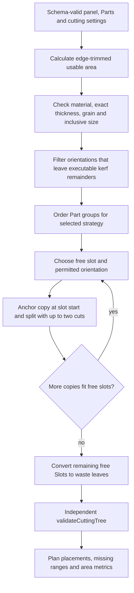
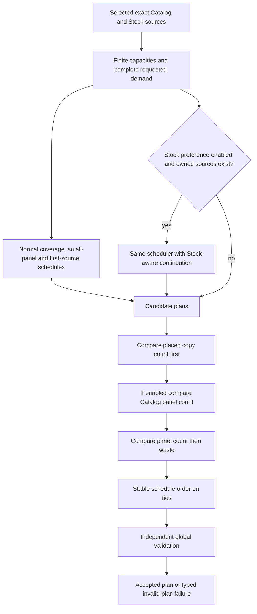
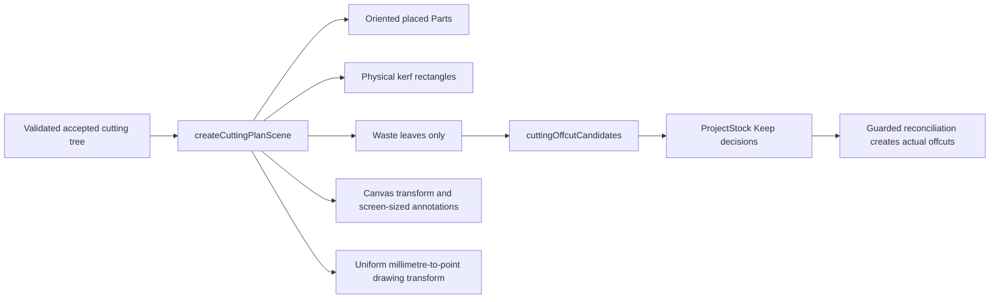

# Optimization, constraints and editing

Read the authoritative [algorithm rules](../AGENTS.md), especially the stable `largestAreaFirst` baseline. Optimization is pure and inventory-independent; persisting its accepted result is a separate inventory-affecting operation.

## Inputs and worker boundary

[OptimizationView.vue](../src/features/optimization/OptimizationView.vue), notably `readInputs` and `start`, rereads the project, owned Parts, selected SupplierProducts and project-aware Stock availability. It resolves historical labels for snapshots and rejects missing/broken source references rather than substituting similar panels.

[OptimizeProjectInput](../src/domain/optimizer/project-plan.ts) carries Parts, source records with finite internal quantities, and cutting settings. Catalog products remain catalog sources; [stockPanel](../src/domain/optimizer/panel-source.ts) creates a geometry-only `stock:<id>` allocation key carrying exact `stockItemId`.

[createOptimizationService](../src/application/optimization/optimization-service.ts) owns a worker port and request IDs. It returns typed outcomes rather than rejecting, supersedes/cancels obsolete work, validates responses and independently validates received plans. [optimization-protocol.ts](../src/application/optimization/optimization-protocol.ts) defines plain structured-cloneable messages and guards. [handleOptimizationRequest](../src/workers/optimization/handle-optimization-request.ts) delegates to domain algorithms; it never selects inventory, saves records or implements alternate placement logic.

## Automatic supply preparation

There are no user-configured source quantities. Legacy `CuttingProject.panelQuantities` is still parsed but is not the new-run supply policy.

- Catalog reference capacity is [catalogPanelSupply(parts)](../src/application/optimization/catalog-panel-supply.ts), the safe-integer sum of requested copies. This is a sufficient finite bound because every allocated panel must place at least one remaining copy.
- Stock capacity is the real available quantity, plus only the current project's active consumed allocation when rerunning. Sources are ordered by stable StockItem ID before optimization so availability read order cannot change physical identity tie-breaks.
- Current-project generated offcuts are excluded by exact cutting provenance. Eligible other-project offcuts are normal owned candidates.
- `unavailable` legacy catalog products remain disallowed. Prices are not costs in optimization.

This avoids unbounded catalog search while never treating physical Stock as unlimited.

## Single-panel engine

[planWithStrategy](../src/domain/optimizer/plan-with-strategy.ts) uses shared integer geometry and guillotine splitting. Current strategies are `largestAreaFirst`, `longestSideFirst`, `bestShortSideFit`. They differ in deterministic demand/region choices, not in validation rules. Do not change the baseline opportunistically while adding another strategy.

[optimizePanel](../src/domain/optimizer/optimize-panel.ts) runs all strategies and ranks valid candidates by:

1. Fewer unplaced copies.
2. Greater used area on this panel.
3. Larger single reusable waste region.
4. Declared strategy order.

Invalid trees appear as rejected candidates and never win. No valid usable region produces a typed failure, not an invented placement.

## Multi-panel schedules and Stock preference

[optimizeProject](../src/domain/optimizer/optimize-project.ts) reuses the single-panel engine inside deterministic greedy schedules. Normal candidates include maximum-copy coverage, smaller-panel selection and each possible first-source seed. Each allocation consumes only an internal source counter and advances explicit Part copy indices.

With `preferStockPanels !== false` and owned sources present, the same scheduler additionally evaluates Stock-aware coverage/small-panel schedules and Stock-aware continuations from each first-source seed. Owned means validated Stock identity, not a name such as “Stock panel.”

Final comparison is lexicographic:

1. Maximize produced copies, so a less complete plan cannot win by avoiding Catalog.
2. When preference is enabled, minimize the number of allocated Catalog panels.
3. Minimize allocated panel count.
4. Minimize waste area.
5. Retain stable candidate order for ties.

Disabling preference runs normal candidates/ranking without an explicit source bias. This is **not a small utilization bonus**, monetary objective or absolute instruction to use every available StockItem. Among evaluated complete solutions, zero Catalog beats one Catalog even if the owned panel is larger.

Example regression: selected Catalog 800 × 400; two distinct StockItems 800 × 600; two compatible 200 × 400 Parts, kerf/margin permitting both layouts. Enabled preference chooses one owned panel and no Catalog panels; the second physical identity is unused. Disabled preference may choose Catalog for lower waste. See [optimize-project.spec.ts](../src/domain/optimizer/__tests__/optimize-project.spec.ts).

### Search limitations and termination

This is not exhaustive packing or a proof of globally minimum Catalog count. A schedule greedily continues after its first source and cannot explore every placement/allocation sequence. At most `2n + 4` schedules are constructed when preference is active for `n` sources; each loop either places at least one remaining copy or stops. Supply is finite and there are no empty allocated panels. Large safe-integer quantities are still potentially expensive: numeric validity is not a performance guarantee.

## Geometry and independent validation

[units.ts](../src/domain/geometry/units.ts) rounds supported millimetres to integer micrometres (0.001 mm). Arithmetic and region comparisons use these helpers. Range errors are distinct from expected “does not fit” outcomes. Validators use nonthrowing conversion and accumulate located issues for malformed external data.

[rect.ts](../src/domain/geometry/rect.ts) removes the edge margin from each side; that margin includes its trim cut. Internal splits account for physical kerf between child regions. A remainder cannot silently absorb an impossible kerf. Material identity and exact thickness are checked separately from 2D geometry.

[getAllowedOrientations](../src/domain/geometry/part-orientation.ts) applies final grain-axis compatibility when both grains are specified, overriding stale rotation preferences where needed. When either grain is `none`, rotation policy applies. Shared fit, optimizer, editor and validators must use this same rule.

[validateCuttingTree](../src/domain/cutting-tree/validate-cutting-tree.ts) checks executable full-region guillotine structure, regions, leaves, compatibility, orientation and copy accounting. [validateProjectPlan](../src/domain/optimizer/validate-project-plan.ts) additionally checks global quantities, source panel limits and allocations. A nonoverlapping picture is insufficient proof of manufacturability.

## Outputs and utilization

[ProjectCuttingPlan](../src/domain/optimizer/project-plan.ts) explicitly returns allocated panels, global unplaced copy ranges/reasons and metrics. Reasons distinguish no compatible source, constraints preventing fit, and finite capacity/usable-space limits. Per-panel `allocatedElsewhere` demand describes copies made on other panels; it is not globally unplaced demand.

Used area sums finished placed rectangles. Panel area uses full physical panel dimensions; waste is panel area minus placed area, so trims and kerf contribute to utilization loss rather than becoming reusable offcuts. Overall utilization is `usedArea / panelArea * 100`, not an average of panel percentages; an empty result uses zero.

## Editing, annotations and persistence

[editCuttingTree](../src/domain/cutting-tree/edit-cutting-tree.ts) performs immutable constrained rotate/swap operations. Rotation may recut only an anchored reserved region; swaps require exact permitted fits within existing regions. Both original and candidate trees are validated. Rejection leaves the old tree unchanged.

[plan-editing-session.ts](../src/application/optimization/plan-editing-session.ts) maintains isolated baseline/current/undo/redo state. [plan-canvas.ts](../src/features/optimization/viewer/plan-canvas.ts) handles presentation; dragging pans, not free part relocation. The accepted edited plan participates in current-result persistence and PDF snapshots, never by mutating the baseline.

[cutting-plan-scene.ts](../src/application/optimization/cutting-plan-scene.ts) derives parts, waste and physical kerf rectangles from a validated tree. [plan-canvas.ts](../src/features/optimization/viewer/plan-canvas.ts) scales those rectangles with panel geometry; zero-width/height kerfs get a 0.75-pixel screen-space stroke for visibility. The current `--cutting-kerf` token in [styles.css](../src/app/styles.css) is brown in light/dark themes, not red. There is no separate red centerline renderer in the current implementation. Piece boundaries use their own palette entry and are not interpreted as additional cuts.

[dimensions.ts](../src/features/optimization/viewer/dimensions.ts) always draws overall dimensions and optionally selected-copy oriented dimensions/X/Y positions from the panel origin. Annotation strokes/text are screen-sized and noninteractive. It does not invent a selected-cut concept or cutting sequence. Fit reserves annotation lanes; ordinary editing does not reset manual zoom.

[Current-result service](../src/application/plans/current-result-service.ts) validates/encodes and atomically replaces the current snapshot while reconciling inventory. Legacy/audited plans are retained. Cancellation and project changes invalidate stale queued writes; failed persistence must not expose an older plan as the current export. See [stock management](stock-management.md) and [testing](testing.md).

## Algorithm data structures and phase boundaries

| Structure | Owner | Meaning |
| --- | --- | --- |
| `PartGroup` | `plan-with-strategy.ts` build phase | One Part, permitted fitting orientations and nextCopyIndex; copies expanded lazily |
| `Slot` | Strategy build phase | Rect, monotonically assigned sequence, and null/Part/cut content |
| Free stack or free-slot array | Strategy build phase | Available guillotine regions; not arbitrary empty polygons |
| `PlacedPart` | Derived accepted plan | Part/copy identity, orientation, exact region and oriented dimensions |
| `UnplacedParts` | Single-panel plan | Compact firstCopyIndex/count range and typed local reason |
| `AllocatedPanel` | Project plan | Exact source allocation key, panelCopyIndex, chosen strategy and validated plan |
| `offsets` / `usage` | Project schedule | Global produced-copy offset per Part and used count per source |
| `Range` | Independent project validator | Compact copy coverage, checked for gaps/overlaps without expanding every missing copy |

[planWithStrategy](../src/domain/optimizer/plan-with-strategy.ts) builds mutable Slots internally, then emits an immutable-style discriminated tree. These build structures are not persisted or sent to Vue. The worker response contains plain completed-plan data, not live Maps of canvas objects.

### The three placement strategies, precisely

`largestAreaFirst` and `longestSideFirst` are region-driven. A stack begins with the usable root; each popped region tries remaining Part groups in the strategy's order, then their allowed orientations. It places the first fitting copy. Equal Part sort keys retain input order; orientation order starts with normal. New remainder slots are pushed so depth-first fill visits the strip beside the Part before the larger remainder.

`largestAreaFirst` sorts descending nominal area then longest side. `longestSideFirst` sorts descending longest side then area. Neither sorts by product price or material name.

`bestShortSideFit` is Part-driven in largest-area group order. For each next copy, it scans current free slots and orientations, minimizing short-side leftover, then long-side leftover. Strict comparison preserves the earlier slot/orientation on ties; free slots are ordered by creation sequence after placement. It is not an arbitrary free-space polygon packer or a new cutting-tree validator.

For any selected slot/orientation, `place()` compares the largest residual rectangle available under length-first versus width-first cuts. Ties favor length-first. A copy is cut from the slot start corner, not centered. Exact-fit axes need no cut; other axes use shared `splitRect`. This is why later free movement of a rectangle would not be a safe manual edit.

### Fit is not executable placement

`checkPartFit` deliberately excludes kerf: it asks whether an oriented finished rectangle fits the empty trimmed panel. Strategy `fitsAlongAxis` then requires either exact match or `sizeUm + kerfUm < extentUm`. The independent tree validator also requires strictly positive second regions.

Concrete example with origin `(0, 0)`, region 800 × 600 mm, a length-axis cut at 200 mm and kerf 3 mm:

- First region: `(0, 0, 200, 600)`.
- Removed kerf: length interval `[200, 203)` across the region's full width.
- Second region: `(203, 0, 597, 600)`.

A 798 mm finished length fits an 800 mm empty panel geometrically, but cannot be freed by a 3 mm separating cut with a positive remainder. It is reported as `remainderNarrowerThanKerf`, not silently shrunk or “fixed” by changing kerf. Margin is independently deducted from both sides before these operations.

## Project candidate generation and ranking trace

Inside each schedule, every remaining source is evaluated by `optimizePanel` on remaining demand. Exhausted/unavailable sources and candidates with zero placements are discarded. A specified first-source seed is honored only when a valid fitting candidate exists. Stock-aware continuation then orders owned candidates first; coverage schedules compare placed-copy count while small-panel schedules compare panel area, followed by unused area and original source index.

This local continuation rule is only candidate construction. The **complete candidate** is ranked afterward by the lexicographic objective described earlier. Keeping both normal and Stock-aware schedules avoids reducing the feature to a single blindly selected first Stock panel, but it remains greedy within each schedule.

Per-Part offsets are added back to every local tree leaf/placement when a panel is allocated. Per-source usage becomes panelCopyIndex. Thus two panels can each produce a “first remaining” local copy without both claiming global copy zero.

At most `n + 2` normal schedules, or `2n + 4` with Stock schedules, are evaluated for `n` sources. That is a count of schedules, **not linear total runtime**: each schedule repeatedly evaluates available sources using all placement strategies and remaining demand. Demand size, free regions and validators contribute additional work. There is no arbitrary iteration cap, but a schedule stops when no source places a copy and each accepted iteration reduces remaining demand.

## Independent global validation details

[validateProjectPlan](../src/domain/optimizer/validate-project-plan.ts) treats trees as authoritative, not response metrics or placement arrays. It:

1. Rejects duplicate input source/Part identities.
2. Resolves each allocated source; checks availability, strategy, safe panelCopyIndex, capacity and reused allocation key.
3. Validates each cutting tree, traverses Part leaves and rebuilds oriented placements.
4. Rejects empty panels and mismatched placement arrays/per-panel metrics.
5. Combines placed singleton ranges and global unplaced ranges; sorted ranges must cover every requested copy exactly once.
6. Checks each per-panel summary covers all demand and distinguishes allocatedElsewhere from genuinely unplaced ranges.
7. Recomputes full-panel/used/waste areas, counts and utilization; reported metrics must match.

Worker validation, saved-plan reconstruction and PDF preparation reuse these checks. A protocol envelope guard alone is insufficient. Some low-level APIs assume schema-valid unique context Parts and throw on programmer misuse; the application/worker boundaries catch/translate these failures.

## Offcuts, editing history and visual transforms

Rotation candidate regions are constrained ancestors sharing the selected leaf's anchor and containing no other finished Part that would be displaced. `trimmedLeaf` recuts with shared geometry; a swap instead preserves existing regions and tries compatible exact-fit orientations. [PlanEditingSession](../src/application/optimization/plan-editing-session.ts) keeps a cloned baseline, history array and cursor; a new successful edit removes the future redo branch, while reset returns to baseline through the editing API.

UI zoom is pixels per mm plus translation in [viewport.ts](../src/features/optimization/viewer/viewport.ts). Detailed dimension lanes use fixed screen-space insets and inverse transforms; they are annotations, not changed geometry. Stock inspection reuses rendering with offcut focus, but does not add free resizing/edit semantics.

## Verified limitations and extension hazards

- The best single-panel packing for the local ranking is the one returned to the project scheduler; alternative internal packings are not all searched globally.
- A minimum-Catalog solution can exist outside evaluated greedy schedules. The enabled option enforces priority among evaluated candidates, not mathematical optimality.
- Safe-integer coordinate conversion does not by itself bound all squared-area products to safe integer range. `areaUm2` multiplies integer extents using JavaScript numbers; extremely large accepted extents deserve explicit numeric-limit review before expanding domain ranges.
- Very large valid demand can be computationally expensive and rendered output can be large. Worker cancellation uses termination, not cooperative checkpoints inside the synchronous algorithm.
- Historical diagnostics are compact; reconstruction can distinguish saved specific reasons but does not invent a full manufacturing sequence.

Before changing scoring or adding a strategy, follow [maintenance](maintenance.md#modify-an-optimization-rule) and update authoritative decisions where required.
