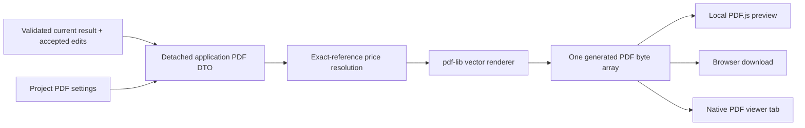

# PDF document generation

PDFs are generated locally with pdf-lib and previewed from the actual bytes with PDF.js. Technical drawings remain vector paths, text, arrows and hatching. Cover images are the only optional user-provided raster content. No screenshot concatenation or external rendering service is involved.

## Boundaries and generation flow

[cutting-plan-pdf-service.ts](../src/application/export/cutting-plan-pdf-service.ts) defines detached document DTOs and the renderer port. It independently validates trees/global copy accounting before calling infrastructure and returns typed generation failures. [cutting-plan-scene.ts](../src/application/optimization/cutting-plan-scene.ts) derives geometry shared with interactive presentation.

[OptimizationView.vue](../src/features/optimization/OptimizationView.vue) supplies the current accepted displayed layouts, including manual edits, only after result persistence is safe. [CuttingPlansWorkspace.vue](../src/features/optimization/CuttingPlansWorkspace.vue) coordinates current settings, generation, cancellation, preview and output.

Neither preview nor generation/print/download consumes stock. Current-result persistence has already performed inventory reconciliation through a different application boundary.

## Document settings and cover

[PdfSettings](../src/domain/model/pdf-settings.ts) belongs to CuttingProject: optional A4/A3, portrait/landscape, title override, description and cover image. Missing orientation defaults to Portrait at use time. Existing explicit Landscape is preserved, including in project JSON. Settings writes reread the project and serialize through the project service, preserving unrelated selections/ownership.

Document title defaults to project name; override affects PDF cover/metadata, never renames the project. Clearing the override restores fallback. Description is optional, multiline and bounded to 2,000 characters. [cover-page.ts](../src/infrastructure/pdf/cover-page.ts) measures/wraps it in gray italic text, preserves meaningful line breaks and fits only present content as a balanced block. There is no empty image placeholder or obsolete OptiCutList/Cutting plans heading above the title.

[cover-image.ts](../src/infrastructure/pdf/cover-image.ts) validates PNG/JPEG decoding, 2 MB maximum and 40 megapixels. One bounded MIME/base64 payload persists in PDF settings; a transient data URI supplies the sidebar preview. Temporary object URLs are never stored. New selections/removal invalidate obsolete reads. Import schema checks signatures/size, while actual decoding still detects corrupt payloads at generation. Replace/Remove remain recovery options.

The sidebar uses full-width title and four-line textarea, horizontal contained image preview/actions, segmented paper/orientation controls and equal-width Print/Download actions. Scaling is automatic, not an editable field. No drawing settings are persisted in cover image data.

Long text is measured and may shrink within supported readable limits. Impossible cover content produces an actionable shorter-text/larger-paper error rather than clipping or silently discarding it.

## Page composition

[generateProjectCuttingPdf](../src/infrastructure/pdf/cutting-plan-pdf.ts) builds one document in this order:

1. Cover.
2. Fabrication schedules: complete Parts list, materials/purchasing and panel inventory; unplaced demand when present.
3. Individual Part drawing grid pages.
4. One cutting drawing per allocated physical/planning panel, with part-list continuation pages when needed.

Sheet numbers are filled after all pages are generated, including continuation pages. The cover has no technical title block but counts in document page numbering. Part/reference codes derive from document Part order and copy indices; technical pages do not show raw database UUIDs.

### Fabrication schedules

[pdf-table.ts](../src/infrastructure/pdf/pdf-table.ts) measures column widths/text and whole-row heights, repeats headers after page breaks and reserves footer space. Fabrication styling uses grayscale hierarchy: medium-light column headers, bold gray parent panels, white normal/indented child rows and thin separators, without position-based zebra striping. Parents can be kept with the next child where possible.

Purchasing groups allocated source identities and counts actual used panels. [resolveProjectPdfPricing](../src/application/export/project-pdf-pricing.ts) obtains current catalog prices by exact catalog identity or purchase/cutting stock provenance, including safe ancestor traversal. Missing/cyclic/unavailable ancestry cannot establish a price. It never matches material/dimensions or invents historical costs. A consumed source that is absent from the live stock repository can limit ancestry resolution; no price-history reconstruction is implemented.

[purchasing-schedule.ts](../src/infrastructure/pdf/purchasing-schedule.ts) computes known unit totals and currency-separated sums. Unknown remains N/A, never zero. The visual summary is a compact right-aligned **TOTAL:** block; when unknown prices exist the numeric sum is only known prices, even though no “known only” note is printed. It is not a complete purchase valuation or optimizer cost function.

### Individual Part drawings

[part-drawing-grid.ts](../src/infrastructure/pdf/part-drawing-grid.ts) creates two columns with up to three rows, depending on orientation/usable height. Partial pages keep the capacity-derived cell size; they do not stretch one or two drawings to fill the sheet. [part-drawings.ts](../src/infrastructure/pdf/part-drawings.ts) centers each nominal Part drawing with independent fit scale, name/thickness, extension lines, arrows and exact millimetre labels. Thin internal grid rules are lighter than the outer frame.

One shared bottom title block per page shows actual project identity, UNITS / Millimeters (mm), SCALE N/A and final SHEET number. There are no per-Part metadata/title-block tables or large page heading bands. Independent cell scale does not change physical dimensions.

### Cutting panel drawings

[panel-drawing.ts](../src/infrastructure/pdf/panel-drawing.ts) draws the validated panel, placed Parts, true oriented dimensions, grain and waste-only hatching. It reserves dimension clearance and title assembly height before choosing scale. [panel-title-block.ts](../src/infrastructure/pdf/panel-title-block.ts) adds a full-width nomenclature directly above the shared technical strip: panel reference/material with dimensions right-aligned, then indented Part references/names with complete oriented dimensions and thin separators. Source Stock/Catalog provenance is omitted from this label.

Rows use their measured heights; extra Parts continue on paginated detail sheets rather than becoming unreadably small or disappearing. Continuation sheets retain technical settings, scale and numbering. No cutting sequence is inferred from decorative borders.

## Shared technical strip

[technical-title-block.ts](../src/infrastructure/pdf/technical-title-block.ts) is the single four-cell renderer:

`PROJECT | CONTEXT | SCALE | SHEET`

The strip is 52 PDF points high, inside the shared frame (28-point side inset, 36-point bottom). Context width is 145 points; SCALE/SHEET are 72.5 points each; project receives remaining width. Grayscale lines/padding/typography are shared. Project text wraps to at most three lines, with bounded truncation for exceptionally long names. SCALE/SHEET label-value pairs are centered horizontally and vertically; sheet values are deferred and bold.

Schedules and cutting sheets use CUTTING SETTINGS / kerf / edge margin; individual drawings use UNITS. Schedules/individual scales are N/A; cutting drawings use their actual calculated print scale. Only cutting drawings have the adjacent nomenclature assembly.

## Coordinates, scales and supported paper

[pdf-layout.ts](../src/infrastructure/pdf/pdf-layout.ts) converts millimetres to PDF points (72 points/inch) and applies uniform scale with PDF's bottom-up coordinate system. [technical-drawing.ts](../src/infrastructure/pdf/technical-drawing.ts) selects a conventional print scale that fits actual available drawing bounds; drawings are never stretched in one axis. Dimensions report source millimetres, not measurements estimated from pixels.

A4/A3 Portrait and Landscape use the same measured layout helpers. Font/column/row overflow is reported where it cannot safely fit rather than clipping geometry. Printing at Actual size / 100% is required to preserve a labeled physical scale; browser “fit” options can rescale an otherwise correct PDF.

## Preview, download and print resources

[pdf-preview.ts](../src/features/optimization/pdf-preview.ts) lazily imports PDF.js and uses its Vite-bundled local worker. It passes detached bytes, cancels obsolete loads/renders, cleans pages and destroys obsolete documents/workers. Preview raster canvases are UI output only; the exported bytes stay vector.

Download and Print share the generation pipeline/current configuration and use busy guards/spinners. Browser handoff success shows no toast claiming disk saving. Errors are retryable and use persistent error toasts where appropriate.

[pdf-print-view.ts](../src/features/optimization/pdf-print-view.ts) opens a tab synchronously from the click to avoid asynchronous popup blocking, clears opener, then embeds the generated Blob URL in a native PDF viewer. Users print there; automatic print dialog behavior is not guaranteed. A blocked/closed tab produces an actionable error. The viewer owns URL cleanup on pagehide and survives SPA workspace navigation once ready; pending tabs close on cancellation/failure.

Download removes its temporary anchor and revokes the URL after a bounded grace period/document exit because browsers expose no reliable download-completion event. Do not revoke an output URL immediately after handing it to a browser consumer.

## Known limits and verification

Built-in Helvetica/WinAnsi does not encode arbitrary Unicode; unsupported text yields an explicit error instead of silently substituted characters. Portrait/landscape structural tests do not replace print QA. Native viewer support, popup policy, device margins and actual print scaling require manual browser/printer verification. Source prices are current references, not recorded acquisition costs. See [PDF regression suites](testing.md#pdf-and-browser-boundaries).
