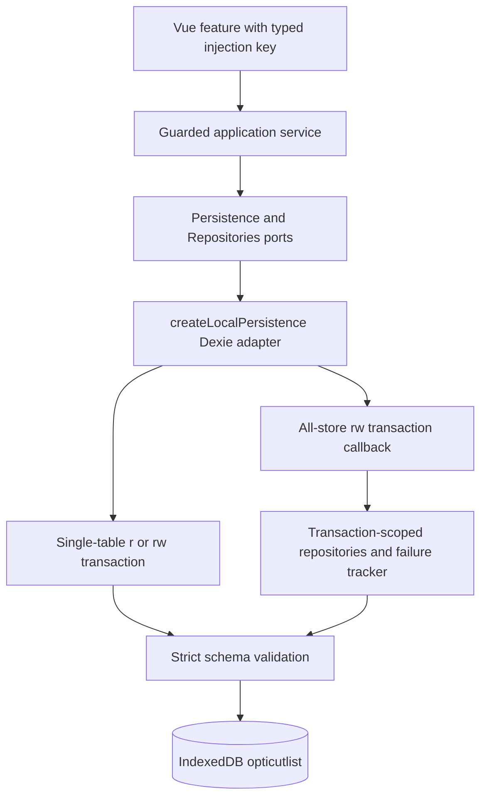
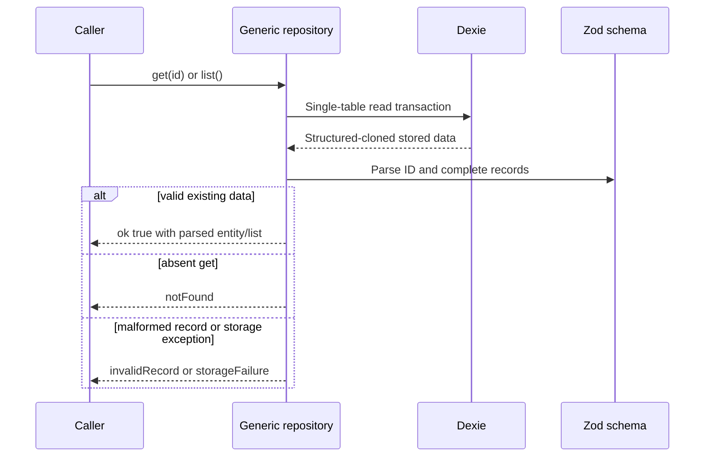
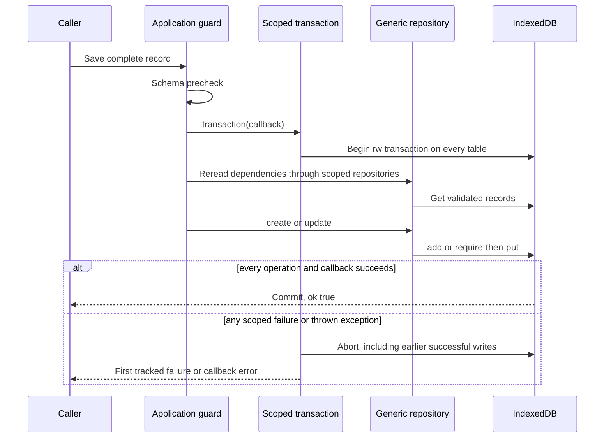
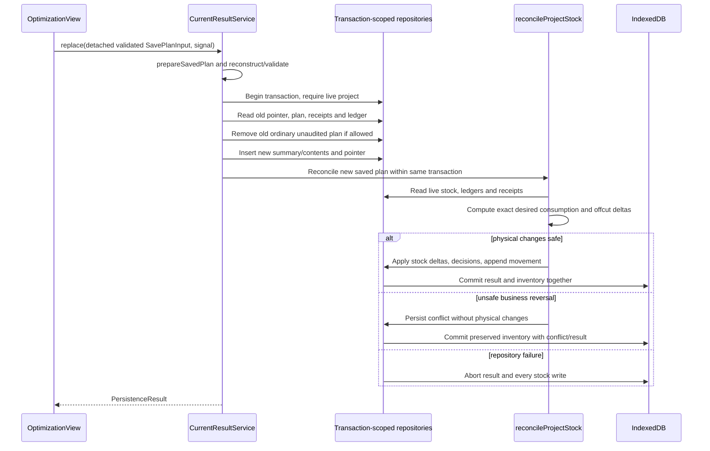
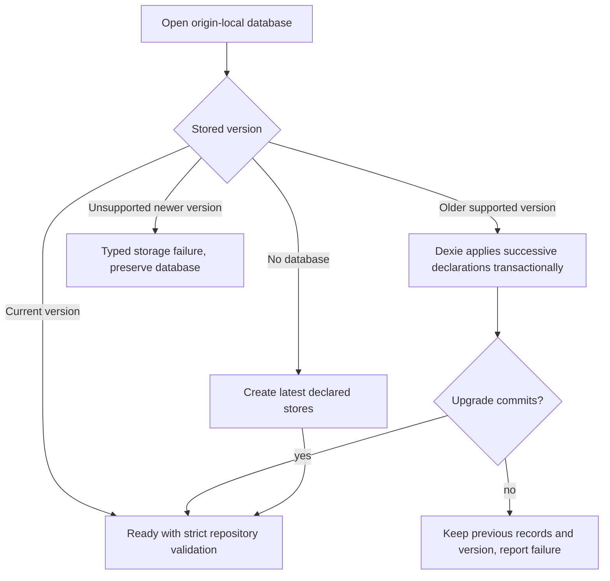
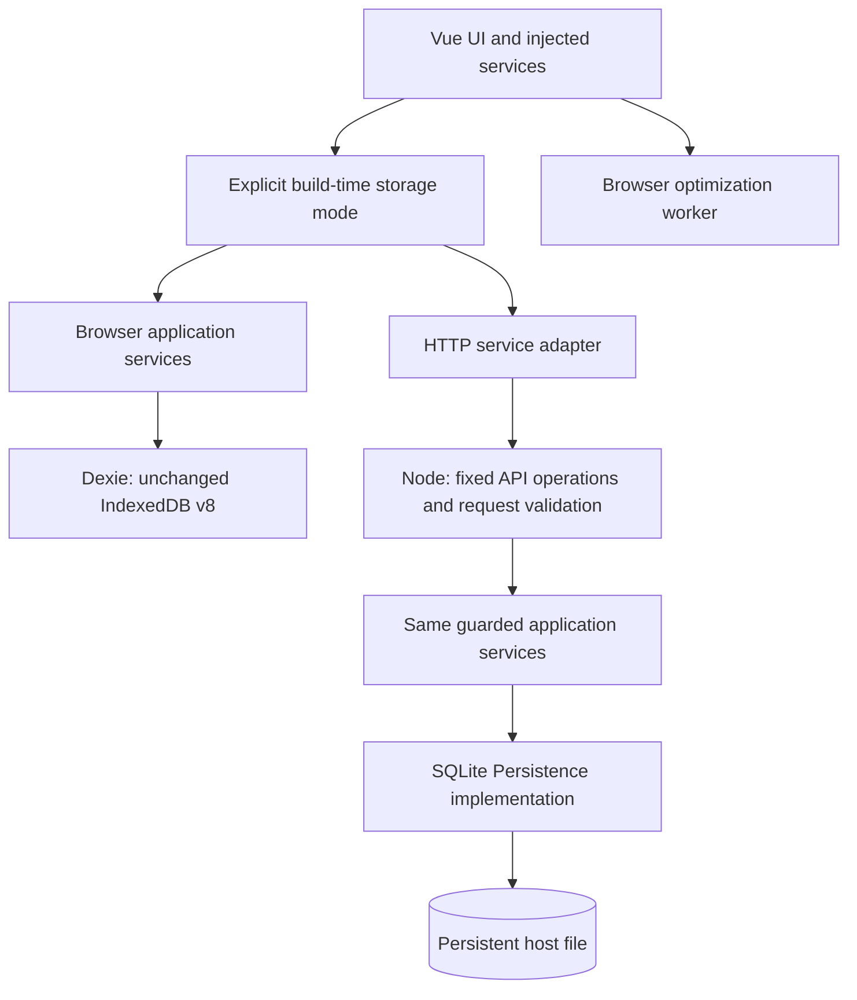

# Persistence backends and browser storage

[Documentation home](README.md) / Data & persistence

This is the physical-storage companion to [persistence and JSON](persistence-and-json.md). Exact contracts are [Repositories / Persistence](../src/application/persistence/repositories.ts), [local-database.ts](../src/infrastructure/persistence/local-database.ts) and the linked schemas below. Relationships are application-enforced; IndexedDB has no foreign-key or automatic cascade rules here.

**On this page:** [Docker & Portainer](#standalone-docker-deployment) · [Self-hosted deployment & API](#self-hosted-storage) · [Storage deployment modes](#storage-deployment-modes) · [Adapter construction and transaction architecture](#adapter-construction-and-transaction-architecture) · [Complete table catalog](#complete-table-catalog) · [CRUD read/write mechanics](#crud-readwrite-mechanics) · [Atomic write sets](#atomic-write-sets) · [Versions: three separate axes](#versions-three-separate-axes) · [Deletion and recovery boundaries](#deletion-and-recovery-boundaries)

## Storage deployment modes

The default browser adapter is unchanged: IndexedDB database `opticutlist`, schema v8, existing keys and strict domain validation. Application services use [Persistence / Repositories](../src/application/persistence/repositories.ts), not Dexie. `LocalPersistence` remains a compatibility alias.

[createConfiguredStorage](../src/app/persistence.ts) selects service execution at bootstrap. Unset/`browser` `VITE_STORAGE_MODE` uses local services and Dexie; `server` uses HTTP adapters to the same guarded services running beside SQLite. Unknown configuration and server failures never fall back to browser storage. `npm run build` remains the static application; `npm run build:self-hosted` explicitly builds the server deployment. There is no hostname detection or user toggle.

The optional Node service, SQLite schema, transaction scopes, shared ownership, backup procedure and no-auth security restrictions are documented in [Self-hosting](storage.md#self-hosted-storage). Browser data is still origin/profile-local. Switching modes does not upload or synchronize it. Existing JSON transfers remain partial exchanges, not complete inventory/audit backups.

Theme preferences remain device-local; navigation and editor state remain transient. Project cutting/PDF settings and cover data follow the configured project persistence. The remainder of this page describes **the browser adapter**, including its independent migration history.

## Adapter construction and transaction architecture

`createLocalPersistence(name = DATABASE_NAME, options?: DexieOptions)` constructs an independent Dexie connection; it is not a singleton. Options allow isolated IndexedDB factories in tests. [Startup selection](../src/app/persistence.ts) creates the production browser instance for `main.ts`; `main.ts` closes it when the app unmounts. Repositories can cause Dexie to open lazily; `open()` is an explicit typed-result API, not a mandatory call before every method.



The generic adapter enforces record validity, ID stability and insert/update semantics. It does **not** itself know Part ownership, supplier deletion dependencies or stock reversibility. Those checks belong in guarded application use cases. Calling raw CRUD from a new feature would bypass them even though Zod parsing still passes.

## Complete table catalog

Every key is the record's `id`, with no auto-increment or compound primary key. Only two secondary indexes are declared. Arrays such as `partIds` are not indexed.

| Table | Primary key | Secondary indexes | Record and purpose | Lifecycle |
| --- | --- | --- | --- | --- |
| `materials` | MaterialId | None | [Material](../src/domain/model/material.ts), compatibility identity and optional preset | Shared; deletion checks selected materials, Parts, products and stock |
| `parts` | PartId | None | [Part](../src/domain/model/part.ts), finished demand | Owned through `projects.partIds`; legacy unassigned records remain |
| `suppliers` | SupplierId | None | [Supplier](../src/domain/model/supplier.ts), supplier metadata | Shared; products block deletion |
| `supplierProducts` | SupplierProductId | None | [SupplierProduct](../src/domain/model/supplier-product.ts), external planning reference | Shared; project choices and purchase-stock provenance block deletion |
| `stockItems` | StockItemId | None | [StockItem](../src/domain/model/stock-item.ts), currently owned available quantity | Depleted records may be deleted; exact historical snapshots remain elsewhere |
| `projects` | CuttingProjectId | None | [CuttingProject](../src/domain/model/cutting-project.ts), ownership, selections, settings | Guarded create/update; coordinated deletion |
| `savedPlanSummaries` | SavedCuttingPlanId | `projectId` | [SavedPlanSummary](../src/domain/model/saved-cutting-plan.ts), name/owner/date | Current, legacy and audited origins |
| `savedPlanContents` | SavedCuttingPlanId | None | [SavedPlanContents](../src/domain/model/saved-cutting-plan.ts), compact validated historical payload | Same identity as summary; deleted together where safe |
| `cuttingConfirmations` | SavedCuttingPlanId | `projectId` | [CuttingConfirmation](../src/domain/model/cutting-confirmation.ts), immutable legacy receipt | Retained across project deletion |
| `currentCuttingResults` | CuttingProjectId | None | [CurrentCuttingResult](../src/domain/model/current-cutting-result.ts), planId and preserveLegacy | At most one pointer per project |
| `projectStock` | CuttingProjectId | None | [ProjectStock](../src/domain/model/project-stock.ts), decisions, active consumption, embedded movements/audit | Preserved as named audit after deletion |
| `stockOrders` | MaterialId | None | [StockOrder](../src/application/inventory/stock-order.ts), ranked Stock IDs | Presentation metadata; stale IDs ignored by sorting |
| `catalogOrders` | SupplierId | None | [CatalogOrder](../src/application/catalog/catalog-order.ts), ranked product IDs | Presentation metadata; per-material views filter supplier-wide order |

A `StockMovement` concept exists as embedded ProjectStock movement records and receipt arrays; there is **no standalone stockMovements table**. Similarly, offcut decisions are embedded entries, not an independent offcuts store. Do not add direct table lookups for conceptual entities that are stored as snapshots.

### Physical relationship diagram

Dashed/historical references below can outlive their live record. `snapshot_arrays` means embedded values, not normalized child tables.


IDs in source snapshots are not necessarily live catalog foreign keys: a Stock allocation uses a branded-compatible `stock:<id>` key plus exact StockItem ID. The historical Part array in saved contents is independent of live `parts` ownership.

## CRUD read/write mechanics

`createRepository` validates unknown input with the supplied schema. `get` validates the ID, checks existence and parses the stored record. `list` reads in primary-key order (`orderBy(':id')`) and parses every record; it fails the entire operation on any corrupt row. It never filters corruption away.



Create uses `add()` and maps ConstraintError to `duplicateId`, so concurrent creation never overwrites. Update parses the new record and ID, requires matching identity, rereads the previous record to confirm existence/validity, then `put()` replaces the full record. Delete requires a valid existing record before removal. No patch API, automatic relationship repair or upsert is exposed.



`find` on projectStock/currentCuttingResults/cuttingConfirmations returns successful null for absence, unlike generic `get`. Project-scoped summary/receipt reads use `projectId` indexes; summaries are explicitly sorted by createdAt then ID. Most reference guards scan lists because no corresponding secondary indexes exist.

## Atomic write sets

| Application operation | Principal records written in one transaction |
| --- | --- |
| Scoped Part create/delete or batch import | `parts` plus owning `projects.partIds` |
| Inline preset product save | Resolve/create `materials`, then `supplierProducts` |
| Catalog Add to stock | Distinct `stockItems` after product/material/supplier snapshot checks |
| Current-result replace | Summary, contents, current pointer, source Stock deltas, generated offcuts and projectStock ledger |
| Keep checkbox | projectStock decision plus safe Stock additions/removals/movement |
| Project deletion | Owned Parts/plans/current/project; audit retained; optional source restoration/offcut removal |
| Catalog import | Materials, suppliers, products and optional catalogOrders after remapping |
| Stock import | New independent stock and optional new stockOrders; no movement reset |
| Ordering move | One order record after rereading complete valid group membership |

Read [workflows](workflows.md) before assuming every read is pure: current-result `load()` can write, and project Stock `sync()` is explicitly a reconciliation operation.

### Stock reconciliation transaction trace

This diagram combines `CurrentResultService.replace` and `reconcileProjectStock`; the physical write phase begins only after safety checks. A business conflict can commit the new result/conflict ledger while leaving inventory untouched. A database failure aborts the entire transaction.



## Versions: three separate axes

| Axis | Current value | Meaning |
| --- | --- | --- |
| Application package version | `0.0.0` in package.json | Development package metadata; product target remains first stable 1.0 |
| IndexedDB/Dexie schema | 8 (native backend version 80) | Table/index upgrade path for one local database |
| JSON exchange contracts | Each envelope version 1 | Independent portable-file contracts; Parts uses `version`, others `schemaVersion` |
| Compact saved payload | `formatVersion: 1` | Persisted/reconstructed tree encoding within saved-plan contents |
| Material manifest | `version: 2` | Static local thumbnail manifest, not a backup or database version |

Changing one axis does not automatically change the others. An added optional project field can remain in DB v8 and project JSON v1. A new indexed table needs a new Dexie version even if no file format changes.

### Implemented upgrade path and future migrations

Current versions 1–8 only append stores/index declarations. There is no application-level record-rewrite migration registry and no destructive recovery handler. Dexie handles declared schema upgrades transactionally; tests exercise failure preservation with an explicit simulated upgrade.



The ready hook rejects native versions greater than `DATABASE_VERSION * 10`; underlying open errors are also surfaced. **Recommendation for future data migrations:** append a version with an awaited upgrade callback, transform in that upgrade transaction, and test real old fixtures before/after reopen plus forced failure. Never edit shipped declarations or silently normalize corrupted records during list reads.

## Deletion and recovery boundaries

Generic delete has no cascade. Guarded supplier deletion refuses existing products; product deletion refuses selected project references or live purchase-linked stock; material deletion refuses direct project choices and live Part/product/stock references. Historical snapshot references intentionally do not always block live catalog deletion.

Scoped Part delete removes its ID from the owner atomically. Project deletion is coordinated by [project-deletion.ts](../src/application/projects/project-deletion.ts), including a transaction-time replay of inventory history before optional restoration. It retains receipts and an archived named ledger, not a hidden active project. Order records are not a replacement for referential ownership: stale ranks are tolerated/ignored and export filters stale IDs.

There is no automatic corrupt-record quarantine, repair UI, full application backup or cross-tab revision conflict protocol. On `invalidRecord`, preserve the original storage and inspect the reported path/schema. `notFound` can be a real dependency issue; do not create replacements with matching names. Browser quota, permission or IndexedDB errors become storage failures; Retry does not promise the underlying condition is resolved. Storage eviction/privacy behavior and concurrent-tab UX remain browser-level risks.

Persisted, derived and transient data are catalogued in [architecture](architecture.md#data-flow-and-state-lifetime). Theme localStorage and session navigation are deliberate exceptions to IndexedDB business persistence, not alternative stores for domain entities.

## Self-hosted storage

OptiCutList v1's default application remains a static, browser-local application. The optional self-hosted build serves the same UI and a small versioned HTTP API from one Node.js process. Its database belongs to the deployment, not to a browser profile. Optimization, manual editing, PDF generation and PDF preview still execute in the browser.

> **Trusted environments only.** This version has no authentication or user isolation. Everyone who can access the service can read and change its entire shared database. Use loopback, a private LAN or a VPN; do not expose it directly to the public internet. Origin checks are not authentication.

### Run the service

Use Node.js 24 or newer and the existing npm dependencies. The server uses `node:http` and `node:sqlite`; no framework, ORM or additional runtime dependency is required. Node 24.8, used for the initial verification, labels SQLite experimental. Prefer an up-to-date maintained Node 24 runtime; review Node's SQLite compatibility before upgrading production.

```sh
npm ci
npm run build:self-hosted
npm run start:self-hosted
```

Open `http://127.0.0.1:3000/opticutlist/`. The frontend retains the existing Vite base and hash routing. `dist-self-hosted/` contains the server-mode frontend; `server-dist/main.js` is the Node entry point. Install dependencies on the host and deploy these two build directories together. Run as an unprivileged OS user with access to the database directory. The service does not require a second web server.

For local development, rebuild with `npm run build:self-hosted` after changes and restart the service. The ordinary `npm run dev` remains browser-local; there is no implicit API proxy or hostname-based mode selection.

| Environment variable | Default | Meaning |
| --- | --- | --- |
| `OCL_HOST` | `127.0.0.1` | Listening interface; binding beyond loopback requires `OCL_ORIGIN` |
| `OCL_PORT` | `3000` | Listening TCP port, 1–65535 |
| `OCL_ORIGIN` | Loopback HTTP origin for the selected port | Exact external `http(s)://host[:port]`, without a path or trailing slash; must match incoming Host and browser Origin |
| `OCL_DATABASE_PATH` | `data/opticutlist.sqlite` | Durable SQLite file, resolved from the process working directory |
| `OCL_FRONTEND_PATH` | `dist-self-hosted` | Matching built frontend directory |

Example behind an HTTPS reverse proxy on a private network:

```sh
OCL_HOST=127.0.0.1 OCL_ORIGIN=https://opticutlist.internal \
OCL_DATABASE_PATH=/srv/opticutlist/data/opticutlist.sqlite npm run start:self-hosted
```

Prefer an absolute database path in a service configuration; otherwise changing the working directory changes the selected dataset. Do not store the database in a frontend/build directory. Startup rejects that configuration, unrelated databases and unsupported newer database versions. It never resets an existing database. A generated storage-mode marker also prevents accidentally serving a browser-mode build as the self-hosted frontend.

Outside loopback, use HTTPS with a browser-trusted certificate even on a LAN/VPN: the existing frontend uses secure-context APIs such as `crypto.randomUUID`. Plain HTTP to a remote LAN IP does not provide those APIs. Loopback HTTP works for local use.

A reverse proxy must preserve the configured Host and forward the actual browser Origin. Set `OCL_ORIGIN` to the exact external origin. The server does not trust forwarded headers or infer an origin from a request. HTTPS, VPN restrictions, process supervision and firewall/access controls are the operator's responsibility.

### Standalone archive

Run OptiCutList without Docker or a source checkout. You need **Node.js 24 or newer** installed on the server. The archive contains the built application and its JavaScript dependencies; no npm install, Git, TypeScript or compilation is needed. SQLite is provided by Node itself, not a separately compiled npm addon.

#### Install and start

1. Open [GitHub Releases](https://github.com/tanguy-rdt/opticutlist/releases) and download `opticutlist-VERSION-self-hosted.tar.gz` from the desired stable or prerelease release. `VERSION` is the full tag, including `v` and any prerelease suffix. Assets appear only after a successful archive job; no particular published version is assumed here.
2. Extract it using your archive manager. Open a terminal in the extracted `opticutlist` folder.
3. Start the server:

```sh
node start.mjs
```

4. Open **http://127.0.0.1:3000/opticutlist/** on that machine. Leave the terminal running; **Ctrl+C** stops the server cleanly.

The default database is **`.opticutlist/opticutlist.sqlite` in the home directory of the account running Node**, outside the installation folder. Keep using that same account when updating. The SQLite database and WAL/journal files belong together; never delete this data directory during an upgrade. The application opens existing databases and applies its existing migrations without resetting them.

To choose another persistent location, use an absolute path outside the installation. On macOS/Linux:

```sh
OCL_DATABASE_PATH="$HOME/opticutlist-data/opticutlist.sqlite" node start.mjs
```

Parent directories are created automatically. Keep this same setting on every start. The launcher rejects database paths inside the extracted installation, including symlink aliases. It locates the bundled frontend independently of the terminal's working directory. Existing `OCL_PORT`, `OCL_HOST` and `OCL_ORIGIN` settings remain available; the defaults are loopback and port 3000.

For a remote server with SSH access, run `ssh -N -L 3000:127.0.0.1:3000 USER@SERVER` on your computer, replacing the login/address, then open the same local URL while the tunnel stays open. Direct access beyond loopback requires an explicit exact `OCL_ORIGIN` and trusted HTTPS browser access. Do not simply expose the port publicly.

**No authentication is built in. Everyone reaching this instance shares its database. Use trusted networks, a private VPN or externally access-controlled deployments only.** Optimization remains in the browser; online browser-local data is not automatically copied to this server.

#### Update safely

1. Stop the server with Ctrl+C and ensure no other process is writing to the same database.
2. Back up the **complete stopped data directory**, including any WAL/journal files. For the default location on macOS/Linux, use:

```sh
tar -czf "$HOME/opticutlist-backup-$(date +%Y%m%d-%H%M%S).tar.gz" -C "$HOME" .opticutlist
```

Check that the backup command succeeded. Use your configured data directory instead if you changed it. Never copy only a live main SQLite file.

3. Extract the newer application into a new folder; keep the old installation and backup until verification succeeds.
4. Run `node start.mjs` in the new application folder, under the same account and with the same database setting. Open the application and check projects and stock.

To restore, stop all writers and extract a known-good backup into a **fresh data directory**, then start the matching application version with `OCL_DATABASE_PATH` pointing to the restored database. Do not mix unrelated database/WAL files or overwrite a live database. Database migrations can make downgrading unsafe without a matching backup.

#### Platform verification

The archive contains JavaScript and static assets, not Node itself or native npm binaries. Use an official compatible Node.js runtime. Local extraction/startup/persistence tests verify macOS ARM64; the release job must run the same tests on its Linux x64 runner before attaching an asset. Until that job has succeeded, Linux release execution is configured but not verified by this local task. Windows and other CPU/OS combinations have not been verified; do not infer support from the archive format alone.

### Standalone Docker deployment

The [Dockerfile](../docker/Dockerfile) packages the existing self-hosted application as one image, one Node process, port **3000/TCP**, and one persistent **`/data`** volume. No Compose, Stack or additional HTTP server is required. Optimization remains in the browser. The ordinary GitHub Pages build is unchanged.

**Requirements:** Docker Engine/Desktop with Linux containers, or Portainer connected to such a Docker host. Published images require no Git, Node.js installation or local compilation.

Stable and SemVer prerelease tags publish **`ghcr.io/tanguy-rdt/opticutlist:VERSION`**, without the leading `v` (for example, `v1.1.0-beta.2` becomes `1.1.0-beta.2`). The examples below use `1.2.3` as an example version, not a claim that this version has already been published. Choose a version from a successful [release publication](ci-cd.md#docker-image-publication). There are no `latest`, `stable`, major-only or minor-only aliases. The workflow targets `linux/amd64` and `linux/arm64`; it publishes the versioned multi-platform image only after both platform builds succeed. Local Docker/multi-platform verification depends on an available daemon; configuration alone is not proof of a successful image build.

A maintainer must set the GHCR package visibility to **Public** before anonymous Docker or Portainer pulls work. GitHub initially creates container packages as private; no GitHub login or personal access token is required to pull a public package. See [registry visibility](https://docs.github.com/en/packages/working-with-a-github-packages-registry/working-with-the-container-registry).

#### Pull and start

Choose an available explicit version:

```sh
docker pull ghcr.io/tanguy-rdt/opticutlist:1.2.3
docker volume create opticutlist-data
docker run -d \
  --name opticutlist \
  --restart unless-stopped \
  --stop-timeout 30 \
  -p 127.0.0.1:8080:3000 \
  -e OCL_ORIGIN=http://127.0.0.1:8080 \
  -v opticutlist-data:/data \
  ghcr.io/tanguy-rdt/opticutlist:1.2.3
```

Open **`http://127.0.0.1:8080/opticutlist/`**. Use that exact hostname: `localhost` is a different origin. Publishing to host loopback restricts access to the Docker host; the backend still listens on `0.0.0.0` inside its bridge-network container. No host networking, privileged mode or Docker socket mount is used.

| Setting | Image default / required value |
| --- | --- |
| `OCL_ORIGIN` | **Required:** exact browser-facing HTTP(S) origin, with port when nonstandard, without path/trailing slash |
| `OCL_HOST` | `0.0.0.0`; leave unchanged in the container |
| `OCL_PORT` | `3000`; normally change the published host port instead |
| `OCL_DATABASE_PATH` | `/data/opticutlist.sqlite`; keep databases under the mounted `/data` directory |
| `OCL_FRONTEND_PATH` | `/app/dist-self-hosted`; leave unchanged |
| Runtime user | `node`, UID/GID `1000:1000` |
| Persistent mount | Named volume `opticutlist-data` → `/data`, read/write |

The builder uses `npm ci` with the lockfile and `npm run build:self-hosted`, which explicitly selects server storage. The runtime contains only compiled frontend/backend files, package/license metadata and the SSR backend's external Zod package. SQLite is built into Node; no compiler or SQLite addon is installed. If the backend gains another external package, update the runtime dependency copies in the Dockerfile. The build context allowlist excludes unrelated repository files, databases, secrets, caches and tests.

An empty named volume receives the image's writable `/data` directory. SQLite and its WAL/journal sidecars stay together there; the image contains no database. Existing databases are opened and checked with the current transactional migrations, never reset. Migration/permission failures stop startup. For a bind mount or an imported volume, the directory and database must be writable by UID/GID `1000:1000`; configure ownership deliberately while stopped rather than running the application as root. See [Docker volumes](https://docs.docker.com/engine/storage/volumes/).

#### Optional local build

Contributors can still build from the repository root, using the same Dockerfile and root build context:

```sh
docker build -f docker/Dockerfile -t opticutlist:local .
```

Use `opticutlist:local` instead of the GHCR image in the start command. This path needs the repository source and network access to the official Node base image and locked npm packages; it does not publish anything.

#### Status, logs and lifecycle

```sh
docker ps --filter name=opticutlist
docker inspect --format '{{.State.Health.Status}}' opticutlist
docker logs --tail 100 opticutlist
docker stop --time 30 opticutlist
docker start opticutlist
docker restart --time 30 opticutlist
```

[Readiness regression tests](../server/__tests__/health.spec.ts) exercise the actual Dockerfile probe against a local Node service, including database failure, recovery and external-Host handling. These are not a substitute for running the image on a Docker daemon. `GET /api/v1/health` performs a serialized SQLite transaction that reads migration metadata. Database failure returns a sanitized **503**; healthy responses retain the existing public service/schema identity. The image probe calls the internal loopback listener with the configured external Host header, so custom host ports and HTTPS origins do not bypass or break origin checks. It uses Node, not curl/wget, with a four-second socket timeout. Docker runs it every 30 seconds with a five-second limit, a 15-second startup grace period and three failure retries.

An unhealthy result does not itself trigger Docker's restart policy. Inspect logs and health details; fix the cause, then restart. Missing/incorrect `OCL_ORIGIN` prevents startup or causes 403 responses. `EACCES` indicates volume ownership or permissions. Do not delete a database to fix an upgrade failure; retain the file and restore a compatible backup or use the matching application version.

#### Portainer: create a container

Use the target Docker environment's **Containers → Add container** interface, not a Stack. Enter the explicit GHCR version below and enable **Always pull the image** for this public image. No registry credentials, Git checkout, Node.js or local build is needed. For a locally built `opticutlist:local` image instead, it must already exist on that Docker host and **Always pull** must be disabled.

| Portainer field | Value |
| --- | --- |
| Name | `opticutlist` |
| Image | `ghcr.io/tanguy-rdt/opticutlist:1.2.3` (choose an available release version) |
| Manual port publishing | Host `8080` → container `3000`, TCP; disable automatic publication of all exposed ports |
| Environment | `OCL_ORIGIN=http://127.0.0.1:8080` for Docker-host loopback access; otherwise the exact approved HTTPS origin |
| Volumes | Create/select named volume `opticutlist-data`, mount at `/data`, writable |
| Restart policy | Unless stopped |
| Command / entrypoint / user | Keep image defaults |
| Network / privileged | Default bridge; privileged disabled |

Restrict the published Host IP to `127.0.0.1` when the interface supports it. If your Portainer version cannot express that binding, use the loopback Docker CLI command above or arrange Docker-aware network access restrictions **before** deployment; a plain `8080:3000` mapping publishes on all host interfaces. Portainer on another computer does not make `127.0.0.1` refer to the Docker host. Portainer's own login protects its management interface, not OptiCutList. See Portainer's [container creation](https://docs.portainer.io/user/docker/containers/add) and [advanced settings](https://docs.portainer.io/user/docker/containers/advanced).

#### Changing ports and enabling remote access

To use host port `9090`, recreate the container with `-p 127.0.0.1:9090:3000` and `-e OCL_ORIGIN=http://127.0.0.1:9090`. Retain the same named volume. Restarting alone cannot change an existing container's ports, environment or image.

For explicit LAN access, bind only the chosen private host address, for example `-p 192.168.1.20:8080:3000`, instead of loopback, and set `OCL_ORIGIN` to the **actual HTTPS browser origin**, such as `https://cutting.lan`. Use existing access-controlled TLS infrastructure and restrict access to the trusted LAN/VPN. The proxy must preserve Host and Origin. The image does not provide TLS or a proxy. Plain HTTP to a remote LAN IP is insufficient for existing secure-context browser APIs; loopback HTTP remains supported.

**No authentication is provided. Everyone who can reach the application shares the entire database. Do not expose this image directly to the public Internet.** There is no wildcard CORS or automatic browser-data migration.

#### Consistent backups and restoration

Stop **every writer** to the volume before taking this offline backup. Copy the complete quiescent directory, including any WAL/SHM/journal files, rather than copying a live main database. Keep backups outside the repository and protect them as application data.

```sh
mkdir -p ../opticutlist-backups
backup_file="../opticutlist-backups/opticutlist-data-$(date -u +%Y%m%dT%H%M%SZ).tar"
docker stop --time 30 opticutlist
docker cp -a opticutlist:/data/. - > "$backup_file"
docker start opticutlist
```

Use a fresh backup filename. Check that the copy command succeeded before relying on the archive; an interrupted copy is not a valid backup. Docker supports tar streaming and copying from stopped containers; `-a` preserves ownership for restoration. See [Docker copy semantics](https://docs.docker.com/reference/cli/docker/container/cp/).

Restore into a **new, empty volume** and a new container name, keeping the original dataset untouched. Set `backup_file` to the completed archive if using a new shell. The example uses port 8081 so the original container can remain intact. Use the application image version corresponding to the backup:

```sh
docker volume create opticutlist-restored-data
docker create \
  --name opticutlist-restored \
  --restart unless-stopped \
  --stop-timeout 30 \
  -p 127.0.0.1:8081:3000 \
  -e OCL_ORIGIN=http://127.0.0.1:8081 \
  -v opticutlist-restored-data:/data \
  ghcr.io/tanguy-rdt/opticutlist:1.2.3
docker cp -a - opticutlist-restored:/data/ < "$backup_file"
docker start opticutlist-restored
```

Verify health, projects and physical inventory before choosing the restored instance. Do not combine unrelated main/WAL files, restore into a live volume or downgrade an incompatible migrated database.

#### Updating the image

1. Take and verify a [consistent SQLite backup](#consistent-backups-and-restoration).
2. Pull the desired available newer version (the example below uses `1.2.4`).
3. Stop and remove only the old **container**.
4. Recreate it with the new version, the **same named volume**, and the same ports/environment.
5. Verify health, projects and inventory before accepting the upgrade.

```sh
docker pull ghcr.io/tanguy-rdt/opticutlist:1.2.4
docker stop --time 30 opticutlist
docker rm opticutlist
docker run -d \
  --name opticutlist \
  --restart unless-stopped \
  --stop-timeout 30 \
  -p 127.0.0.1:8080:3000 \
  -e OCL_ORIGIN=http://127.0.0.1:8080 \
  -v opticutlist-data:/data \
  ghcr.io/tanguy-rdt/opticutlist:1.2.4
docker inspect --format '{{.State.Health.Status}}' opticutlist
docker logs --tail 100 opticutlist
```

In Portainer, stop the container, use **Duplicate/Edit** to change the image version, pull/redeploy and replace the container, preserving the existing volume, environment, published port and restart policy. Inspect the replacement's health and logs. Do not select any option that deletes the persistent volume.

For local-source images, rebuild with `docker build --pull -f docker/Dockerfile -t opticutlist:local .` and recreate using that local image instead. Pulling or rebuilding alone does not update a running container; there is no automatic updater.

Never remove the volume as part of an update. Startup migrations run before HTTP listening; if an upgrade fails, preserve the volume and inspect logs. Database migrations may make downgrading unsafe: roll back an image only when its schema remains compatible, otherwise restore the matching backup into a fresh volume.


### Execution and storage boundary



[createConfiguredStorage](../src/app/persistence.ts) composes the service interfaces injected by [main.ts](../src/app/main.ts). Unset/`browser` `VITE_STORAGE_MODE` constructs the unchanged Dexie adapter and local services. `server` constructs [HTTP service adapters](../src/infrastructure/http/storage-services.ts). Unknown modes fail; unavailable server storage returns a clear typed failure and never falls back to IndexedDB.

[createStorageServices](../src/application/storage/services.ts) is shared browser/server composition for the existing catalog, project, Parts, stock, current-result, offcut, confirmation and transfer use cases. The backend executes these operations, not a separate copy of their business rules. The existing [Persistence contract](../src/application/persistence/repositories.ts) remains an **in-process** transaction boundary. A callback is never sent over HTTP.

Theme and navigation preferences remain browser-local. Business records, project settings, cover images and accepted plans are shared through SQLite in server mode. There is no live synchronization of already-open screens; reloading/rereading is needed to see other clients' changes.

### API contract

[api-contract.ts](../src/application/storage/api-contract.ts) defines every supported method, argument tuple and response codec. [operations.ts](../server/operations.ts) maps the fixed whitelist to guarded application operations. The paths below are prefixed by `/api/v1/`; dots in contract names become slashes.

| Paths | Methods and operations |
| --- | --- |
| `health` | GET: SQLite readiness check; 503 when database access fails |
| `catalog/materials/{list,get,create,update,delete}` | GET list/get, POST create, PUT update, DELETE delete |
| `catalog/suppliers/{list,get,create,update,delete}` | Same guarded CRUD methods |
| `catalog/products/{list,get,create,update,delete}` | Same guarded CRUD methods |
| `catalog/products/{ordering,move,saveWithPreset}` | GET ordering; POST move/saveWithPreset |
| `projects/records/{list,get,create,update,delete}` | Guarded project CRUD; deletion preserves the existing default stock handling |
| `projects/{deletionPreview,delete,legacyParts,adopt}` | GET preview/legacyParts; DELETE delete with keep/restore; POST adoption |
| `parts/{list,get,create,createMany,update,delete}` | Project-scoped GET reads, POST creation, PUT update, DELETE deletion |
| `stock/{list,get,create,update,delete}` | Guarded physical inventory CRUD, including supplied stale-draft checks |
| `stock/{ordering,move,addFromProduct,saveWithPreset}` | GET ordering; POST movement in UI order/purchase/preset save |
| `stock/{selectionStock,planningStock,history}` | GET project-aware snapshots/history |
| `current/{load,replace}` | POST load (may reconcile/adopt); PUT validated result replacement plus stock reconciliation |
| `projectStock/{preview,sync,setKeep}` | GET preview; POST reconciliation/Keep decision |
| `confirmations/{list,preview,confirm}` | GET legacy receipt reads; POST existing guarded confirmation |
| `{catalogTransfer,stockTransfer,projectTransfer}/{export,preview,import}` | GET export; POST validated preview/import with existing consent rules |
| `partsTransfer/{preview,import}` | POST project-scoped Parts preview/import |

GET arguments are a JSON tuple in the `args` query parameter (maximum 8 KiB). Other methods use a JSON tuple body (maximum 16 MiB), `Content-Type: application/json`, `X-OptiCutList: 1` and a unique `Idempotency-Key` (1–128 ASCII alphanumeric/hyphen characters). Tuple order and record schemas are authoritative in the contract, not inferred from URL parameters.

For example, POST `catalog/materials/create` accepts `[materialRecord]`; PUT `stock/update` accepts `[stockId, replacementRecord, previousSnapshot?]`. PUT `current/replace` accepts `[projectId, validatedCompactContents, editedPanelIndices]`. It reconstructs and independently validates plan data through existing services; there is no optimization endpoint.

Responses are `{ "ok": true, "value": ... }` or `{ "ok": false, "error": ... }`. Void responses omit `value` (cached retries may return null). Errors retain the existing discriminants: invalid records → 400, missing records → 404, identity/reference conflicts → 409, storage failures → 503. Protocol/security errors use 403/405/413/414/415 as appropriate; unexpected failures return a sanitized 500. Clients validate envelopes and returned records. Neither SQL nor arbitrary repository/transaction execution is exposed.

The host/origin checks, non-simple application header, JSON content type and lack of CORS approval prevent ordinary cross-origin browser mutations. They do not prevent a trusted-network client from deliberately calling the API. No credentials, tracking or analytics are introduced.

### SQLite model and migrations

[sqlite.ts](../server/sqlite.ts) implements the existing repositories. Migration **1** creates thirteen strict entity tables with stable text IDs and schema-validated JSON records:

| Tables | Ownership and additional database constraints |
| --- | --- |
| `materials`, `suppliers` | Shared catalog records |
| `supplierProducts` | Generated material/supplier foreign keys |
| `parts`, `stockItems` | Generated material foreign key; ownership/provenance remain application-validated |
| `projects` | Selections/settings and Part IDs retain their existing domain format |
| `savedPlanSummaries`, `savedPlanContents` | Contents ID references summary; summaries indexed by project |
| `currentCuttingResults` | Project ID and current saved-plan ID foreign keys |
| `projectStock` | Existing consumption, offcut decisions, movements and deleted-project audits |
| `cuttingConfirmations` | Immutable legacy receipts, indexed by project |
| `stockOrders`, `catalogOrders` | Existing presentation ordering |

Every entity table checks JSON validity and agreement between the primary key and record ID. Strict domain Zod schemas validate reads and writes, including every list item. Generated foreign keys are deferred until commit, allowing valid multi-record writes. Arrays and historical audit references remain governed by the existing application rules. There are deliberately no cascading deletes of inventory audits or shared catalog records. This is not a blind table dump: historical references can legitimately outlive live projects/plans and must not be forced into live-record foreign keys.

`schema_migrations` records applied versions; `PRAGMA user_version` is the SQLite schema version and `application_id` identifies this database. These versions are independent of IndexedDB v8, JSON format v1 and the released product version. Future SQL upgrades must append a transactionally applied migration; never rewrite migration 1, reset a file or assume an IndexedDB migration is a SQL migration.

`request_receipts` stores successful mutation response/hash pairs with their request keys. Old receipts are pruned after 30 days on subsequent successful commands; do not reuse a key after that retention window. They are operational retry records, not a replacement for immutable inventory audit history.

### Transactions, concurrency and network failures

Each API mutation wraps the **entire guarded operation and its request receipt** in a SQLite `BEGIN IMMEDIATE` transaction. Application transaction callbacks run locally with transaction-scoped repositories. Nested service transactions share the same operation. A failed scoped operation poisons the transaction even if its result is ignored; scopes expire at completion. Responses report success only after commit. Writes use parameters; table names come only from a fixed internal registry.

One process uses one serialized connection with foreign keys enabled, WAL journaling, `synchronous=FULL` and a five-second lock wait. This prevents concurrent stock checks and deductions from interleaving. Purchase creation, complete imports, result replacement/reconciliation, offcut changes and deletion/restoration retain the existing application's identity checks and rollback behavior. SQLite does not turn catalog references into owned inventory. Stock reconciliation still uses exact source IDs and remains idempotent.

Replaying the same key and payload returns the committed response without repeating the operation, including across service restart. Reusing a key for different arguments fails. No separate HTTP requests emulate a transaction. Browser plan computation remains independent and writes no stock until accepted-result persistence.

HTTP requests have a 30-second timeout covering response loading. Invalid outgoing argument tuples return validation errors before transmission; malformed responses and unavailable storage return actionable storage failures. A timeout releases the UI request, but cannot retract a committed server operation. The frontend does not automatically retry failed writes. A lost connection can occur **after** commit; reload before repeating an action. A pre-aborted current-result save is rejected before transmission, but disconnecting/canceling after transmission cannot retract a server commit. Existing stock snapshot and reconciliation guards protect inventory, while ordinary project/catalog edits retain the existing full-record last-writer behavior. This is not real-time collaboration or a general optimistic-revision protocol. Run a single service process per dataset; clustering/high availability are outside this implementation.

### Backup, restore and explicit data transfers

Default durable files are in `data/`, outside build outputs, and ignored by Git. New directories use owner-only permissions and the SQLite main file is set to owner read/write. Protect the containing directory, WAL/SHM files and backups with OS permissions. Avoid network filesystems whose locking/durability cannot satisfy SQLite's requirements.

For a consistent full backup:

1. Stop the service gracefully and ensure no other process is writing the dataset.
2. Copy the complete database directory to protected backup storage; retain any WAL/SHM sidecars present. Do not copy just a live main file.
3. Restart the service. Periodically test restoring a copy in a separate private instance.

To restore, stop the service, preserve the existing directory as a rollback copy, restore the complete compatible backup into an empty destination directory, check ownership/permissions, set `OCL_DATABASE_PATH`, and restart. Never combine unrelated main/WAL files or remove sidecars from a live database. An online SQLite backup procedure can be added operationally; no backup/reset HTTP endpoint exists.

Browser data remains in its original origin/profile. There is no automatic browser-to-server upload or synchronization. Existing Catalog/project/Stock JSON imports remain available with their current preview, confirmation, conflict and identity rules. They are **partial transfers**, not a complete backup: movement history and missing/consumed offcuts are not recreated. See [JSON formats](json-formats.md) and [backup boundaries](persistence-and-json.md#backup-boundaries) before migrating real inventory. A complete browser snapshot/restore format remains unimplemented.

### Validation and limitations

`npm run test:server` runs the new Node-environment tests under `server/__tests__/`, using real temporary file databases and HTTP listeners. They cover migrations/restart, ignored-operation rollback, foreign keys, expired scopes, request validation, concurrent stock changes, deduplication, JSON workflows, unavailable storage and idempotent current-result/offcut reconciliation. `npm run test:unit` also includes them. Existing browser tests remain unchanged.

The integration audit adds paired real-storage workflows in [storage-integration.spec.ts](../server/__tests__/storage-integration.spec.ts): isolated fake-indexeddb connections use the unchanged Dexie adapter, while independent HTTP service clients use a temporary SQLite file. The same assertions cover project/material selections, scoped Parts, catalog and stock CRUD/presets/ordering, all JSON transfers, cutting/PDF settings and cover persistence, accepted plans, real vector PDF bytes, offcuts, restart and safe deletion/restoration. Browser optimizer functions supply the fixture plan; these tests do not run a browser Web Worker or click through a browser UI.

[http-boundaries.spec.ts](../server/__tests__/http-boundaries.spec.ts) checks malformed/chunked/oversized requests, invalid references, parameterized lookup and a real mid-write SQL failure. A temporary trigger forces the second stock insert to fail: both the first insert and the request receipt must roll back, and database details must stay out of the API response. [Transport tests](../src/infrastructure/http/__tests__/storage-services.spec.ts) cover timeout, invalid responses and validation classification; [composition tests](../src/app/__tests__/storage-configuration.spec.ts) verify backend-free default operation and no fallback. Existing tests/fixtures remain unchanged.

The ordinary `npm run build` still produces the backend-free GitHub Pages application. Self-hosted builds and startup do not modify IndexedDB schemas or release tags. No accounts, automatic migration, cloud sync, network optimization, live updates or multi-tenant isolation are implemented. Public hosting requires a separately designed access-control boundary; do not interpret a working shared API as approval for unauthenticated public exposure.


---

**Continue exploring:** [Inventory lifecycle](stock-management.md) · [Migration recipe](maintenance.md#add-a-dexie-table-or-migration) · [Documentation home](README.md)
