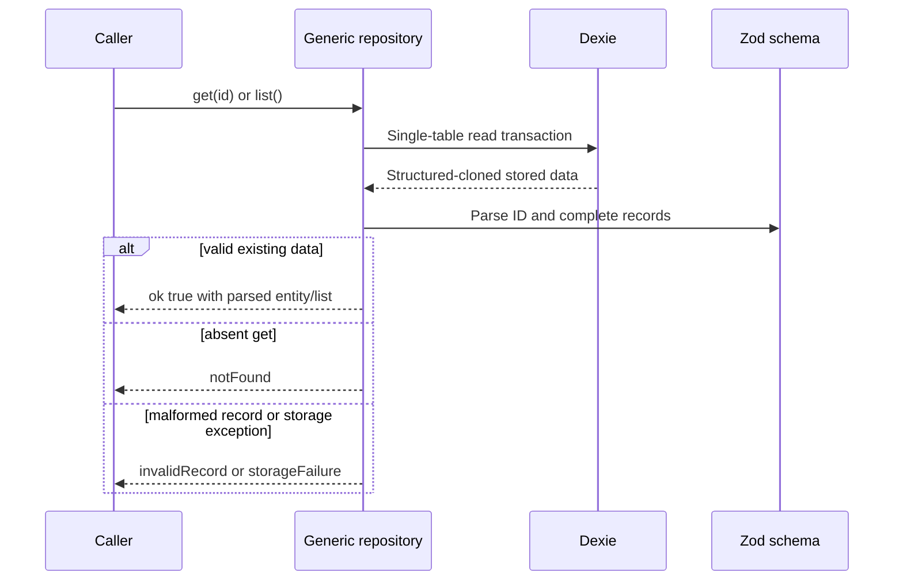
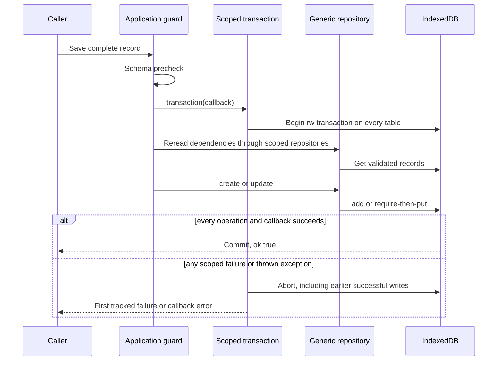
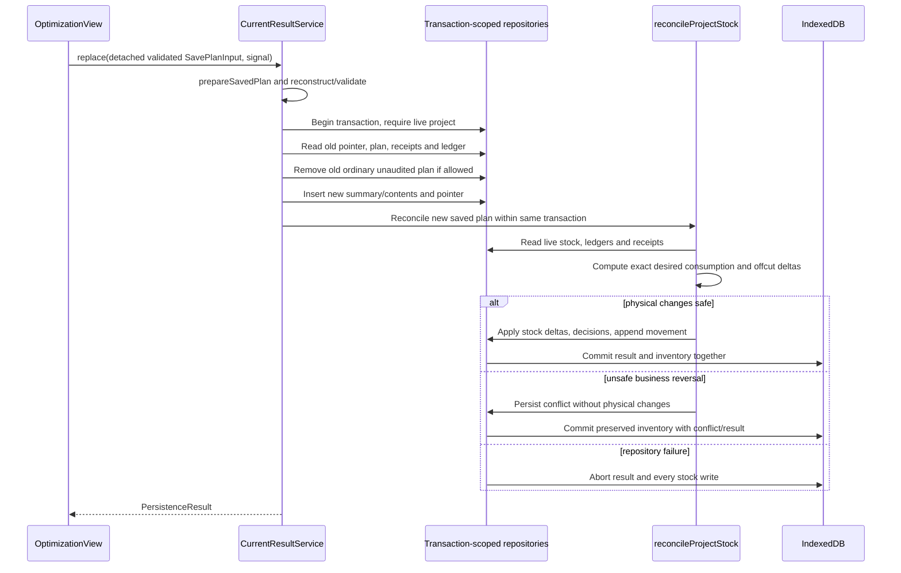
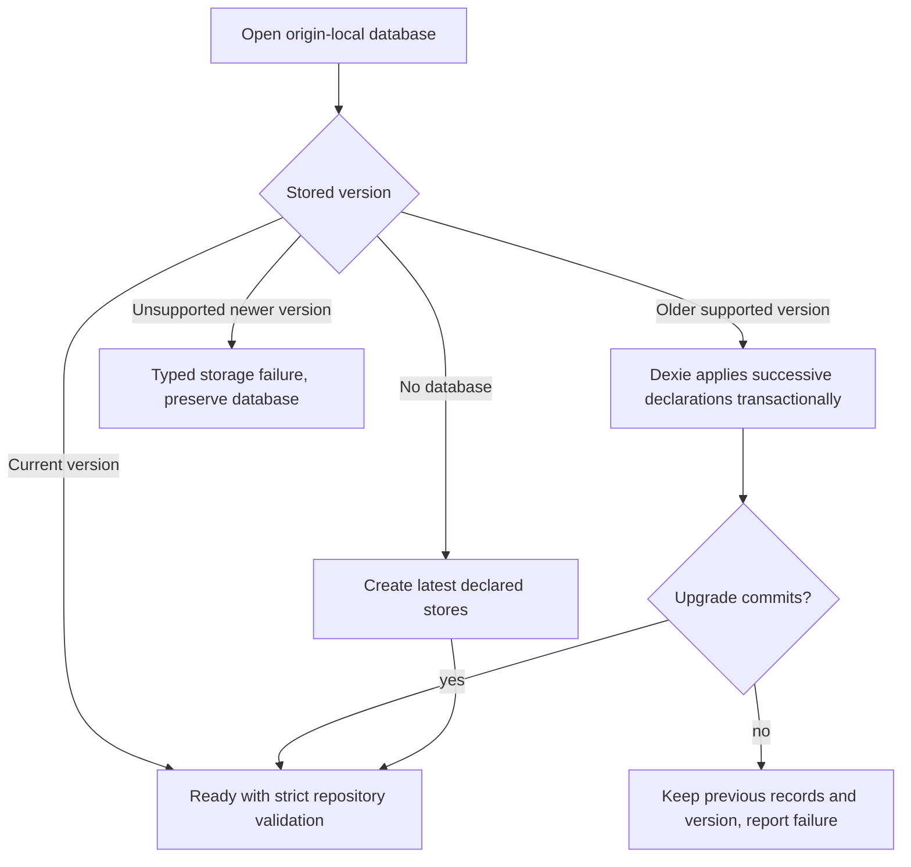

# IndexedDB storage reference

This is the physical-storage companion to [persistence and JSON](persistence-and-json.md). Exact contracts are [Repositories / LocalPersistence](../src/application/persistence/repositories.ts), [local-database.ts](../src/infrastructure/persistence/local-database.ts) and the linked schemas below. Relationships are application-enforced; IndexedDB has no foreign-key or automatic cascade rules here.

## Adapter construction and transaction architecture

`createLocalPersistence(name = DATABASE_NAME, options?: DexieOptions)` constructs an independent Dexie connection; it is not a singleton. Options allow isolated IndexedDB factories in tests. `main.ts` creates the production instance and closes it when the app unmounts. Repositories can cause Dexie to open lazily; `open()` is an explicit typed-result API, not a mandatory call before every method.

The generic adapter enforces record validity, ID stability and insert/update semantics. It does **not** itself know Part ownership, supplier deletion dependencies or stock reversibility. Those checks belong in guarded application use cases. Calling raw CRUD from a new feature would bypass them even though Zod parsing still passes.

## Complete table catalog

Every key is the record's `id`, with no auto-increment or compound primary key. Only two secondary indexes are declared. Arrays such as `partIds` are not indexed.

| Table | Primary key | Secondary indexes | Record and purpose | Lifecycle |
| --- | --- | --- | --- | --- |
| `materials` | MaterialId | None | [Material](../src/domain/model/material.ts), compatibility identity and optional preset | Shared; deletion checks selected materials, Parts, products and stock |
| `parts` | PartId | None | [Part](../src/domain/model/part.ts), finished demand | Owned through `projects.partIds`; legacy unassigned records remain |
| `suppliers` | SupplierId | None | [Supplier](../src/domain/model/supplier.ts), supplier metadata | Shared; products block deletion |
| `supplierProducts` | SupplierProductId | None | [SupplierProduct](../src/domain/model/supplier-product.ts), external planning reference | Shared; project choices and purchase-stock provenance block deletion |
| `stockItems` | StockItemId | None | [StockItem](../src/domain/model/stock-item.ts), currently owned available quantity | Depleted records may be deleted; exact historical snapshots remain elsewhere |
| `projects` | CuttingProjectId | None | [CuttingProject](../src/domain/model/cutting-project.ts), ownership, selections, settings | Guarded create/update; coordinated deletion |
| `savedPlanSummaries` | SavedCuttingPlanId | `projectId` | [SavedPlanSummary](../src/domain/model/saved-cutting-plan.ts), name/owner/date | Current, legacy and audited origins |
| `savedPlanContents` | SavedCuttingPlanId | None | [SavedPlanContents](../src/domain/model/saved-cutting-plan.ts), compact validated historical payload | Same identity as summary; deleted together where safe |
| `cuttingConfirmations` | SavedCuttingPlanId | `projectId` | [CuttingConfirmation](../src/domain/model/cutting-confirmation.ts), immutable legacy receipt | Retained across project deletion |
| `currentCuttingResults` | CuttingProjectId | None | [CurrentCuttingResult](../src/domain/model/current-cutting-result.ts), planId and preserveLegacy | At most one pointer per project |
| `projectStock` | CuttingProjectId | None | [ProjectStock](../src/domain/model/project-stock.ts), decisions, active consumption, embedded movements/audit | Preserved as named audit after deletion |
| `stockOrders` | MaterialId | None | [StockOrder](../src/application/inventory/stock-order.ts), ranked Stock IDs | Presentation metadata; stale IDs ignored by sorting |
| `catalogOrders` | SupplierId | None | [CatalogOrder](../src/application/catalog/catalog-order.ts), ranked product IDs | Presentation metadata; per-material views filter supplier-wide order |

A `StockMovement` concept exists as embedded ProjectStock movement records and receipt arrays; there is **no standalone stockMovements table**. Similarly, offcut decisions are embedded entries, not an independent offcuts store. Do not add direct table lookups for conceptual entities that are stored as snapshots.

### Physical relationship diagram

Dashed/historical references below can outlive their live record. `snapshot_arrays` means embedded values, not normalized child tables.

IDs in source snapshots are not necessarily live catalog foreign keys: a Stock allocation uses a branded-compatible `stock:<id>` key plus exact StockItem ID. The historical Part array in saved contents is independent of live `parts` ownership.

## CRUD read/write mechanics

`createRepository` validates unknown input with the supplied schema. `get` validates the ID, checks existence and parses the stored record. `list` reads in primary-key order (`orderBy(':id')`) and parses every record; it fails the entire operation on any corrupt row. It never filters corruption away.

Create uses `add()` and maps ConstraintError to `duplicateId`, so concurrent creation never overwrites. Update parses the new record and ID, requires matching identity, rereads the previous record to confirm existence/validity, then `put()` replaces the full record. Delete requires a valid existing record before removal. No patch API, automatic relationship repair or upsert is exposed.

`find` on projectStock/currentCuttingResults/cuttingConfirmations returns successful null for absence, unlike generic `get`. Project-scoped summary/receipt reads use `projectId` indexes; summaries are explicitly sorted by createdAt then ID. Most reference guards scan lists because no corresponding secondary indexes exist.

## Atomic write sets

| Application operation | Principal records written in one transaction |
| --- | --- |
| Scoped Part create/delete or batch import | `parts` plus owning `projects.partIds` |
| Inline preset product save | Resolve/create `materials`, then `supplierProducts` |
| Catalog Add to stock | Distinct `stockItems` after product/material/supplier snapshot checks |
| Current-result replace | Summary, contents, current pointer, source Stock deltas, generated offcuts and projectStock ledger |
| Keep checkbox | projectStock decision plus safe Stock additions/removals/movement |
| Project deletion | Owned Parts/plans/current/project; audit retained; optional source restoration/offcut removal |
| Catalog import | Materials, suppliers, products and optional catalogOrders after remapping |
| Stock import | New independent stock and optional new stockOrders; no movement reset |
| Ordering move | One order record after rereading complete valid group membership |

Read [workflows](workflows.md) before assuming every read is pure: current-result `load()` can write, and project Stock `sync()` is explicitly a reconciliation operation.

### Stock reconciliation transaction trace

This diagram combines `CurrentResultService.replace` and `reconcileProjectStock`; the physical write phase begins only after safety checks. A business conflict can commit the new result/conflict ledger while leaving inventory untouched. A database failure aborts the entire transaction.

## Versions: three separate axes

| Axis | Current value | Meaning |
| --- | --- | --- |
| Application package version | `0.0.0` in package.json | Development package metadata; product target remains first stable 1.0 |
| IndexedDB/Dexie schema | 8 (native backend version 80) | Table/index upgrade path for one local database |
| JSON exchange contracts | Each envelope version 1 | Independent portable-file contracts; Parts uses `version`, others `schemaVersion` |
| Compact saved payload | `formatVersion: 1` | Persisted/reconstructed tree encoding within saved-plan contents |
| Material manifest | `version: 2` | Static local thumbnail manifest, not a backup or database version |

Changing one axis does not automatically change the others. An added optional project field can remain in DB v8 and project JSON v1. A new indexed table needs a new Dexie version even if no file format changes.

### Implemented upgrade path and future migrations

Current versions 1–8 only append stores/index declarations. There is no application-level record-rewrite migration registry and no destructive recovery handler. Dexie handles declared schema upgrades transactionally; tests exercise failure preservation with an explicit simulated upgrade.

The ready hook rejects native versions greater than `DATABASE_VERSION * 10`; underlying open errors are also surfaced. **Recommendation for future data migrations:** append a version with an awaited upgrade callback, transform in that upgrade transaction, and test real old fixtures before/after reopen plus forced failure. Never edit shipped declarations or silently normalize corrupted records during list reads.

## Deletion and recovery boundaries

Generic delete has no cascade. Guarded supplier deletion refuses existing products; product deletion refuses selected project references or live purchase-linked stock; material deletion refuses direct project choices and live Part/product/stock references. Historical snapshot references intentionally do not always block live catalog deletion.

Scoped Part delete removes its ID from the owner atomically. Project deletion is coordinated by [project-deletion.ts](../src/application/projects/project-deletion.ts), including a transaction-time replay of inventory history before optional restoration. It retains receipts and an archived named ledger, not a hidden active project. Order records are not a replacement for referential ownership: stale ranks are tolerated/ignored and export filters stale IDs.

There is no automatic corrupt-record quarantine, repair UI, full application backup or cross-tab revision conflict protocol. On `invalidRecord`, preserve the original storage and inspect the reported path/schema. `notFound` can be a real dependency issue; do not create replacements with matching names. Browser quota, permission or IndexedDB errors become storage failures; Retry does not promise the underlying condition is resolved. Storage eviction/privacy behavior and concurrent-tab UX remain browser-level risks.

Persisted, derived and transient data are catalogued in [architecture](architecture.md#data-flow-and-state-lifetime). Theme localStorage and session navigation are deliberate exceptions to IndexedDB business persistence, not alternative stores for domain entities.
