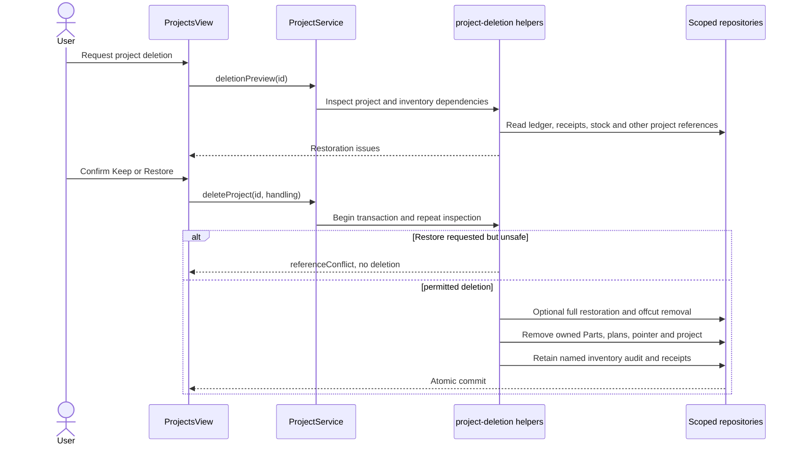
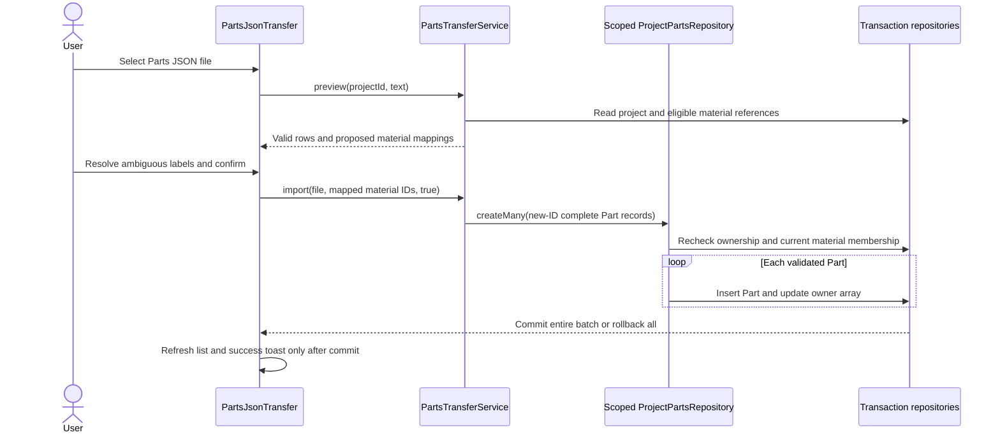
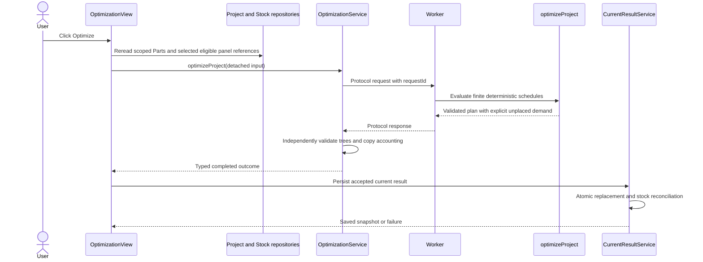
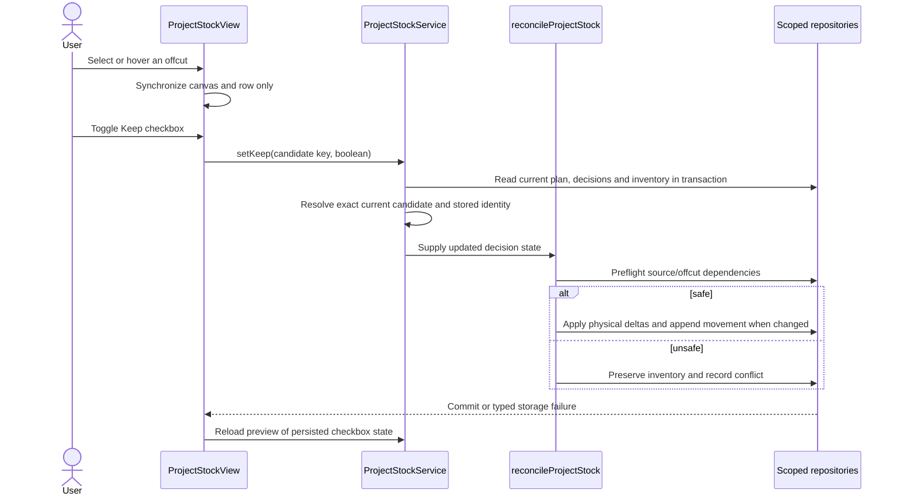

# End-to-end workflow traces

[Documentation home](README.md) / Development & reference

Read this alongside [feature map](features.md), [architecture](architecture.md) and [storage](storage.md). Paths below connect UI entry points to application/domain operations and actual writes. Unless stated otherwise, failure retains the user's draft or presents an actionable error; successful notification follows the underlying completed operation.

**On this page:** [Project creation and editing](#project-creation-and-editing) · [Materials and supplier reference selection](#materials-and-supplier-reference-selection) · [Optimization and source allocation](#optimization-and-source-allocation) · [Manual cutting-plan editing](#manual-cutting-plan-editing) · [PDF generation and output](#pdf-generation-and-output) · [Generated offcuts and Keep updates](#generated-offcuts-and-keep-updates)

## Project creation and editing

| Stage | Entry / operation | Reads and writes / validation |
| --- | --- | --- |
| Launch | Home tiles, Projects split button, [ProjectCreationDialog](../src/ui/components/projects/ProjectCreationDialog.vue) | New draft name/description, empty ownership/selections |
| Submit | `createProjectService().projects.create` | Parse complete CuttingProject; refuse archived identity or direct Part reassignment; validate selections in transaction |
| Commit | `repositories.projects.create` | Insert only; duplicate ID cannot replace existing project |
| Open | ProjectWorkspace load and router | Schema-valid route ID, existing project, scoped Part repository, current-result restoration |
| Edit | [ProjectsView.save](../src/ui/pages/ProjectsView.vue) | Reread latest project; replace name/description while preserving ID, Parts and selections |

Description is not a separate entity. Empty is valid. Cancel discards draft values; a project rename does not rewrite historical plan snapshots or PDF-only title override. Workspace activation rereads actual project name.

Project creation and import are distinct flows: import performs dependency remapping and plan validation, not a sequence of independent entity-form submits.

## Project deletion

[ProjectsView](../src/ui/pages/ProjectsView.vue) calls `deletionPreview`, displays confirmation and selects Keep or Restore stock behavior. [deleteProjectData](../src/application/projects/project-deletion.ts) repeats all safety checks transactionally; preview alone is not a guarantee inventory remains reversible.

Shared catalog and other projects' Parts are never cascaded. External references, changed offcuts, ambiguous snapshots and missing complete reversal history block Restore; Keep does not pretend to undo prior consumption.

## Materials and supplier reference selection

Entry: [MaterialsView](../src/ui/pages/MaterialsView.vue), using project service, guarded catalog reads and `StockRepository.selectionStock(projectId)`.

1. Load project, materials, products, suppliers and project-aware stock; preserve pending/failed selection drafts during lifecycle refresh.
2. Derive current material, eligible Stock, supplier groups and summary from the same selected-ID arrays. Supplier names are presentation; stable supplier IDs group products.
3. Individual/bulk actions update draft IDs only. Computed checked/indeterminate states derive from those IDs. Collapses never write selections.
4. Serialized autosave rereads latest project, filters legacy quantities for deselected products and updates the full project through selection validation.
5. Wait for pending writes before leaving; failed changes expose Retry/discard protection. Reactivation/window focus refresh snapshots, not polling.

Only the current material's eligible choices can enter bulk selection. Products with retained availability `unavailable` cannot be newly selected; own-generated offcuts cannot be newly selected. Current-project consumed stock stays valid only through authoritative active ledger consumption. Source-less saved material selections remain explicit instead of disappearing.

Selecting catalog panels creates no physical stock. Selecting Stock is not reservation; actual inventory is rechecked when the current result reconciles.

## Scoped Parts CRUD and import

[ProjectPartsView](../src/ui/pages/ProjectPartsView.vue) / ProjectWorkspace provide `service.parts(projectId)` to [PartsView](../src/ui/pages/PartsView.vue). [PartForm](../src/ui/components/parts/PartForm.vue) parses a complete Part and requires explicit eligible material selection. Empty numeric fields stay empty until validation. Grain changes hide/show rotation without discarding its draft preference.

`ProjectPartsRepository.withProject` verifies live project existence and no overlapping Part ownership with other projects. Save validates the selected material inside that same transaction; create updates project partIds, edit retains ID, delete removes both entity and ownership. Existing Parts are not silently deleted when Materials choices change.

Duplicate names are allowed; reimport adds a second batch. No material is created from a file label. Legacy unassigned Parts use a separate explicit adoption workflow, not automatic ownership on mount.

## Optimization and source allocation

[OptimizationView.start](../src/ui/pages/OptimizationView.vue) rereads inputs and saved settings, computes catalog demand bound, keeps exact physical capacities and rejects missing/circular choices. It passes plain input through the injected optimization service, not a Worker directly.

No source mutation occurs during candidate evaluation. Maximal coverage outranks catalog count; with preference enabled fewer Catalog panels outrank panel count/waste among evaluated solutions. Offcuts participate only if eligible. Finite capacity and heuristic limitations are detailed in [optimization](optimization.md).

Saving Cutting settings persists kerf/margin/preference and closes the dialog without running this sequence. Changed settings invalidate displayed/current restoration eligibility; old snapshots keep their original technical settings for history.

## Manual cutting-plan editing

Entry: [CuttingPlanViewer](../src/ui/components/optimization/CuttingPlanViewer.vue) and [PanelPlanView](../src/ui/components/optimization/PanelPlanView.vue). A canvas click selects a Part copy; dragging pans the viewport. Toolbar rotate/swap/undo/redo/reset operate on a panel-isolated [PlanEditingSession](../src/application/optimization/plan-editing-session.ts).

`applyPlanEdit` calls domain `editCuttingTree`, validates original/candidate trees, rebuilds scene-derived placements and metrics, and appends history after the cursor (discarding obsolete redo branch). Rotate can recut only a permitted anchored region containing the target and waste; swap cannot relocate cut boundaries. Invalid edits preserve the accepted session.

The view collects all accepted panel edits into one SavePlanInput, persists replacement with cancellation-aware sequencing and updates document readiness only after success. Undo history is not serialized. Failed persistence prevents stale document export and prompts before discarding pending/failed manual changes. This path can change reusable waste geometry, so inventory reconciliation must follow accepted edits rather than the optimizer baseline.

## PDF generation and output

Entry: [CuttingPlansWorkspace](../src/ui/components/optimization/CuttingPlansWorkspace.vue), not older `PdfExportControls`. Settings update through OptimizationView's serialized project writes; title override does not rename the project. A watcher regenerates actual bytes, with generation/render revisions rejecting obsolete completions.

[CuttingPlanPdfService](../src/application/export/cutting-plan-pdf-service.ts) clones the input, validates the complete result, creates scenes and resolves optional exact-reference prices. The lazy infrastructure renderer produces cover, schedules, Part grids and cutting sheets. PDF.js renders detached generated bytes, not a second cutting-plan drawing implementation.

Print/Download share `regenerate()` and the same configuration. Print opens a blank tab synchronously, then supplies bytes to a native PDF iframe. Download hands the PDF Blob to an anchor. Action busy guards prevent duplicates; errors restore controls and preserve retry. View/worker/render/Blob URL resources have different lifetimes; see [PDF generation](pdf-generation.md).

## Generated offcuts and Keep updates

[ProjectStockView](../src/ui/pages/ProjectStockView.vue) calls `sync()` then `preview()`, using current independently validated waste leaves. It filters Outdated rows from current inspection and gives per-panel temporary numbering in waste-index order. Hover/selection only update UI keys.

Keep entries and physical Stock IDs are separate concepts. A consumed generated offcut is not recreated on repeated sync. Canceling/hovering/selecting does not call setKeep. Multiple identical offcuts remain distinct through source/copy/region identity.

## Global Catalog and Stock maintenance

| UI entry | Application boundary | Important checks / writes |
| --- | --- | --- |
| SupplierForm / supplier menu | `createCatalogRepositories().suppliers` | Complete supplier schema; products block supplier deletion |
| ProductForm | Guarded product save / `saveWithPreset` | Supplier/material reads and optional exact preset resolution in write transaction |
| Product row delete | Guarded product delete | Selected-project and purchase-provenance conflicts, existing confirmation |
| Product row Add to stock | `StockRepository.addFromProduct` | Recheck unchanged product snapshot, supplier/material, create unique quantity-one full panels atomically |
| StockForm / row actions | Guarded StockRepository | Dimensions/material/provenance, caller's previous snapshot, history-reserved IDs and deletion guards |
| Catalog / Stock grips | Guarded `move` | Reread group, reject cross-material/cross-supplier moves, persist separate order record |

Supplier website normalization is UI input handling; domain stores absolute URLs. Material preset identity never determines compatibility by itself. Stock panels do not inherit a copied supplier name field; purchase provenance references the product/supplier relationship.

## File transfers and Settings

[ProjectImport](../src/ui/pages/ProjectImport.vue), [ProjectExport](../src/ui/components/projects/ProjectExport.vue), [CatalogTransfer](../src/ui/components/suppliers/CatalogTransfer.vue) and [StockTransfer](../src/ui/components/inventory/StockTransfer.vue) are feature-level entry points. Settings mounts the latter two without changing route. Each calls its injected transfer service for preview/import/export; JSON.parse inside a component is not the authoritative validation layer.

Project/catalog imports can remap conflicts; Stock import must preserve physical identity and block unsafe conflicts. Settings import success increments the shared revision so active views refresh. No polling, automatic purchase, stock movement reset or global project-selection mutation follows a transfer. Read [JSON reference](json-formats.md) for exact envelopes and [storage](storage.md) for commit/rollback behavior.

## Error-path checklist for debugging

1. Identify whether failure is form validation, dependency conflict, missing record, worker failure, ledger conflict or document generation error.
2. Inspect the owning project's actual IDs, not the selected row's label.
3. Check whether the UI is a pending draft, saved snapshot, restored history or current live inventory.
4. Verify transaction-time checks, especially after preview or an async modal was opened.
5. Confirm obsolete loads/workers/writes are invalidated on route changes.
6. Reproduce with application-level isolated persistence tests before changing rendering or suppressing warnings.

---

**Continue exploring:** [Screen-level overview](features.md) · [Verify a workflow](testing.md) · [Documentation home](README.md)
